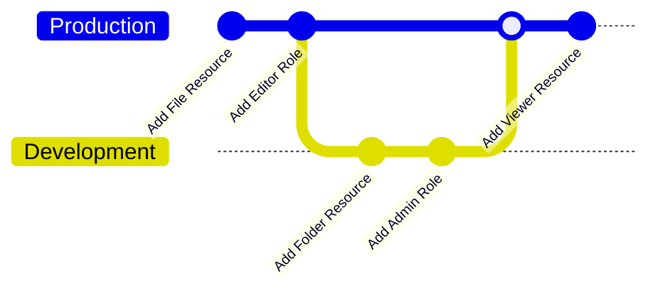
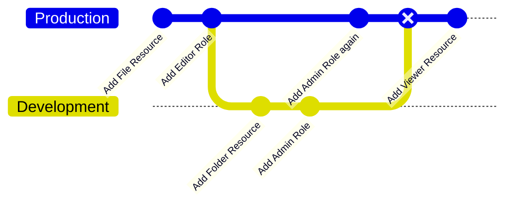

import createEnvironment from "/ui-videos/workspace-settings/creating-new-environment.mp4";

Create a Permit.io environment in the dashboard or with the Permit API, and copy or merge policy between environments to promote changes from development to production. This page is for developers and admins who manage the projects and environments of a Permit workspace. For what projects and environments are, see [Projects and environments](/manage-your-account/projects-and-env).

## Prerequisites

- A Permit.io project. See [Projects and environments](/manage-your-account/projects-and-env#projects).
- For the API: an organization-level or project-level API key. See [API key levels](/manage-your-account/workspace-settings#api-keys).
- For the API: your project ID or key. See [Get the project ID and environment ID](/api/examples/get-project-and-env).

## Create an environment in the dashboard \{#create-a-new-environment}

1. In the [Permit dashboard](https://app.permit.io), open the **Projects** screen and find your project.
2. Click **New Environment**.
3. Fill in the environment details and save.

<video controls>
  <source src={createEnvironment}/>
</video>

The new environment appears as a card under your project. The card menu has **Copy API Key**, **Rotate API Key**, **Edit Environment**, and **Delete Environment**.

## Create an environment with the API \{#creating-environment-via-api}

Send a `POST` request to `/v2/projects/<project-id>/envs` with the environment `key` and `name`. Replace `<project-id>` with your project ID or key and `<api-key>` with your organization-level or project-level API key:

```bash
curl 'https://api.permit.io/v2/projects/<project-id>/envs' \
  -H 'authorization: Bearer <api-key>' \
  -H 'Content-Type: application/json' \
  --data-raw '{"key":"new-env-name","name":"New Env Name"}'
```

:::info API key level
The Create Environment API accepts an organization-level or project-level API key. See [API key levels](/manage-your-account/workspace-settings#api-keys).
:::

The response contains the new environment object. To confirm, list the environments of the project with the [List Environments API](https://api.permit.io/v2/redoc#tag/Environments/operation/list_environments), or open the **Projects** screen in the dashboard. For all request fields, see [Create Environment](https://api.permit.io/v2/redoc#tag/Environments/operation/create_environment) in the API reference.

## Default roles for new resources \{#default-role-creation}

An environment can create a default set of roles (Admin, Editor, and Viewer) with predefined permissions every time a workspace member creates a resource in the environment, for example in the Policy Editor. Resources created through the Permit API with an API key don't get default roles.

Default role creation is **off** by default. Turn default role creation on when you create an environment with the API, or later with the toggle in the Policy Editor settings.

### Default settings of a new environment \{#new-environments-default-settings}

The environment settings that control default roles have this shape. `default_resource_actions` lists the actions of each new resource, and `default_resource_permissions` lists the permissions of each default role:

```json
{
  "default_resource_actions": ["create", "read", "update", "delete"],
  "default_resource_permissions": {
    "admin": ["create", "read", "update", "delete"],
    "editor": ["create", "read", "update"],
    "viewer": ["read"]
  },
  "enable_default_roles": false
}
```

:::note
`enable_default_roles` defaults to `false`. With `enable_default_roles` set to `false`, Permit doesn't create default roles for new resources.
:::

### Toggle default role creation in the UI \{#toggle-default-role-creation-in-the-ui}

1. Open the **[Policy Editor](https://app.permit.io/policy-editor)** in the Permit dashboard.
2. Click the settings button of the Policy Editor.
3. Use the default roles toggle:
   - **On**: Permit creates the default roles (Admin, Editor, Viewer) with their predefined permissions for each new resource in the environment.
   - **Off** (default): Permit doesn't create default roles. You create roles yourself.

### Turn on default roles with the API \{#enable-default-roles-via-api}

To turn on default role creation, set `settings.enable_default_roles` to `true` in the Create Environment request body:

```bash
curl 'https://api.permit.io/v2/projects/{project_id}/envs' \
  -H 'authorization: Bearer API_SECRET_KEY' \
  -H 'Content-Type: application/json' \
  --data-raw '{"key":"new-env-name","name":"New Env Name", "settings": {"enable_default_roles": true}}'
```

To turn off default role creation explicitly, set `settings.enable_default_roles` to `false`:

```bash
curl 'https://api.permit.io/v2/projects/{project_id}/envs' \
  -H 'authorization: Bearer API_SECRET_KEY' \
  -H 'Content-Type: application/json' \
  --data-raw '{"key":"new-env-name","name":"New Env Name", "settings": {"enable_default_roles": false}}'
```

In these samples, replace `{project_id}` with your project ID or key and `API_SECRET_KEY` with your organization-level or project-level API key.

## Copy and merge environments \{#coping--merging-environments}

You can copy an environment into a new environment, or into an existing environment (a merge). Copy and merge let you manage policy changes, such as a new resource, role, or condition set, in a controlled way. For example, to test a new resource, copy the production environment to a development environment, add the resource in development, test it, and merge development back into production.



In the diagram, the Production environment has a `File` resource and an `Editor` role. Production is copied into a Development environment, where a `Folder` resource and an `Admin` role are added. After testing, Development is merged back into Production.

This flow lets you promote policy changes between environments the same way a CI/CD pipeline promotes code. See [Policy life cycle with Permit](/how-to/sdlc/ci-cd).

Copy rules:

- Copy and merge work only between environments in the same project. Copying across projects or workspaces isn't allowed.
- To copy into a new environment, the API key or member needs write access to the project.
- To copy into an existing environment, the API key or member needs write access to the target environment.
- To [delete condition sets the source doesn't have](#delete-target-only-condition-sets), the API key or member also needs permission to delete condition sets in the target environment.

### Copy an environment with the API \{#copy-environments-via-api}

Send a `POST` request to `/v2/projects/{project_id}/envs/{env_id}/copy`, where `{env_id}` is the source environment. Set `target_env.new` to create an environment, or `target_env.existing` to the ID or key of an existing environment to merge into.

```bash
curl --location 'https://api.permit.io/v2/projects/{project_id}/envs/{env_id}/copy' \
  -H 'authorization: Bearer API_SECRET_KEY' \
  -H 'Content-Type: application/json' \
  --data '{
  "target_env": {
    "new": {
        "key": "prod",
        "name": "production"
    }
  }
}'
```

For all request fields, see [Copy Environment](https://api.permit.io/v2/redoc#tag/Environments/operation/copy_environment) in the API reference.

### Copy a large environment in the background \{#copy-environment---background-api}

Copying a large environment can take time. The background Copy Environment API (`/copy/async`) runs the copy asynchronously, returns HTTP `202 Accepted` with a `task_id`, and lets you fetch the result later.

```bash
curl --location 'https://api.permit.io/v2/projects/default/envs/staging/copy/async' \
  -H 'authorization: Bearer API_SECRET_KEY' \
  -H 'Content-Type: application/json' \
  --data '{
  "target_env": {
    "new": {
        "key": "prod",
        "name": "production"
    }
  }
}'
```

To wait for the task and read its result, see [Background APIs](/api/background-tasks).

### Objects that copy and merge include \{#supported-objects}

Copy and merge apply only to **policy** objects, such as resources, roles, and condition sets.
**Directory** objects, such as users, tenants, and resource instances, are not copied or merged.

When you copy an environment, Permit copies the checked objects below:

- [x] Resource
- [x] Resource Actions
- [ ] Resource Action Groups
- [x] Resource Attributes
- [x] Resource Roles
- [x] Resource Relations
- [x] Roles
- [x] Role Permissions
- [x] Role Derivations
- [ ] Role Hierarchy
- [x] Condition Sets
- [x] User Sets
- [x] Resource Sets
- [x] Condition Sets Rules
- [x] Condition Sets Inheritance ([details](#condition-set-hierarchy))
- [x] Custom Policies ([details](#custom-policies))

### Custom policies in copied environments \{#custom-policies}

When you [use GitOps](/integrations/gitops/custom_policy) with a custom Git repository, copying an environment copies **all files** in the source environment's branch into the new environment's branch, including all custom `.rego` policy files.

### Copy into an environment protected by a Policy Guard \{#copy-into-a-guarded-environment}

When the target environment is protected by a [Policy Guard](/how-to/policy-guard/policy_guard), the copy checks every guarded object it would change or delete, the same way the API does when you change that object directly. That includes granting a role a permission and adding a condition set rule, even on a role the same copy creates.

- If the guard forbids a change, the copy fails with `403 Forbidden`, the error names the object, and nothing is copied.
- If Permit can't reach the Policy Guard to check, the copy fails with `503 Service Unavailable` and nothing is copied. Retry the copy.
- With the background Copy Environment API (`/copy/async`), an unreachable Policy Guard makes the request itself return `503`, and no task is started. A forbidden change fails the task: the result endpoint returns `status: "failure"`, and `error` names the object (see [Handle a failed background task](/api/background-tasks#error-handling)). If the target became protected by a Policy Guard after the task started, the task can also fail with the `503` error.

Creating new resources, actions, roles, and condition sets doesn't need the guard's permission. Granting a permission to a new role, or adding a rule to a new condition set, does. Objects the copy leaves unchanged aren't checked. So a `/copy` with `"conflict_strategy": "overwrite"` into an environment whose guarded objects are already identical succeeds, even while the Policy Guard can't be reached. `/copy/async` asks the Policy Guard before it starts, so it returns `503` while the guard can't be reached, even if the copy would change nothing.

### Conflict strategy for merges \{#conflict-strategy}

When you merge into an existing environment, a conflict occurs if the same object, such as a resource or role, was changed in both environments.



In the diagram, an `Admin` role is added to Production after Production was copied into Development. Development also has an `Admin` role, so merging Development back into Production causes a conflict on the `Admin` role.

Set `conflict_strategy` in the copy request body to choose how Permit resolves conflicts:

| `conflict_strategy` | Result |
|---|---|
| `fail` (default) | The merge fails, Permit rolls back the entire merge, and the target environment keeps its existing objects. |
| `overwrite` | Permit replaces the existing object in the target environment with the object from the source environment. For a condition set, Permit also sets its parent to the parent it has in the source environment, or removes the parent if the source has none. |

Neither strategy deletes a condition set that exists only in the target environment. To delete those, see [Delete condition sets the source doesn't have](#delete-target-only-condition-sets).

### Condition set hierarchy in a copy \{#condition-set-hierarchy}

A copied condition set keeps its parent. A child condition set matches only the users or resources that also match every ancestor, so copying it without its parent would grant more than the source environment does.

- If `scope` copies a condition set but leaves out its parent, the copy fails with `409 Conflict` and nothing is copied, even if the target environment already has that parent. Change `scope` so it also copies the parent, or so it leaves out the child.
- Copying again with `"conflict_strategy": "overwrite"` re-parents condition sets that already exist in the target environment to match the source environment, including removing a parent the source no longer has.
- If the source environment's hierarchy contains a cycle, or a parent of a different type or resource than its child, the copy fails with `406 Not Acceptable` and nothing is copied.
- Copies made before October 19, 2026 didn't keep the parent, so a condition set copied then may have no parent in the target environment even though it has one in the source, and grants more than in the source. The next copy into that environment with `"conflict_strategy": "overwrite"` restores the parent, which can deny access the copied environment allowed before. To keep that condition set's broader access in the copied environment, leave it out of the copy with [`scope`](#excluding--including-objects).

### Exclude or include objects in a copy \{#excluding--including-objects}

Set `scope` in the copy request body to **exclude** or **include** specific objects. `scope` accepts `resources`, `roles`, `user_sets`, `resource_sets`, and `custom_policies`, each with `include` and `exclude` lists.

```bash
curl --location 'https://api.permit.io/v2/projects/{project_id}/envs/{env_id}/copy' \
  -H 'authorization: Bearer API_SECRET_KEY' \
  -H 'Content-Type: application/json' \
  --data '{
  "target_env": {
    "new": {
        "key": "prod",
        "name": "production"
    }
  },
  "scope": {
      "roles": {
          "exclude": ["*"]
      },
      "resources": {
          "include": ["folder", "file"]
      },
      "resource_sets": {
          "exclude": ["test*"]
      },
      "user_sets": {
          "exclude": ["canada_users"]
      },
      "custom_policies": {
          "include": ["*.rego"]
      }
  }
}'
```

`include` and `exclude` match object keys. `*` is the only wildcard and matches any run of characters, other characters match themselves, and matching is case-sensitive. An object is copied when its key matches any `include` pattern (or `include` is empty) and no `exclude` pattern. `custom_policies` patterns are different: they match file paths in the environment's policy branch and follow [Unix filename pattern matching](https://docs.python.org/3/library/fnmatch.html).

:::warning Scope patterns match differently since October 19, 2026
Before October 19, 2026, an object was copied only when its key matched **every** `include` pattern, matching ignored case, `_` matched any single character, and `%` matched any run of characters. If you send `scope`, check your patterns against [the matching rules](#excluding--including-objects). Otherwise a copy can include objects you meant to leave out, or leave out objects you meant to copy:

- Two `include` patterns copy the objects that match either one.
- An `exclude` pattern such as `Admin` doesn't exclude `admin`, and `svc_*` doesn't exclude `svc-a`.
- An `include` pattern such as `Admin*` doesn't include `admin-eu`.
- A pattern that contains `%` matches only a literal `%`.

:::

### Delete condition sets the source doesn't have \{#delete-target-only-condition-sets}

When you merge into an existing environment, set `"delete_target_only_condition_sets": true` to delete the target environment's condition sets that the source environment doesn't have. Use `delete_target_only_condition_sets` to promote a removal or a key rename from one environment to the next.

`delete_target_only_condition_sets` is off by default. It works with either `conflict_strategy`, but with `fail` the merge still fails when both environments have a non-autogenerated condition set the copy selects, so combine it with `"conflict_strategy": "overwrite"`.

```bash
curl --location 'https://api.permit.io/v2/projects/{project_id}/envs/{env_id}/copy' \
  -H 'authorization: Bearer API_SECRET_KEY' \
  -H 'Content-Type: application/json' \
  --data '{
  "target_env": {
    "existing": "prod"
  },
  "conflict_strategy": "overwrite",
  "delete_target_only_condition_sets": true
}'
```

`{env_id}` is the source environment, and `prod` is the key of the existing target environment.

:::danger Deleted condition sets can't be restored
The copy deletes each selected condition set, its child condition sets, and its condition set rules from the target environment. Without `scope`, that is every non-autogenerated condition set the source environment doesn't have. Send a `scope` that selects only the condition sets you mean to delete.

:::

Permit deletes a target condition set only when all of these are true:

- `scope` selects it, using the same matching as the copy.
- The source environment has no condition set with the same key, whether or not `scope` selects that key in the source.
- It isn't an autogenerated condition set, such as the user set Permit creates for a role.
- If it is a resource set, its resource is copied.

Deleting a condition set also deletes its child condition sets and its condition set rules. Before deleting, Permit moves a child condition set that this copy also copies (the source has it and `scope` selects it) out from under the deleted one, and gives it the parent it has in the source. If deleting a selected condition set would also delete another child condition set that isn't deleted on its own, such as one the source has but `scope` leaves out, the copy fails with `409 Conflict`. If the condition sets selected for deletion form a cycle, the copy fails with `406 Not Acceptable`. In both cases nothing is copied or deleted.

The deletion needs permission to delete condition sets in the target environment. In a target protected by a Policy Guard, each deleted condition set, and each one moved out from under it, is also checked against the guard.

`delete_target_only_condition_sets` has no effect when you copy into a new environment.

## Customize the GitOps branch name \{#customize-gitops-branch-name}

When you create or copy an environment, you can set the name of the Git branch that stores the environment's policy. A custom branch name requires an [active policy repository](/integrations/gitops/github#configure-permit-to-use-your-repository) on the project.

Set `custom_branch_name` when you create the environment:

```bash
curl 'https://api.permit.io/v2/projects/{project_id}/envs' \
  -H 'authorization: Bearer {API_SECRET_KEY}' \
  -H 'Content-Type: application/json' \
  --data-raw '{"key":"new-env-name","name":"New Env Name", "custom_branch_name": "new-env-branch-name"}'
```

Your policy repository then has a branch named `new-env-branch-name` for the new environment.

You can also set `custom_branch_name` in `target_env.new` when you copy into a new environment. To move an existing environment to a different branch, update the environment with a `PATCH` request:

```bash
curl 'https://api.permit.io/v2/projects/{project_id}/envs/{env_id}' -X 'PATCH' \
  -H 'authorization: Bearer {API_SECRET_KEY}' \
  -H 'Content-Type: application/json' \
  --data-raw '{"custom_branch_name": "new-env-branch-name"}'
```

## Next steps

- [Understand projects and environments](/manage-your-account/projects-and-env)
- [Manage policy as code with GitOps](/integrations/gitops/overview)
- [Wait for background API tasks](/api/background-tasks)
- [Promote policy through CI/CD](/how-to/sdlc/ci-cd)
