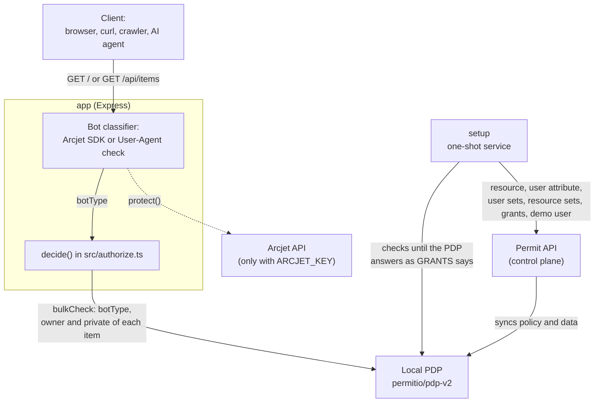
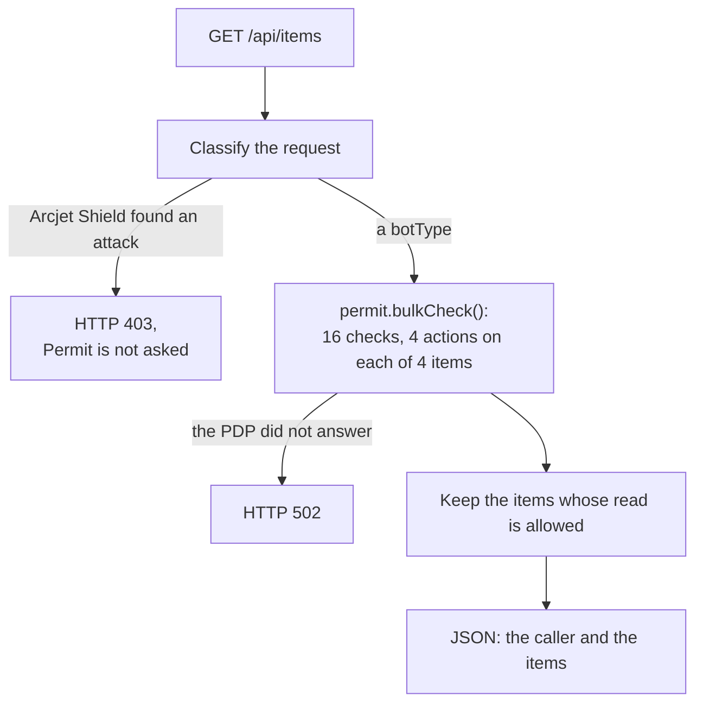
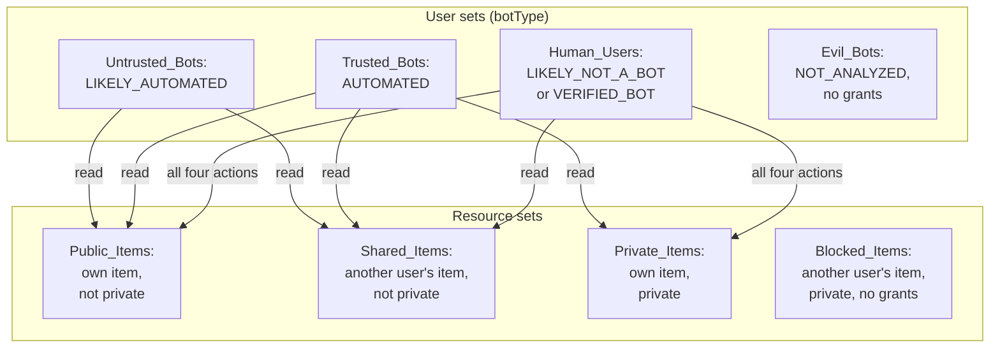

Learn how a small Express app gives people, bots that say what they are, and bots that hide or disguise themselves different access to the same content with Permit.io. The app classifies each request, sends the result to Permit as the `botType` attribute of the user, and attribute-based access control (ABAC) rules decide what that kind of caller may do with each item. This page is for developers who want to handle automated traffic, AI crawlers and agents included, as a kind of user in their authorization policy instead of only blocking it at the edge.

The code is in the [fine-grained-bot-protection folder](https://github.com/permitio/examples/tree/main/fine-grained-bot-protection) of the `permitio/examples` repository. The app runs on your machine with Docker Compose and needs only a Permit environment API key. All paths on this page are relative to the `fine-grained-bot-protection` folder.

The demo page at `http://localhost:3000` shows Permit's decision for every item and action, and buttons at the top send the request as each kind of caller. In the following screenshot, the request goes as a human using Chrome on a desktop. Permit allows every action on the user's own items, only `read` on the item another user shares, and nothing on the other user's private item:


## What the example shows \{#what-it-shows}

Every request acts as the same signed-in user, `user@example.com`, so the only thing that changes Permit's answer is what kind of caller sent the request. The demo has four callers, one for each user set in the policy:

| Caller | User-Agent it sends | `botType` | User set | Description of the user set |
|---|---|---|---|---|
| Human | Chrome on a desktop | `LIKELY_NOT_A_BOT` | `Human_Users` | Known humans and verified bots |
| Trusted bot | `curl/8.11.1` | `AUTOMATED` | `Trusted_Bots` | Bots that do not hide what they are |
| Untrusted bot | Headless Chrome | `LIKELY_AUTOMATED` | `Untrusted_Bots` | Bots that pretend to be human |
| Evil bot | None | `NOT_ANALYZED` | `Evil_Bots` | Bots that hide what they are |

A crawler or an AI agent that names itself in its User-Agent, such as `Googlebot` or `GPTBot`, is a trusted bot. With an Arcjet key, a bot whose identity Arcjet verifies is `VERIFIED_BOT` instead, and gets a human's access through `Human_Users`. The `botType` values are the names of Arcjet's earlier bot ranks. [How a request is classified](#classification) explains where each value comes from.

The buttons replace the browser's own User-Agent with the caller's, because a browser can't change its own. The page's `?as=` parameter that does this exists only for the demo: the API, `/api/items`, classifies each request as it arrives.

## Application architecture \{#architecture}

Docker Compose runs three services:

| Service | Role in the example |
|---|---|
| `app` | An Express app with the demo page on `/` and the API on `/api/items`, on `http://localhost:3000`. It classifies each request, then asks the PDP in one bulk check. |
| `pdp` | The policy decision point (PDP), `permitio/pdp-v2`, connected to your Permit environment, on `http://localhost:7766`. It answers the app's checks. |
| `setup` | A one-shot service that writes the policy and the demo user to your Permit environment through the Permit API, waits until the PDP answers every check as `GRANTS` says, then exits. The app starts once setup has finished. |

The classifier runs inside the app. With an `ARCJET_KEY`, it is the [Arcjet](https://arcjet.com) SDK, which asks Arcjet's API about each request. Without one, it is a User-Agent check in the app's own code. The following diagram shows which part calls which:



Each request to `/api/items` goes through the same steps:



## The authorization model \{#model}

[`src/policy.ts`](https://github.com/permitio/examples/blob/main/fine-grained-bot-protection/src/policy.ts) holds the policy as data. [`src/write-policy.ts`](https://github.com/permitio/examples/blob/main/fine-grained-bot-protection/src/write-policy.ts) turns it into Permit API calls with the Node.js SDK, and `src/setup.ts` runs it. Setup creates what is missing and updates what exists, so it is safe to run again. The model has no roles: user sets and resource sets decide everything.

### The resource \{#resource}

| Resource | Actions | Attributes |
|---|---|---|
| `Content_Item` | `read`, `create`, `update`, `delete` | `owner` (string): the key of the user who owns the item. `private` (bool): whether only the owner may see the item. |

The app doesn't sync its items to Permit as resource instances. It sends each item's `owner` and `private` attributes with the check. The demo has four items, in `src/items.ts`:

| Item | `owner` | `private` | Resource set it falls in |
|---|---|---|---|
| Public Item | `user@example.com`, the caller | `false` | `Public_Items` |
| Shared Item | `other-user@example.com` | `false` | `Shared_Items` |
| Private Item | `user@example.com`, the caller | `true` | `Private_Items` |
| Blocked Item | `other-user@example.com` | `true` | `Blocked_Items` |

### The botType attribute and the user sets \{#user-sets}

A user set is a condition set based on user attributes. Setup creates one user attribute, `botType` (string), on Permit's built-in `__user` resource, and four user sets on it:

| User set | Matches `botType` |
|---|---|
| `Human_Users` | `LIKELY_NOT_A_BOT` or `VERIFIED_BOT` |
| `Trusted_Bots` | `AUTOMATED` |
| `Untrusted_Bots` | `LIKELY_AUTOMATED` |
| `Evil_Bots` | `NOT_ANALYZED` |

Permit doesn't store a `botType` value for the user. The app sends `botType` with every check, so the same user falls in a different user set on each request. The `Human_Users` entry in `src/policy.ts`:

```ts
{
  key: 'Human_Users',
  name: 'Human Users',
  description: 'Known humans and verified bots',
  botTypes: ['LIKELY_NOT_A_BOT', 'VERIFIED_BOT'],
},
```

`userSetPayload()` in `src/write-policy.ts` turns each entry into a user set that matches any of its bot types:

```ts
export function userSetPayload(set: (typeof USER_SETS)[number]): SetPayload {
  const matches = set.botTypes.map((botType) => ({ 'user.botType': { equals: botType } }));
  return {
    key: set.key,
    name: set.name,
    description: set.description,
    type: 'userset',
    conditions: { allOf: [{ anyOf: matches }] },
  };
}
```

### The resource sets \{#resource-sets}

A resource set is a condition set based on resource attributes. A resource set condition can compare a resource attribute with a user attribute, which this policy uses to tell the caller's items from another user's:

| Resource set | Condition |
|---|---|
| `Public_Items` | `resource.owner` equals `user.key`, and `resource.private` is `false` |
| `Shared_Items` | `resource.owner` doesn't equal `user.key`, and `resource.private` is `false` |
| `Private_Items` | `resource.owner` equals `user.key`, and `resource.private` is `true` |
| `Blocked_Items` | `resource.owner` doesn't equal `user.key`, and `resource.private` is `true` |

`resourceSetPayload()` in `src/write-policy.ts` builds each condition from the set's `owner` (`caller` or `other`) and `private` fields:

```ts
export function resourceSetPayload(set: (typeof RESOURCE_SETS)[number]): SetPayload {
  const owner = set.owner === 'caller' ? 'equals' : 'not-equals';
  return {
    key: set.key,
    name: set.name,
    description: set.name,
    type: 'resourceset',
    resource_id: RESOURCE_KEY,
    conditions: {
      allOf: [
        {
          allOf: [
            { 'resource.owner': { [owner]: { ref: 'user.key' } } },
            { 'resource.private': { equals: set.private } },
          ],
        },
      ],
    },
  };
}
```

Setup also syncs the demo user, `user@example.com`, with `permit.api.users.sync()`. The conditions compare an item's `owner` with the user's `key` attribute, which the PDP has only for users that Permit knows. For the same ownership pattern in the Permit dashboard, see [Model ownership](/how-to/ownership).

### The policy grid \{#grants}

Condition set rules grant each user set actions on each resource set. A pair without a rule grants nothing:

| User set | `Public_Items` | `Shared_Items` | `Private_Items` | `Blocked_Items` |
|---|---|---|---|---|
| `Human_Users` | `read`, `create`, `update`, `delete` | `read` | `read`, `create`, `update`, `delete` | None |
| `Trusted_Bots` | `read` | `read` | `read` | None |
| `Untrusted_Bots` | `read` | `read` | None | None |
| `Evil_Bots` | None | None | None | None |

No one may touch a blocked item, and an evil bot may do nothing. Only a human may create, update, or delete, and only on the caller's own items. The following diagram shows the same grid: each user set with the `botType` values it matches, and the actions it may take on each resource set:



The grid is `GRANTS` in `src/policy.ts`. `grantRules()` in `src/write-policy.ts` turns each listed action into one rule of user set, `Content_Item:<action>` permission, and resource set:

```ts
export const GRANTS: Record<UserSetKey, Partial<Record<ResourceSetKey, readonly Action[]>>> = {
  Human_Users: {
    Public_Items: ACTIONS,
    Shared_Items: ['read'],
    Private_Items: ACTIONS,
  },
  Trusted_Bots: {
    Public_Items: ['read'],
    Shared_Items: ['read'],
    Private_Items: ['read'],
  },
  Untrusted_Bots: {
    Public_Items: ['read'],
    Shared_Items: ['read'],
  },
  Evil_Bots: {},
};
```

:::note Setup keeps the rules in step with `GRANTS`
Setup creates each rule in `GRANTS` that the environment doesn't have yet, and deletes the rules between this policy's user sets and resource sets that `GRANTS` no longer lists. Rules that involve any other set stay. To try a stricter grid, edit `GRANTS` and run setup again.
:::

## How a request is classified \{#classification}

The app picks a classifier when it starts, in `src/choose-classifier.ts`, and logs which one it runs:

```text
Bot classifier: Arcjet (ARCJET_KEY is set)
Bot classifier: User-Agent check (ARCJET_KEY is not set)
```

### Without an Arcjet key: the User-Agent check \{#user-agent-check}

`classifyUserAgent()` in `src/user-agent-classifier.ts` reads only the User-Agent header. The first rule that matches decides:

1. No User-Agent, or an empty one: `NOT_ANALYZED`.
2. A script-driven browser (`HeadlessChrome`, `PhantomJS`, `Cypress`): `LIKELY_AUTOMATED`.
3. A bot, crawler, or HTTP tool that names itself (`bot`, `crawl`, `spider`, `curl/`, `python-`, and others): `AUTOMATED`.
4. A browser (`Mozilla/5.0 (`): `LIKELY_NOT_A_BOT`.
5. Anything else: `AUTOMATED`.

The User-Agent check never reports `VERIFIED_BOT`: telling a real Googlebot from a copy takes the caller's network address, which Arcjet checks.

:::warning The User-Agent check protects nothing
Any client can send any User-Agent. Without an Arcjet key, a bot that sends a desktop browser's User-Agent is classified as a human and gets a human's access. The User-Agent check shows how the policy works. To protect real content, classify requests on more than a header: the Arcjet classifier also uses the caller's network address.
:::

### With an Arcjet key \{#arcjet}

`createArcjetClassifier()` in `src/arcjet-classifier.ts` runs Arcjet's bot detection in `DRY_RUN` mode, so it only reports what it finds and Permit decides, and Arcjet Shield in `LIVE` mode. Arcjet's current SDK doesn't report the old bot ranks, so `classifyDecision()` maps its findings onto them. The first match decides:

1. Shield detects an attack: the app answers HTTP 403 and doesn't ask Permit.
2. No User-Agent, a spoofed bot (one that claims to be Googlebot from another network, for example), or a known botnet: `NOT_ANALYZED`.
3. A bot whose identity Arcjet verified: `VERIFIED_BOT`, which is in `Human_Users`.
4. A script-driven browser, or a browser User-Agent from a hosting provider's network: `LIKELY_AUTOMATED`.
5. Any other bot Arcjet identified, such as curl, a crawler, or an AI agent: `AUTOMATED`.
6. No sign of a bot: `LIKELY_NOT_A_BOT`.

When Arcjet can't decide, for example because the key is wrong or its API is unreachable, the User-Agent check decides that request, and the reason on the page and in the API response says so.

## Walk through the callers \{#walkthrough}

The results in this section come from a run without an Arcjet key, so the User-Agent check classifies each request. The page's decision table and the API agree with [the policy grid](#grants) for every caller.

### A human \{#human}

Open `http://localhost:3000/?as=human`, or click **Human**. The request carries a desktop Chrome User-Agent, so the caller is `LIKELY_NOT_A_BOT` in `Human_Users`. Permit allows all four actions on Public Item and Private Item, which the caller owns, and only `read` on Shared Item. Everything on Blocked Item is denied, because no rule grants anything on `Blocked_Items`. The screenshot at the top of this page shows this table.

### A trusted bot \{#trusted-bot}

Click **Trusted bot**, or call the API with curl, which sends its own User-Agent:

```bash
curl http://localhost:3000/api/items
```

The caller is `AUTOMATED` in `Trusted_Bots`. Permit allows `read` on Public Item, Shared Item, and Private Item, and denies `create`, `update`, and `delete` on every item. The API lists those three items. A request whose User-Agent names `GPTBot` gets the same classification and the same three items.

### An untrusted bot \{#untrusted-bot}

Click **Untrusted bot**. The request carries a Headless Chrome User-Agent, so the caller is `LIKELY_AUTOMATED` in `Untrusted_Bots`. Permit allows `read` on Public Item and Shared Item only. Unlike for a trusted bot, Private Item is denied, although the same user owns it:


The API gives the same answer. This response is piped through `jq` for readability:

```bash
curl -s -A 'HeadlessChrome/142.0.0.0' http://localhost:3000/api/items | jq .
```

```json
{
  "caller": {
    "userAgent": "HeadlessChrome/142.0.0.0",
    "classifiedBy": "user-agent",
    "reason": "Its User-Agent is a browser driven by a script, posing as a person.",
    "botType": "LIKELY_AUTOMATED",
    "userSet": "Untrusted_Bots"
  },
  "items": [
    {
      "id": 1,
      "name": "Public Item",
      "owner": "user@example.com",
      "private": false
    },
    {
      "id": 2,
      "name": "Shared Item",
      "owner": "other-user@example.com",
      "private": false
    }
  ]
}
```

A headless browser that opens the page with **Your browser** sends its own Headless Chrome User-Agent, and is classified the same way.

### An evil bot \{#evil-bot}

Click **Evil bot**, or send a request without a User-Agent. The caller is `NOT_ANALYZED` in `Evil_Bots`, which has no grants, so Permit denies every action on every item:

```bash
curl -s -H 'User-Agent:' http://localhost:3000/api/items | jq .
```

```json
{
  "caller": {
    "userAgent": null,
    "classifiedBy": "user-agent",
    "reason": "It sent no User-Agent, hiding what it is.",
    "botType": "NOT_ANALYZED",
    "userSet": "Evil_Bots"
  },
  "items": []
}
```

The API answers HTTP 200 with an empty list, not an error. Each item is filtered out by the `read` check.

## How the app enforces the policy \{#enforcement}

The app asks Permit in one place. Every line that calls Permit carries a `// Permit check:`, `// Permit read:`, or `// Permit write:` comment, so `git grep -n "// Permit \(check\|read\|write\):" src` lists them all.

| Path | Contents |
|---|---|
| `src/policy.ts` | The policy as data: the resource, the `botType` attribute, the user sets, the resource sets, and `GRANTS` |
| `src/write-policy.ts`, `src/setup.ts` | The setup that writes the policy and the demo user with the Node.js SDK |
| `src/wait-for-pdp.ts` | The setup step that sends every check the app can send until the PDP's answers match `GRANTS` |
| `src/items.ts`, `src/personas.ts` | The demo user, the four items, and the User-Agent of each caller on the demo page |
| `src/user-agent-classifier.ts`, `src/arcjet-classifier.ts` | The two classifiers |
| `src/authorize.ts` | `decide()`, the one bulk check the app sends per request |
| `src/app.ts` | The `/api/items` route and the demo page |

### One bulk check per request \{#bulk-check}

`decide()` in `src/authorize.ts` sends a check for each item and action in one `permit.bulkCheck()` call. Each check carries the demo user's key with the `botType` the classifier reported, and the item's `owner` and `private` attributes. The resource has a type and attributes, and no instance key:

```ts
const pairs = ITEMS.flatMap((item) => ACTIONS.map((action) => ({ item, action })));
let answers: boolean[];
try {
  // Permit check: one bulk call, a check per item and action.
  answers = await permit.bulkCheck(
    pairs.map(({ item, action }) => ({
      user: { key: USER_KEY, attributes: { botType } },
      action,
      resource: {
        type: RESOURCE_KEY,
        attributes: { owner: item.owner, private: item.private },
      },
    })),
  );
} catch (err) {
  throw new PdpError(err);
}
```

The PDP returns one boolean per check, in order. When the PDP doesn't answer, or returns fewer answers than checks, `decide()` throws a `PdpError`, and the app answers HTTP 502. See [Check many permissions with bulk check](/how-to/enforce-permissions/bulk-check).

### Filter the items by the read check \{#filter}

The `/api/items` route in `src/app.ts` classifies the request, stops a request that Arcjet Shield blocked, and returns only the items whose `read` check Permit allowed:

```ts
app.get('/api/items', async (req, res) => {
  const classification = await classifier.classify(req);
  const caller = callerJson(userAgentOf(req), classification);
  if (classification.kind === 'blocked') {
    res.status(403).json({ error: classification.reason, caller });
    return;
  }
  const decisions = await decide(permit, classification.botType);
  res.json({ caller, items: decisions.filter((d) => d.allowed.read).map((d) => d.item) });
});
```

The demo page runs the same classification and the same `decide()` call, and shows all 16 answers in its table instead of filtering.

## Run the example locally \{#run-it-locally}

The [fine-grained-bot-protection README](https://github.com/permitio/examples/tree/main/fine-grained-bot-protection#run-it-with-docker-compose) has the steps. In short, you copy `.env.example` to `.env`, set your environment API key ([Get your API key](/overview/get-api-key)) as `PERMIT_API_KEY`, and run `docker compose up --build`. Compose starts the PDP, the one-shot `setup` service that writes the policy and the demo user, and the app on `http://localhost:3000`. An `ARCJET_KEY` is optional. The README also describes a dev mode that runs the app with Node 24 outside Docker.

:::warning Use an environment made for this example
Setup writes the `Content_Item` resource, the `botType` user attribute, and the user sets, resource sets, and rules into the environment that `PERMIT_API_KEY` belongs to, and updates any of them that exist with the same keys.
:::

**Verify:** Open `http://localhost:3000/?as=untrusted-bot`. The table allows `read` on Public Item and Shared Item, and denies every other action.

## Next steps

- [Build ABAC policies](/how-to/build-policies/abac/building-abac-policy) with user sets and resource sets in the Permit dashboard.
- [Define attributes](/how-to/build-policies/abac/defining-attributes) as stored values, or send them with each check as this example does with `botType`.
- [Model ownership](/how-to/ownership) with an `owner` attribute or a relationship.
- Read the [fine-grained-bot-protection source](https://github.com/permitio/examples/tree/main/fine-grained-bot-protection) to see every check and write in context.
