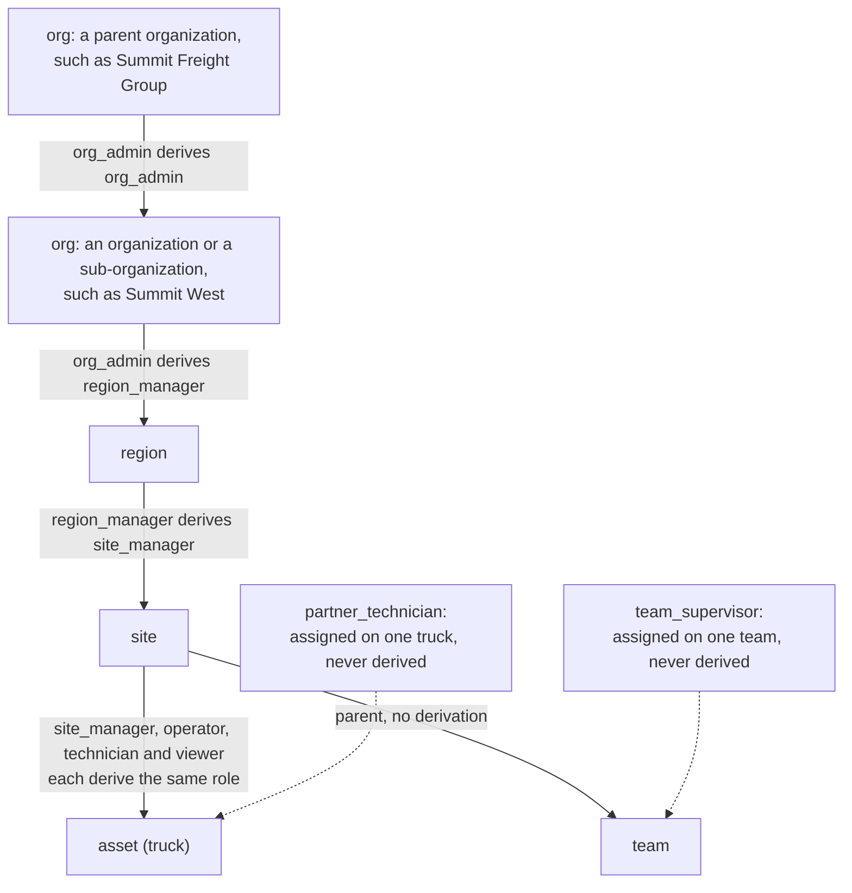
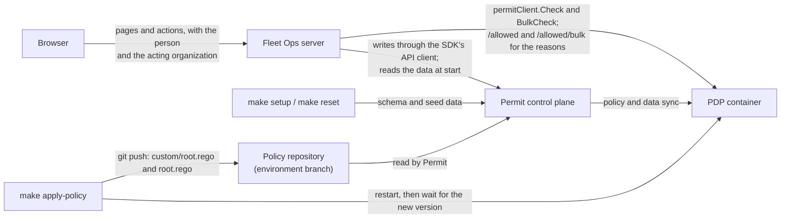
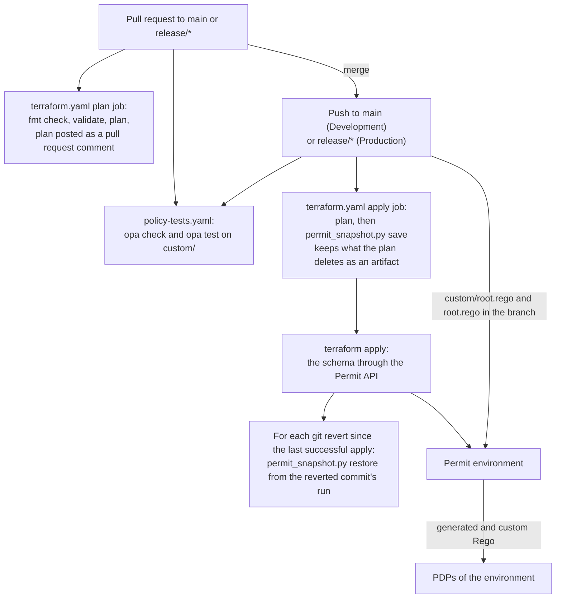

Learn how Fleet Ops, an open source multi-tenant fleet operations app, models its authorization with Permit.io: an organization tree of regions, sites and trucks with derived roles, partner technicians on single trucks, attribute-based sets of trucks, and custom Rego rules for tenant isolation, loaded through GitOps. This page is for developers who build a multi-tenant B2B application in which one person can work for several organizations, and who want a worked example of where Permit's built-in models end and custom policy code starts.

The code is in the [fleet-ops-demo folder](https://github.com/permitio/examples/tree/main/fleet-ops-demo) of the `permitio/examples` repository. The app is written in Go and makes every decision with the [Permit Go SDK](https://github.com/permitio/permit-golang) against a policy decision point (PDP) container running next to it. All paths on this page are relative to the `fleet-ops-demo` folder.

You pick a person in **Signed in as** and the organization they act for in **Organization**. The **PDP checks** panel on the right lists every check the server sent, with the PDP's answer and the reason. In the following screenshot, Rachel, the region manager for South at Acme Freight, opens the truck HOU-01. The PDP allows `view` through the relationship route region manager on South, then site manager on Houston terminal, then site manager on HOU-01:


## What the example shows \{#what-it-shows}

The [fleet-ops-demo README](https://github.com/permitio/examples/tree/main/fleet-ops-demo#what-it-shows) lists 17 scenarios. They fall into three groups by how Permit decides them:

| Group | Scenarios | How it is built |
|---|---|---|
| Relationships | Role derivation down the organization tree, scoped admin delegation, nested organizations, re-parenting a truck, team supervisors, a broker's read-only view of shared trucks, revocation, merging organizations | Relationship-based access control (ReBAC): roles, relations and role derivations |
| Attributes | Org-level roles that see only the trucks in region South, or only the trucks that serve account Acct1 | Attribute-based access control (ABAC): resource sets and condition set rules |
| Custom rules | Tenant isolation, owner and operator organizations, certification-gated service, lifecycle states, time-boxed break-glass access | Custom Rego in the environment's GitOps repository, required on every allow |

Partner access, certifications and audit combine the built-in models with the custom rules.

## The authorization model \{#model}

The schema is defined twice, with the same content: in Go in [`internal/schema/schema.go`](https://github.com/permitio/examples/blob/main/fleet-ops-demo/internal/schema/schema.go), which `make setup` writes through the API, and in Terraform in [`gitops/terraform`](https://github.com/permitio/examples/tree/main/fleet-ops-demo/gitops/terraform), for a team that manages the schema as code (see [Policy as code with GitOps and Terraform](#gitops)).

### Organizations are tenants \{#tenants}

Each organization is a Permit tenant: the four customer and partner organizations (Acme Freight, Lone Star Logistics, Summit Freight Group, Mesa Fleet Services) and Fleet Ops, the platform operator. The org admins of Fleet Ops are platform staff. The app passes the acting organization as the tenant of every check, so the same person can hold different access in each organization they work for.

Permit doesn't compare the tenant of a check with the organization that owns the resource. Relationship-derived roles apply whatever tenant the check passes. A custom rule adds that comparison (see [Custom rules](#custom-rules)).

### Resources and roles \{#resources}

| Resource | Parent | Actions | Roles on it |
|---|---|---|---|
| `org` | Parent org (for sub-organizations) | `manage_users`, `assign_roles` | `org_admin` |
| `region` | Org | `view`, `assign_roles` | `region_manager` |
| `site` | Region | `view`, `assign_roles` | `site_manager`, `operator`, `technician`, `viewer` |
| `asset` (truck) | Site | `view`, `operate`, `service_basic`, `service_advanced`, `decommission` | `site_manager`, `operator`, `technician`, `viewer`, `partner_technician` |
| `team` | Site | `view_activity` | `team_supervisor` |

Each resource type links to its parent with a `parent` relation. Role derivations carry a role assigned high in the tree down to everything below it:



On a truck, the site manager can `view` and `decommission`, an operator can `operate`, and a technician can `service_basic` and `service_advanced`. Permit keeps a resource's permissions on that resource's own roles, so each site role also exists on trucks under the same name. The `asset` entry in `internal/schema/schema.go` declares the truck roles and where each one comes from:

```go
Roles: []Role{
	// Permit keeps a resource's permissions on that resource's own roles, so the site roles also
	// exist on assets, derived from the asset's site. The site manager's share is the ownership
	// action, decommission (scenarios 7 and 13); service needs a certification (scenario 9).
	{Key: "site_manager", Name: "Site manager", Permissions: []string{"view", "decommission"}, DerivedFrom: from("site_manager", "site")},
	{Key: "operator", Name: "Operator", Permissions: []string{"view", "operate"}, DerivedFrom: from("operator", "site")},
	{Key: "technician", Name: "Technician", Permissions: []string{"view", "service_basic", "service_advanced"}, DerivedFrom: from("technician", "site")},
	{Key: "viewer", Name: "Viewer", Permissions: []string{"view"}, DerivedFrom: from("viewer", "site")},
	// A user from another tenant, given this role on named assets only (scenario 6): never derived.
	{Key: "partner_technician", Name: "Partner technician", Permissions: []string{"view", "service_basic", "service_advanced"}},
},
```

`from(role, resource)` is a derivation over the `parent` relation. The technician role grants both service actions; the [fleet rules](#custom-rules) then require a certification for each.

### Attributes and attribute-based sets \{#attributes}

| Attribute | On | Values |
|---|---|---|
| `certifications` | User | `tier1`, `tier2`, `tier3` |
| `home_tenant` | User | The organization that employs the person |
| `breakglass` | User | Time-boxed grants, each with `tenant`, `incident_id` and `expires_at`. Permit can't put attributes on a role assignment, so the grants are stored on the person. |
| `region` | Asset | `South`, `West`, `East` |
| `served_account` | Asset | The shipper account the truck serves, such as `Acct1` |
| `lifecycle_state` | Asset | `unassigned`, `active`, `transferring`, `decommissioned` |
| `owner_org`, `operator_org` | Asset | The organization that owns the truck and the one that operates it |

Two org-level roles, `operator` and `viewer`, hold no permissions of their own. Condition set rules give them sets of trucks by attribute:

| User set | Resource set | Condition | Permissions |
|---|---|---|---|
| `__autogen_operator` (everyone with the org-level `operator` role in the acting organization) | `south_assets` | `resource.region` equals `South` | `asset:view`, `asset:operate` |
| `__autogen_viewer` | `acct1_assets` | `resource.served_account` equals `Acct1` | `asset:view` |

Permit creates an `__autogen_<role>` user set for each org-level role. Attribute rules grant permissions to user sets, and a user set can require an org-level role but not a relationship-derived one. That is why `operator` and `viewer` exist both as site roles and as org-level roles. The Terraform version of the South set, from `gitops/terraform/attribute_groups.tf`:

```hcl
resource "permitio_resource_set" "south_assets" {
  key      = "south_assets"
  name     = "Assets where region = South"
  resource = permitio_resource.asset.key
  conditions = jsonencode({
    allOf = [{ "resource.region" = { equals = "South" } }]
  })
}
```

One of the rules that grant the South set to the org-level `operator` role, in the same file:

```hcl
resource "permitio_condition_set_rule" "operator_operates_south" {
  user_set     = "__autogen_operator"
  permission   = "asset:operate"
  resource_set = permitio_resource_set.south_assets.key
  depends_on   = [permitio_role.operator]
}
```

### Custom rules \{#custom-rules}

The Policy Editor can't express the rest of the model, so it is custom Rego in [`policy/custom.rego`](https://github.com/permitio/examples/blob/main/fleet-ops-demo/policy/custom.rego), installed as `custom/root.rego` in the environment's GitOps branch. The rules are configuration that this example adds, not built-in Permit behavior.

| Rule | What it does | Debug code when it denies |
|---|---|---|
| Tenant isolation | A check about a specific resource passes only when the resource belongs to the acting organization. A resource the PDP doesn't know is denied. | `acting_org_mismatch`, `no_acting_org`, `unknown_resource` |
| Owner and operator | On a truck that another organization operates, the owner keeps ownership actions (`view`, `decommission`), and the operating organization gets the operational actions through a role its own people hold in it | `operated_by_other_org` |
| Certifications | Basic service needs tier 1 or tier 2. Advanced service needs tier 3. | `certification_missing` |
| Lifecycle | Only platform staff see or use an `unassigned` truck. A `decommissioned` truck allows only `view` and `decommission`. | `unassigned`, `decommissioned` |
| Break-glass | A grant in the person's `breakglass` attribute allows `view` and `service_basic` on the acting organization's trucks until `expires_at`, compared with the clock on every decision | None: it is a grant |

`make apply-policy` replaces the `allow` rules of Permit's generated `root.rego` with two rules. Either the generated policy (RBAC, ReBAC and ABAC) or a custom grant allows, and both rules also require tenant isolation and the fleet rules. The rules, from [`policy/policy.go`](https://github.com/permitio/examples/blob/main/fleet-ops-demo/policy/policy.go):

```rego
allow {
	policies.allow
	custom.acting_org_ok
	custom.fleet_rules_ok
}

allow {
	custom.extra_allow
	custom.acting_org_ok
	custom.fleet_rules_ok
}
```

Two `allow` rules in Rego combine with "or", and the statements inside one rule combine with "and". The tenant isolation rule in `policy/custom.rego`:

```rego
default acting_org_ok := false

# A check about a specific resource (it names a key) must find that resource in the PDP's data. A
# type-level check (no key) has no owning organization to compare. An unknown resource fails closed.
resource_key_given {
	input.resource.key != ""
}

acting_org_ok {
	not resource_key_given
}

acting_org_ok {
	resource_org == acting_org
}

acting_org_ok {
	operator_org_allow
}
```

`acting_org` is the tenant of the check, and `resource_org` is the tenant that the PDP's data stores for the instance. The custom Rego uses Rego v0 syntax, like Permit's generated policy.

The fleet rules are a set of violations, and `fleet_rules_ok` holds when the set is empty. The owner and operator rule:

```rego
fleet_violations[v] {
	truck.attributes.operator_org != truck.tenant
	acting_org == truck.tenant
	input.action in operational_actions
	input.action != "view"
	v := {"code": "operated_by_other_org", "operator_org": truck.attributes.operator_org, "reason": sprintf("%s is operated by '%s': operational actions belong to the operating organization", [instance_key, truck.attributes.operator_org])}
}
```

Break-glass access ends on time without a cleanup job, because each decision compares the grant's expiry with the clock:

```rego
breakglass_grants[g] {
	some g in object.get(data.users[input.user.key].attributes, "breakglass", [])
	g.tenant == acting_org
	time.now_ns() < g.expires_at * 1000000000
}
```

The custom rules also add `acting_org` and `fleet_rules` to the debug output of every decision, with the custom policy version that `make apply-policy` stamps in the file. The PDP checks panel shows both.

## Application architecture \{#architecture}

Fleet Ops runs these parts on your machine:

| Component | Role in the example |
|---|---|
| Fleet Ops server (`cmd/server`, `internal/server`) | Serves the page from `web/` and the API on `http://localhost:3000`. Loads the authorization data from Permit when it starts, checks every page and every write with the Go SDK, and writes changes through the SDK's API client. |
| PDP container | `permitio/pdp-v2`, started by `docker-compose.yml` with `PDP_DEBUG` on, so every decision returns its reason. Port 7766 is the PDP API, and port 8181 the embedded Open Policy Agent (OPA), which the app reads to confirm what the PDP has loaded. |
| `make setup`, `make reset` (`cmd/sync`) | Write the schema and the seed data to Permit, or restore only the seed data. |
| `make apply-policy` (`cmd/apply-policy`) | Installs the custom Rego in the GitOps branch, restarts the PDP and waits until the PDP has loaded the new policy version. |
| Policy repository | The Git repository connected to the Permit environment through GitOps. Holds Permit's generated Rego and the custom rules. |
| Permit control plane | Stores the schema and the data, reads the policy from the environment's branch, and syncs policy and data to the PDP. |

The attribute rules and the custom Rego need a container PDP: the [Cloud PDP](/concepts/pdp/cloud-pdp-capabilities) evaluates neither ABAC nor custom Rego. The following diagram shows which part calls which:



The app has no sign-in. The server listens on `127.0.0.1`, refuses other host names and cross-site requests, and takes the person and the acting organization from each request. In production, take both from your authentication session.

## Walk through the scenarios \{#walkthrough}

The [README walkthrough](https://github.com/permitio/examples/tree/main/fleet-ops-demo#walkthrough) has 16 steps in order, with what to point at in the panel for each. The walkthrough changes data in Permit, and later steps rely on earlier ones. The groups below follow the same scenarios.

### Derived roles and scoped delegation \{#derivation}

- **Role derivation.** Sign in as Rachel (region manager, South). The fleet shows the five trucks of Dallas and Houston. Open HOU-01: the PDP allows through region manager on South, site manager on Houston terminal, site manager on HOU-01. Switch to Sam (site manager, Dallas) on the same page: denied, because a site role stops at its site.
- **Scoped admin delegation.** As Sam, give Ivy the Operator role at Houston terminal: the check `assign_roles` on `site:acme-houston` denies. As Rachel, the same check allows, and the app asks the PDP "Can Ivy Walker operate Truck HOU-01 now?", which allows.
- **Re-parenting.** As Rachel, move DAL-02 to Houston terminal. The app checks `assign_roles` on both sites, deletes one `parent` relationship tuple and creates another. No role assignment changes, and access that derives through the site follows the truck: Sam is denied, Ivy (now an operator at Houston) is allowed.
- **Team supervisor.** As Sam, open **People**. `view_activity` is allowed on the Dallas night shift, which Sam supervises, so Ivy's activity shows. It is denied on the day shift, so Quinn's doesn't.
- **Nested organizations.** Avery, org admin of Summit Freight Group, sees ATL-01 and DEN-01 through Summit East and Summit West. Jamie, org admin of Summit East only, sees ATL-01, and the check on DEN-01 denies.

### Tenant isolation \{#tenant-isolation}

Jordan, a Mesa technician with tier 3, is a technician at Acme's Dallas terminal and at Lone Star's Fort Worth terminal. Acting for Acme, Jordan runs advanced service on DAL-01. Acting for Lone Star, Jordan runs it on FTW-01: the certification is a person attribute and counts in both. Still acting for Lone Star, Jordan opens `#/truck/acme-dal-01` and the PDP denies with `acting_org_mismatch`. The relationship route to DAL-01 exists, but it was granted by Acme.

The same rule stops attribute rules. Quinn has the org-level `operator` role at Acme, and FTW-01 is in region South too. Acting for Acme, Quinn opens `#/truck/lonestar-ftw-01`. Both conditions of the attribute rule match, and the tenant rule denies:


### Attribute-based sets \{#abac}

Quinn sees Acme's South trucks and no Phoenix truck. Riley, with the org-level `viewer` role, sees the trucks that serve Acct1 and not DAL-02, which serves Acct2. The panel lists each rule condition with the value the PDP evaluated. For Quinn on PHX-01, the role condition is met and the region condition isn't:


As Rachel, open DAL-02, set the served account to Acct1 and save: the app asks "Can Riley Shaw see Truck DAL-02 now?" and the PDP allows. Set the region to West: "Can Quinn Ellis operate Truck DAL-02 now?" denies, with the unmet region condition. The edit changes the instance's attributes in Permit, and the resource sets read them at check time.

### Owner and operator organizations \{#owner-operator}

DAL-04 is owned by Acme and operated by Lone Star. Lena, org admin of Lone Star, acting for Lone Star, can dispatch it: the custom grant allows operational actions to the operating organization's people, and tenant isolation reports `operator_org`. Sam, acting for Acme, can decommission it. Quinn, acting for Acme, can't dispatch it:


### Partners, certifications, lifecycle and break-glass \{#partners}

- **Certifications.** Ivy (tier 1) can log basic service on DAL-01, not advanced service. As Olivia, org admin of Acme, giving Ivy tier 3 is denied: tier 3 is checked as `manage_users` on the Fleet Ops organization, so only platform staff may give it. Tier 2 is checked as `manage_users` on Acme and is allowed. As Ava, a platform operator acting for Acme, tier 3 is allowed, and the follow-up check of advanced service on DAL-01 allows.
- **Lifecycle.** Ava acting for Acme sees 7 trucks, including the unassigned PHX-02. Olivia sees 6. Ivy can't service the decommissioned DAL-03, and Sam, as its site manager, can reactivate it.
- **Partner access and a transfer.** Pat, a Mesa technician with `partner_technician` on DAL-01 and DAL-02, sees only those two trucks acting for Acme. Ava transfers DAL-01 to Lone Star's Fort Worth terminal. A resource instance's tenant is fixed, so the app deletes the instance and creates it again in Lone Star, and the old grants go with the deletion. Afterwards, Pat is denied acting for Acme (`acting_org_mismatch`) and acting for Lone Star (no grant).
- **Break-glass.** As Olivia, open **Access** and give Pat break-glass access for incident INC-1042 for 2 minutes. Acting for Acme, Pat sees every Acme truck except the unassigned PHX-02. Two minutes later, Pat sees only DAL-02 again.

### Aggregated read-only, revocation and merge \{#revocation}

- **Aggregated read-only.** Skyler, a broker, has `viewer` on one truck each from Acme, Lone Star and Summit. With **All my organizations**, the fleet list sends one bulk check per organization, each acting for its own organization, and shows HOU-01, FTW-01 and ATL-01, view only.
- **Revocation.** As Olivia, revoke Pat's partner access on DAL-02, then remove Riley from Permit. As Ava, delete Summit Freight Group. Each action shows a check before (allow), a check after (deny), and what Permit still holds for it: 0 role assignments, and for the organization also 0 resource instances and 0 relationships.
- **Merge.** As Ava, merge Lone Star Logistics into Acme Freight as a sub-organization. Instances can't change tenant, so the app deletes Lone Star and creates its tree again in Acme, under a `parent` link from Acme's organization, with the same roles for its people. Lena keeps her role and now acts for Acme. Olivia reaches Lone Star's trucks through the new sub-organization link.

### Audit \{#audit}

Every check's **Why** shows the reason, the relationship route or the rule conditions, the tenant isolation result and the custom policy version, and **PDP response** shows the raw debug output. The decision record carries `debug.acting_org` and `debug.fleet_rules.policy_version`. The same decisions appear in the Permit [audit log](/how-to/use-audit-logs/types-and-filtering), where you can filter by user.

## How the app enforces decisions \{#enforcement}

Every page asks the PDP before it shows anything, and every write is checked again on the server before the app changes Permit. The SDK calls are in [`internal/pdp/pdp.go`](https://github.com/permitio/examples/blob/main/fleet-ops-demo/internal/pdp/pdp.go). `NewCheck` puts the acting organization in the resource's tenant, and `Request` builds the SDK's check request:

```go
// NewCheck builds a check. The acting organization travels as the resource's tenant. Attributes come
// from Permit's stored data, never from the request.
func NewCheck(user, action, resource, actingOrg string) Check {
	typ, key, _ := strings.Cut(resource, ":")
	return Check{User: user, Action: action, Resource: Resource{Type: typ, Key: key, Tenant: actingOrg}}
}

// Request is the check as the SDK takes it.
func (c Check) Request() enforcement.CheckRequest {
	return enforcement.CheckRequest{
		User:     enforcement.UserBuilder(c.User).Build(),
		Action:   enforcement.Action(c.Action),
		Resource: enforcement.ResourceBuilder(c.Resource.Type).WithKey(c.Resource.Key).WithTenant(c.Resource.Tenant).Build(),
	}
}
```

`Client.Check` passes the request to `permitClient.Check`, and `Client.BulkCheck` passes a list to `permitClient.BulkCheck`. The SDK's `BulkCheck` sends one `/allowed/bulk` request per tenant.

Writes go through an `enforce` helper in [`internal/server/actions.go`](https://github.com/permitio/examples/blob/main/fleet-ops-demo/internal/server/actions.go), which checks with the acting organization and returns the PDP's reason when it denies. Dispatching a truck:

```go
case "dispatch":
	if ok, err := enforce("Dispatch "+truck.Name, "operate", id); !ok {
		return r.refuse(err)
	}
```

Where the checks are:

| Path | Checks |
|---|---|
| `internal/server/pages.go` | The fleet list (one `BulkCheck` of `view` per organization), a truck page (`view`, then one `BulkCheck` for the truck's actions, `assign_roles` on the organization's sites and the platform check), a site page |
| `internal/server/actions.go` | Truck actions: `operate`, `service_basic`, `service_advanced`, `decommission`; `assign_roles` on the site for moves, details and partner access; the platform check for transfers |
| `internal/server/people.go` | Roles at a site (`assign_roles`), tier 1 and tier 2 (`manage_users` on the organization), tier 3 (the platform check), removing a person, and break-glass grants (`assign_roles` on the organization) |
| `internal/server/orgs.go` | The organizations page, deleting and merging organizations: the platform check |
| `internal/server/log.go` | `checkOne` and `checkMany`, which run the checks and record them for the panel; `platform`, the check for platform-only actions: `manage_users` on `org:platform`, acting for Fleet Ops |

The SDK returns booleans. For the panel, the app sends the same checks to the PDP's `/allowed` or `/allowed/bulk` endpoint and words the debug output that comes back ([`internal/explain`](https://github.com/permitio/examples/tree/main/fleet-ops-demo/internal/explain)). The app builds its lists with `BulkCheck` instead of `/user-permissions`, because `/user-permissions` doesn't evaluate the root policy, so the tenant rule wouldn't apply to it.

After a write, the app waits until the PDP's data shows the change, then asks the PDP what the change did, such as "After the move: can Sam Ortiz (site manager at Dallas terminal) view Truck DAL-02?". When the PDP hasn't caught up in time, the page says so instead of reporting success.

## Policy as code with GitOps and Terraform \{#gitops}

The [`gitops/` folder](https://github.com/permitio/examples/tree/main/fleet-ops-demo/gitops) is laid out like the root of the Git repository that Permit's [GitOps](/integrations/gitops/overview) reads. Copy its contents to that repository to manage the whole policy in Git, with one Permit environment per branch: Development follows `main`, and Production follows a release branch (`release/*`). You point each environment at its branch with the environment's `custom_branch_name` setting.

| Path | What it is |
|---|---|
| `terraform/` | The schema as Terraform, with the [Permit Terraform provider](/integrations/infra-as-code/terraform-provider): resource types and relations (`resources.tf`), roles (`roles.tf`), role derivations (`derivations.tf`), the resource sets and their rules (`attribute_groups.tf`), and the user attributes. The same objects that `make setup` writes from `internal/schema/schema.go`. |
| `terraform/cloud.tf` | Keeps the Terraform state in HCP Terraform, one workspace per environment (`fleet-ops-dev`, `fleet-ops-prod`). Delete it to keep the state in a local file. |
| `.github/workflows/terraform.yaml` | Plans each change on its pull request and applies it on push |
| `.github/workflows/policy-tests.yaml` | Runs `opa check` and `opa test` on the custom rules in `custom/` |
| `ci/permit_snapshot.py` | Saves the role assignments and relationship tuples that an apply deletes, and puts them back after a revert |

The role derivations in `terraform/derivations.tf` are a map with one entry per derivation, applied with `for_each`:

```hcl
locals {
  derivations = {
    # An org admin is also org admin of every sub-organization, and region manager of its regions.
    org_admin_suborg = { resource = "org", to_role = "org_admin", on_resource = "org", role = "org_admin" }
    region_manager   = { resource = "region", to_role = "region_manager", on_resource = "org", role = "org_admin" }
    # A region manager is site manager of the region's sites.
    site_manager = { resource = "site", to_role = "site_manager", on_resource = "region", role = "region_manager" }
    # Each site role carries down to the site's trucks.
    asset_site_manager = { resource = "asset", to_role = "site_manager", on_resource = "site", role = "site_manager" }
    asset_operator     = { resource = "asset", to_role = "operator", on_resource = "site", role = "operator" }
    asset_technician   = { resource = "asset", to_role = "technician", on_resource = "site", role = "technician" }
    asset_viewer       = { resource = "asset", to_role = "viewer", on_resource = "site", role = "viewer" }
  }
}
```

### How the custom Rego reaches the PDP \{#custom-rego-to-pdp}

Permit writes the Rego it generates from the schema to the environment's branch, and syncs the branch to the environment's PDPs. The custom rules go into the same branch:

1. `make apply-policy` pulls the environment branch from the clone in `policy-repo/`.
2. It writes `policy/custom.rego` to `custom/root.rego`, stamped with a new policy version when the rules changed.
3. It rewrites the `allow` rules of `root.rego` so that every allow requires `custom.acting_org_ok` and `custom.fleet_rules_ok`, and adds both custom verdicts to the debug result.
4. It commits and pushes the branch. Permit detects the push and sends the updated policy to the PDP.
5. It restarts the PDP, which loads its policy and data from Permit again, and reads the loaded `custom/root.rego` through OPA until it carries the new version. Permit fetches the push on its own schedule, so the restarted PDP can load the previous version first.

`make verify` and the panel's **Custom rules loaded** status read the policy the PDP has loaded and confirm that every `allow` rule in `root.rego` requires both custom rules. When Permit replaces `root.rego`, run `make apply-policy` again. See [Write custom policies with GitOps](/integrations/gitops/custom_policy) for the branch layout and the `root.rego` change.

### What the CI does \{#ci}



- **On a pull request**, `terraform.yaml` runs `terraform fmt -check`, `validate` and `plan` against the environment the pull request targets, and posts the plan as a comment. `policy-tests.yaml` runs the custom rules' unit tests: copy `policy/custom_test.rego` to `custom/root_test.rego` in the repository. The PDP loads only the files that `.manifest` lists, so the tests never reach it.
- **On a push**, `terraform.yaml` applies the plan to Development (`main`) or Production (`release/*`). Runs take turns per environment, and an apply is never cancelled half way.
- **Before each apply**, `ci/permit_snapshot.py save` reads the plan and, for every role or relation the plan destroys, saves its role assignments or relationship tuples as a run artifact for 30 days. Git and Terraform version the schema, not Permit's data: deleting a role in Permit also deletes every assignment of it, and reverting the commit brings the role back empty. When the plan destroys a resource type that still has instances, `save` stops the apply, because Permit would delete the instances with everything attached to them.
- **After each apply**, the workflow finds the commits since the branch's last successful apply that say `This reverts commit <sha>`, downloads the snapshot of the run that applied that commit, and restores it with `ci/permit_snapshot.py restore`. The log shows only counts.

The [gitops README](https://github.com/permitio/examples/tree/main/fleet-ops-demo/gitops#what-to-know-before-you-rely-on-it) lists what to know before you rely on the restore step: revert the commit a push ended on, keep the line that `git revert` writes, use one release branch at a time, and keep the policy repository private because the snapshots name who held which role.

## Run Fleet Ops locally \{#run-locally}

The [fleet-ops-demo README](https://github.com/permitio/examples/tree/main/fleet-ops-demo#run-it) has the steps. In short, you set the environment API key ([Get your API key](/overview/get-api-key)) as `PERMIT_API_KEY` in `.env`, start the PDP with `make pdp`, write the schema and seed data with `make setup`, install the custom rules with `make apply-policy`, check with `make verify`, and start the app with `make start` on `http://localhost:3000`. You need Docker, Go, an empty Permit environment, and, for the custom rules, a Git repository connected to that environment through GitOps ([Connect a GitHub repository to Permit](/integrations/gitops/github)). The API key stays on the server, and the browser never sees it.

**Verify:** `make verify` ends with "All checks match" (53 checks), and the top of the PDP checks panel says **Local PDP connected** and **Custom rules loaded**. Sign in as Rachel and open HOU-01: the check allows with the relationship route shown at the top of this page. After the walkthrough, stop the app, run `make reset` and start the app again, because the app reads its data from Permit when it starts.

## Next steps

- Read the [fleet-ops-demo source](https://github.com/permitio/examples/tree/main/fleet-ops-demo) to see every check and write in context.
- Learn how Permit separates customers in [Multi-tenant authorization](/concepts/multi-tenant-authorization).
- Build relations and role derivations in [Build ReBAC policies](/how-to/build-policies/rebac/building-rebac-policies).
- Extend the generated policy with [custom Rego through GitOps](/integrations/gitops/custom_policy).
