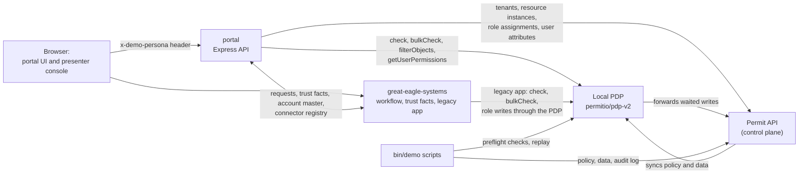
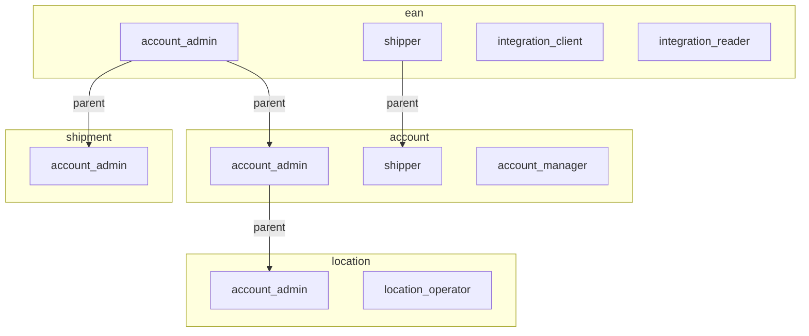

Learn how the Great Eagle Logistics business portal, an open source demo, asks Permit.io before every protected action: onboarding a new customer organization, delegated administration, an external collaborator with access that expires, an integration that acts for a customer, and a legacy app that moves its authorization to Permit. This page is for developers who build a business-to-business (B2B) customer portal and want a worked example of each of these flows to copy from.

The code is in the [permit-portal-demo folder](https://github.com/permitio/examples/tree/main/permit-portal-demo) of the `permitio/examples` repository. The demo runs on your machine with Docker Compose and needs only a Permit environment API key.

Great Eagle Logistics runs the portal for its business customers, Shire Freight and Riders of Rohan. A persona menu at the top of the portal stands in for sign-in, and a decision panel on the right lists each Permit check and each write as it happens. In the following screenshot, Frodo, the account admin of the billing account `EAN-1001`, opens a shipment on that account:


## What the demo shows \{#what-the-demo-shows}

The README lists five scenarios. Each one shows a group of Permit features:

| Scenario | Personas | Permit features |
|---|---|---|
| [S1: a new organization and its first admin](#s1-onboarding) | Éowyn, Gandalf, Éomer | One tenant per customer organization, tenant roles, a user set built on trust facts, resource sets on organization and EAN attributes, an approval before the first admin role |
| [S2: delegated administration](#s2-delegated-administration) | Sam, Merry, Frodo | Resource roles on EANs, child accounts and locations, role derivations through `parent` relations, grant rights modeled as actions, `permit.bulkCheck()` and `permit.getUserPermissions()` |
| [S4: an external collaborator](#s4-external-collaborator) | Frodo, Sam, Aragorn | A time-boxed grant stored as a user attribute, an `any_match` condition on the current time, a renewal limit, `permit.filterObjects()` |
| [S5: an integration acting for a customer](#s5-integration) | Pippin, Sam | A connector as a Permit user of its own, a sandbox scope, production scope after approval, view-only and revoke |
| [S8: a legacy app moving to Permit](#s8-legacy-migration) | Sam, Frodo | A second app with its own SDK client, shadow, both, and Permit-only modes, a role mapping synced through the PDP, a replay of the audit log against today's policy |

An EAN is a billing account. Each EAN has child accounts, and each child account has locations (depots).

## Application architecture \{#architecture}

Docker Compose runs three containers. `bin/demo` runs the scripts that seed, reset, and check the Permit environment:

| Component | Role in the demo |
|---|---|
| `apps/portal` | An Express API that asks Permit before every protected action, and a React web app with the decision panel, on `http://localhost:3000`. |
| `apps/great-eagle-systems` | A stand-in for Great Eagle's own systems: the request workflow, the trust facts, the account master, a connector registry, the legacy billing app, and a presenter console, on `http://localhost:4100`. |
| Policy decision point (PDP) | `permitio/pdp-v2`, connected to your Permit environment, on `http://localhost:7766`. It answers every check from both apps. |
| `bin/demo` | Seeds the policy and the demo data, resets the demo, runs the preflight checks and the scenario runners, and replays the audit log. |

The following diagram shows which part calls which:



Each write the portal makes returns only once the local PDP holds the change, so the next check sees it. By default (`PERMIT_WRITES=fast`), the portal sends the write to the Permit API and reads the change back from the PDP's debug answer. With `PERMIT_WRITES=waited`, the SDK sends the write through the PDP, which answers once it has applied the change. See [Send consistent updates through the PDP](/how-to/manage-data/local-facts-uploader).

Trust facts, organization ownership, and EAN proofs live in the Great Eagle systems. When a trust fact changes there, the systems call the portal's internal `POST /internal/facts-changed` route, and the portal writes the fact to Permit as a user or resource attribute.

## The authorization model \{#model}

`bin/demo seed` creates the policy from [`apps/portal/scripts/policy.ts`](https://github.com/permitio/examples/blob/main/permit-portal-demo/apps/portal/scripts/policy.ts) with the Node.js SDK. Each customer organization is a tenant, and Great Eagle's own staff work in the `great-eagle` tenant.

### Resources

| Resource | Actions | Attributes |
|---|---|---|
| `organization` | `view_profile`, `view_own_request`, `cancel_request`, `manage_members`, `invite`, `transfer_admin`, `request_ean_association`, `register_integration` | `id`, `ownership_verified` (bool) |
| `ean` | `view`, `ship`, `view_billing`, `manage_access`, `grant_shipper`, `grant_account_admin`, `create_shipment`, `approve_integration` | `id`, `association_verified` (bool) |
| `account` (child account) | `view`, `ship`, `view_billing`, `grant_account_manager` | `id` |
| `location` | `view`, `operate`, `grant_location_operator` | `id` |
| `shipment` | `view`, `upload_docs`, `comment`, `invite_collaborator`, `approve_collaborator`, `revoke_collaborator`, `request_renewal`, `approve_renewal` | `id`, `requested_days` (number) |
| `onboarding_queue` | `review` | `id` |

A grant is itself an action: `grant_<role>` on the resource the role would go on. Every resource instance stores its own key as the `id` attribute, because condition set rules compare attributes and can't read the instance key itself.

### Relations and role derivations

Each child resource declares a `parent` relation: an EAN is the parent of its child accounts and its shipments, and a child account is the parent of its locations. Role derivations carry roles down these relations:



`account_admin` on an EAN therefore gives `account_admin` on each child account and shipment of that EAN, and on each location of those child accounts. The shipment role declares its derivation with `granted_to`:

```ts
{
  resource: 'shipment',
  role: {
    key: 'account_admin',
    name: 'Account admin',
    permissions: [
      'view',
      'comment',
      'invite_collaborator',
      'approve_collaborator',
      'revoke_collaborator',
      'approve_renewal',
    ],
    granted_to: {
      users_with_role: [
        { role: 'account_admin', on_resource: 'ean', linked_by_relation: 'parent' },
      ],
    },
  },
},
```

To learn the ReBAC (relationship-based access control) terms, see [Build ReBAC policies](/how-to/build-policies/rebac/building-rebac-policies).

### Roles

**Tenant roles** (role-based access control, RBAC) apply in one organization's tenant:

| Role | Permissions |
|---|---|
| `pending_member` | `organization:view_own_request`, `organization:cancel_request` |
| `org_member` | `organization:view_profile` |
| `org_admin` | `organization:view_profile`. The admin rights come from the `verified_org_admin` user set. |
| `onboarding_reviewer` | `onboarding_queue:review` |
| `developer` | `organization:register_integration` |

**Resource roles** apply to one resource instance:

| Role | Permissions | How a user gets it |
|---|---|---|
| `ean#account_admin` | `view`, `ship`, `view_billing`, `manage_access`, `grant_shipper` | Assigned on the EAN |
| `ean#shipper` | `view`, `ship` | Assigned on the EAN |
| `ean#integration_client` | `view`, `create_shipment` | Assigned to a connector on the EAN |
| `ean#integration_reader` | `view` | Assigned to a connector on the EAN |
| `account#account_admin` | `view`, `view_billing`, `grant_account_manager` | Derived from `account_admin` on the parent EAN |
| `account#shipper` | `view`, `ship` | Derived from `shipper` on the parent EAN |
| `account#account_manager` | `view`, `ship`, `view_billing` | Assigned on the child account |
| `location#account_admin` | `view`, `grant_location_operator` | Derived from `account_admin` on the parent child account |
| `location#location_operator` | `view`, `operate` | Assigned on the location |
| `shipment#account_admin` | `view`, `comment`, `invite_collaborator`, `approve_collaborator`, `revoke_collaborator`, `approve_renewal` | Derived from `account_admin` on the parent EAN |

`ean#account_admin` doesn't include `grant_account_admin` or `approve_integration`. Only a verified organization admin makes another EAN admin or approves an integration.

### User attributes and condition sets \{#condition-sets}

Condition sets (attribute-based access control, ABAC) match users and resources by their attributes. The policy reads these user attributes: `identity_verified`, `duplicate_check`, and `risk_state` (the trust facts Great Eagle holds on each person), `time_based_grants` (an `object_array` of collaborator grants), `current_time` (sent with every check), and `principal_type`, `owner`, and `customer` (set on S5's connector).

| Condition set | Type | Matches |
|---|---|---|
| `verified_org_admin` | User set | Users with the `org_admin` role, `identity_verified` true, `duplicate_check` `clear`, and `risk_state` `ok` |
| `verified_organization` | Resource set | Organizations with `ownership_verified` true |
| `associated_ean` | Resource set | EANs with `association_verified` true |
| `active_collaborator` | User set | Users with a `time_based_grants` entry for this resource, with role `collaborator`, whose `expires` is at or after `current_time` |
| `renewable_collaborator` | User set | Users with a `time_based_grants` entry for this resource, with role `collaborator`, and `renewals_used` less than 2 |
| `renewal_within_limit` | Resource set | Shipments with `requested_days` of 30 or fewer |

The `verified_org_admin` user set requires the role and all three trust facts:

```ts
{
  key: 'verified_org_admin',
  name: 'Verified org admin',
  type: 'userset',
  conditions: all(
    { 'user.roles': { array_contains: 'org_admin' } },
    { 'user.identity_verified': { equals: true } },
    { 'user.duplicate_check': { equals: 'clear' } },
    { 'user.risk_state': { equals: 'ok' } },
  ),
},
```

`all()` wraps the conditions in `{ allOf: [{ allOf: [...] }] }`. The `active_collaborator` user set matches an entry of the `time_based_grants` array with `any_match`, and compares each field with an attribute of the check:

```ts
conditions: all({
  'user.time_based_grants': {
    any_match: {
      match: {
        resource: { equals: { ref: 'resource.id' } },
        role: { equals: 'collaborator' },
        expires: { 'greater-than-equals': { ref: 'user.current_time' } },
      },
    },
  },
}),
```

For the same pattern on a tenant role, see [Time based role example](/how-to/build-policies/abac/time-based-role).

### Condition set rules

| User set | Resource set or type | Permissions |
|---|---|---|
| `verified_org_admin` | `verified_organization` | `manage_members`, `invite`, `transfer_admin`, `request_ean_association` |
| `verified_org_admin` | `associated_ean` | `view`, `ship`, `view_billing`, `manage_access`, `grant_shipper`, `grant_account_admin`, `approve_integration` |
| `verified_org_admin` | Every `shipment` | `view`, `approve_collaborator`, `revoke_collaborator`, `approve_renewal` |
| `verified_org_admin` | Every `account` | `view`, `view_billing`, `grant_account_manager` |
| `verified_org_admin` | Every `location` | `view`, `grant_location_operator` |
| `active_collaborator` | Every `shipment` | `view`, `upload_docs`, `comment` |
| `renewable_collaborator` | `renewal_within_limit` | `request_renewal` |

The rules on every instance of a type set `is_resource: true`, so their resource set is the resource type itself. The `verified_org_admin` rules still apply only in a tenant where the user holds `org_admin`, because `user.roles` lists the user's roles in the tenant of the check.

## Walk through the scenarios \{#scenarios}

Each scenario has an automated runner, `bin/demo scenario <profile> <s1|s2|s4|s5|s8>`, that resets the demo, drives the portal's API as each persona, and asserts every decision and status code. The scripts are in [`apps/portal/scripts`](https://github.com/permitio/examples/tree/main/permit-portal-demo/apps/portal/scripts) (`scenario-s1.ts` to `scenario-s8.ts`). You can also run each scenario by hand in the portal, with the presenter console at `http://localhost:4100` to change the trust facts.

### S1: a new organization and its first admin \{#s1-onboarding}

Éowyn of Riders of Rohan creates the organization in the portal. Great Eagle checks Éowyn's identity and the organization's ownership, and Gandalf, a Great Eagle reviewer, approves Éowyn as the first admin.

1. **Create the organization.** `POST /api/s1/organizations` creates the `riders-of-rohan` tenant, an `organization` instance with `ownership_verified: false`, and gives Éowyn `pending_member`. Permit allows Éowyn `view_own_request` and denies `manage_members`.
2. **Verify identity and ownership.** In the presenter console, the trust service sets `identity_verified` on Éowyn and `ownership_verified` on the organization. The portal writes both to Permit. `manage_members` is still denied: Éowyn has no `org_admin` role yet.
3. **Review the queue.** Gandalf holds `onboarding_reviewer` in the `great-eagle` tenant. `GET /api/s1/reviewer-queue` checks `review` on `onboarding_queue:first-admin` and lists the pending requests with each requester's trust facts.
4. **Deny and approve.** Gandalf denies Gríma, whose `duplicate_check` is `suspected`: the portal removes Gríma's `pending_member`, and every check for Gríma denies. Gandalf approves Éowyn: the portal assigns `org_admin` and removes `pending_member`. Éowyn now matches `verified_org_admin` on a `verified_organization`, so `manage_members` allows.
5. **Associate an EAN.** Éowyn sends the EAN-2001 proof. `request_ean_association` allows, the account master checks the proof, and the portal creates `ean:EAN-2001` with `association_verified: true`. The `associated_ean` rule then allows Éowyn `view` on it.
6. **Suspend on risk.** The trust service sets `risk_state` to `suspended`. `manage_members` and `view` on the EAN deny at once, with no role removed. Setting it back to `ok` allows both again.
7. **Invite and hand over.** Éowyn invites Éomer (`invite`), and Éomer accepts to become `org_member`. Éowyn then nominates Éomer as admin (`transfer_admin`). When Éomer accepts, the portal assigns Éomer `org_admin`, checks that Éomer's `manage_members` allows, and only then moves Éowyn to `org_member`.
8. **Keep an admin.** Éomer tries to step down. The portal checks `manage_members` for every other `org_admin` holder, finds none whose check allows, and answers HTTP 409.


The trust facts act as a switch on the admin's rights. The `org_admin` role stays assigned, and the `verified_org_admin` user set decides at each check whether the role's rights are in effect.

### S2: delegated administration \{#s2-delegated-administration}

Sam, the Shire Freight organization admin, gives Merry access to EANs, a child account, and depots. Frodo, the account admin of EAN-1001 only, can grant only inside that EAN.

- **The form offers only what Permit allows.** `GET /api/s2/team` asks `grant_<role>` for every role on every place in one `permit.bulkCheck()` call, and the Team access form lists only the allowed pairs. Sam gets every pair through `verified_org_admin`. Frodo gets `grant_shipper` on EAN-1001 from `ean#account_admin`, `grant_account_manager` on its two child accounts, and `grant_location_operator` on their three depots through the derived roles. Frodo never gets `grant_account_admin`.
- **Each grant is checked before the write.** `POST /api/s2/grants` checks the same `grant_<role>` action on the exact resource, then assigns the role on that one instance. A grant that the console's tester sends as Frodo, shipper on EAN-1002, gets HTTP 403 `Permit denied grant_shipper on ean:EAN-1002.` and nothing is written.
- **The portal refuses self-grants.** An admin can't change their own access in Team access. The portal answers HTTP 403 before it asks Permit, because a role an admin gave themselves would bring grant rights that the S1 trust facts don't switch off.
- **Merry sees what Permit allows.** The **What I can do** tab calls `permit.getUserPermissions()` for Merry in `shire-freight` and shows one row per EAN, child account, and location, with the roles, derived ones included, and the actions they allow. When Sam removes a depot role, its row disappears.


### S4: an external collaborator \{#s4-external-collaborator}

Aragorn, an outside customs broker, gets access to one shipment without joining Shire Freight. The access needs an approval and ends at a set time.

1. **Invite.** Frodo invites Aragorn to `SHP-77001`. `invite_collaborator` allows through the derived `shipment#account_admin` role. Aragorn is still denied `view` on the shipment.
2. **Approve.** Permit also allows Frodo `approve_collaborator`, but the portal's separation-of-duties rule refuses: a request can't be approved by the person who made it or the person it is for (HTTP 409). Sam approves and chooses how long the access lasts. The portal adds an entry to Aragorn's `time_based_grants` attribute: `{ resource: 'SHP-77001', role: 'collaborator', expires, renewals_used: 0 }`.
3. **Use.** `active_collaborator` now matches Aragorn on `SHP-77001`, so `view`, `upload_docs`, and `comment` allow. `view` on `SHP-77002` and `view_profile` on the organization still deny, because the entry names one shipment and Aragorn holds no role in the tenant.
4. **Expire.** Every check carries `current_time`. Once it passes `expires`, the user set stops matching and the checks deny, with the entry still on Aragorn's record. A cleanup job in the Great Eagle systems later removes expired entries, as housekeeping.
5. **Renew.** Aragorn asks for 7 more days. The renewal check sends `requested_days` as a resource attribute: `renewable_collaborator` on `renewal_within_limit` allows up to 30 days and two renewals. Frodo approves each renewal with `approve_renewal`, and the third request gets HTTP 403.
6. **Revoke.** Frodo revokes Aragorn (`revoke_collaborator`), and the portal removes the grant entry. Aragorn's checks deny again.


The **Shared with you** page reruns its live checks every 5 seconds with one bulk check, so the expiry shows without a reload. The shipment list uses `permit.filterObjects()` to keep only the shipments the persona may view.

### S5: an integration acting for a customer \{#s5-integration}

Pippin, a developer at Shire Freight, registers the Shire ERP connector. Sam approves its production scope on EAN-1001 and later narrows and revokes it.

- **The connector is a user of its own.** Registration checks `register_integration` on the organization (Pippin's `developer` role), then syncs the connector as a Permit user with `principal_type: 'integration'`, `owner`, and `customer` attributes. It assigns `integration_client` on `EAN-SANDBOX` only. The Great Eagle systems issue the connector's client credential.
- **The connector authenticates with its credential.** The integration API (`/api/integration/shipments`) resolves the bearer credential to the connector, and checks `create_shipment` or `view` on the EAN as the connector, not as Pippin. Before approval, both calls on EAN-1001 get HTTP 403.
- **Production scope needs an approval.** Pippin asks for EAN-1001. Pippin can't approve the request (the separation-of-duties rule), and Frodo is refused by Permit (`approve_integration` comes only from `verified_org_admin`). Sam approves, and the portal assigns `integration_client` on `ean:EAN-1001` to the connector, never to Pippin.
- **The scope stays on one EAN.** The connector can create shipments on EAN-1001, and is denied on EAN-1002.
- **View-only and revoke.** Sam makes the connector view-only: the portal assigns `integration_reader` first, then removes `integration_client`, so `create_shipment` denies and `view` keeps working. Revoking removes every role the connector holds on the EAN, and every call is denied.

### S8: a legacy app moving to Permit \{#s8-legacy-migration}

The Great Eagle systems include a legacy billing app with its own users table and its own rule for its one protected action, `view_billing` on a child account: a user is an admin, or their `accounts` list holds the child account's code or its EAN's. The legacy app adds Permit next to that rule with its own SDK client, built in [`apps/great-eagle-systems/src/legacy/permit.ts`](https://github.com/permitio/examples/blob/main/permit-portal-demo/apps/great-eagle-systems/src/legacy/permit.ts), against the same local PDP.

1. **Shadow mode.** The legacy rule decides, and the app records Permit's answer next to it.
2. **Validate the mapping.** The app replays a generated access log through both sides, Permit with one `permit.bulkCheck()`, and groups the differences by user. With mapping version 1, three users differ. Two are tightenings that Sam approved in [`demo-data/legacy-mapping.json`](https://github.com/permitio/examples/blob/main/permit-portal-demo/demo-data/legacy-mapping.json): an admin flag the owner didn't confirm, and a user who left. The third, Pippin, shows a mapping bug: version 1 doesn't translate child-account codes.
3. **Fix and sync.** Mapping version 2 maps child-account codes to `account_manager`. The sync writes each mapped role with `permit.api.users.waitForSync(5, 'fail').assignRole()`, which returns once the PDP has applied it, and skips users that aren't in Permit's directory. Validating again shows 0 unexpected differences.
4. **Both, then Permit.** In `both` mode, each side must allow. Sam removes Frodo's `account_admin` on EAN-1001 in Team access, and the legacy app denies Frodo at once, while its own table still lists EAN-1001 for Frodo. In `permit` mode, Permit decides alone. One switch rolls back to `both`.
5. **Replay.** `bin/demo replay <profile> --since <time>` reads the run's decisions from Permit's audit log, asks the PDP again with each recorded input, and lists the decisions that would change: Frodo's `view_billing` allows that are denies now, and Pippin's denies that are allows after the mapping fix.

The legacy app picks its answer by mode:

```ts
function enforce(mode: LegacyMode, legacy: boolean, permit: boolean | null): boolean {
  switch (mode) {
    case 'shadow':
      return legacy;
    case 'both':
      return legacy && permit === true;
    case 'permit':
      return permit === true;
  }
}
```

A Permit answer of `null` means the PDP didn't answer, so `both` and `permit` deny. To compare decisions before and after a policy change in your own environment, see [Replay audit logs against a PDP](/how-to/use-audit-logs/audit-log-replay).

## How the portal enforces the policy \{#enforcement}

All paths are relative to the `permit-portal-demo` folder. Every route line that asks Permit carries a `// Permit check:` comment, and every line that writes to Permit a `// Permit write:` comment, so `git grep -n "Permit check" apps` lists them all.

| Path | Contents |
|---|---|
| `apps/portal/scripts/policy.ts`, `apps/portal/scripts/seed.ts` | The policy model, and the script that writes it with the SDK |
| `apps/portal/scripts/lib/fixtures.ts` | The demo data and the preflight expectation matrix |
| `apps/portal/src/server/permit/client.ts` | The one `Permit` client the portal creates |
| `apps/portal/src/server/permit/enforcer.ts` | Wraps `check`, `bulkCheck`, `filterObjects`, and `getUserPermissions`, and records each decision for the decision panel |
| `apps/portal/src/server/permit/confirmed-writes.ts` | Sends each write to the Permit API and waits until the PDP holds it |
| `apps/portal/src/server/permit/facts-writer.ts` | The single writer of user attributes: trust facts and grant entries |
| `apps/portal/src/server/routes/` | The API routes for each scenario, the approval workflow (`requests.ts`), and the connector's integration API |
| `apps/great-eagle-systems/src/routes-s8.ts` | The legacy app's modes, validation, and mapping sync |

:::info Vendored SDK build
The demo uses `permitio` 3.0.0, built from [permit-node pull request #134](https://github.com/permitio/permit-node/pull/134) and vendored as `vendor/permitio-3.0.0-ffe1ccc.tgz`. When the demo was built, the latest `permitio` release on npm was 2.7.6.
:::

### Check with the current time and the resource id \{#check}

`Enforcer.check()` adds `current_time` to the user and the instance key as `id` to the resource, then calls `permit.check()`. A PDP that doesn't answer is a denial with HTTP 503:

```ts
user(key: string): IUser {
  return { key, attributes: { current_time: this.clock.now() } };
}

resource(r: ResourceRef): IResource {
  return {
    type: r.type,
    key: r.key,
    tenant: r.tenant,
    attributes: { ...r.attributes, id: r.key },
  };
}
```

Each route wraps the enforcer in a one-line `enforce()` that throws HTTP 403 on a deny. The S2 grant route checks the grant action, then writes the role on one instance:

```ts
r.post('/s2/grants', async (req, res) => {
  const { user, role, ref, instance } = grantOf(d, bodyOf(req));
  notOwnAccess(res, user);
  // Permit check: may this persona give this role on this exact resource?
  await enforce(res, role.action, ref);
  // Permit write: the role on that one resource, confirmed on the PDP. Permit takes a role the
  // member holds already with success, so a repeat is written and confirmed again and changes
  // nothing; a 409, should Permit answer one, is done (ms 0).
  const ms = await ensureInstanceRole(d, user, role.role, TENANT.shire, instance);
  res.status(201).json({ ms });
});
```

A check can also carry a resource attribute that exists only for the request. The S4 renewal route sends the requested days:

```ts
if (
  !(await d.enforcer.check(
    persona,
    'request_renewal',
    refOf(shipment, { requested_days: days }),
    { source: sourceOf(res) },
  ))
)
  throw new DeniedError('Renewal not allowed by policy');
```

See [Check permissions](/how-to/enforce-permissions/check), [Bulk check](/how-to/enforce-permissions/bulk-check), and [List user permissions](/how-to/enforce-permissions/user-permissions).

### Write attributes without losing other entries \{#facts-writer}

Permit replaces a user's whole attribute set on each update. `FactsWriter` reads the current attributes, applies one change, and writes the full set back, one change per user at a time, so a trust fact update never erases a grant entry. The approval of an S4 invitation adds a grant entry this way:

```ts
const update = await d.facts.update(user, `grant ${shipment}`, (a) =>
  upsertGrant(a, {
    resource: shipment,
    role: 'collaborator',
    expires: d.clock.now() + duration,
    renewals_used: 0,
  }),
);
```

### Show why Permit decided \{#decision-panel}

The decision panel lists every check and write, newest first, with the user, action, resource, and decision. When you expand a check, the portal sends its recorded input to the PDP's `POST /allowed` endpoint, whose debug block holds Permit's reason. The SDK returns only `true` or `false`. Compose starts the PDP with `PDP_DEBUG=True`, which the reasons and the default write mode both need. The **Evidence** tab lists the request history from the Great Eagle workflow, with a link to Permit's audit log.

## Check the policy with preflight \{#preflight}

`bin/demo preflight <profile>` checks that the PDP is up, then runs a matrix of 22 expected allows and denies against fixtures in a separate `preflight` tenant: verified and unverified admins, active, expired, and maxed-out collaborators, an EAN admin on one of two EAN chains, and a connector. A deny proves nothing while the PDP hasn't loaded the user yet, so each deny row whose user has no allow row carries a witness check on the same user that must allow in the same pass. `bin/demo reset` ends with a preflight run.

## Run the demo locally \{#run-the-demo-locally}

The [permit-portal-demo README](https://github.com/permitio/examples/tree/main/permit-portal-demo#run-it) has the steps. In short, you need Node 24 and Docker with Compose. You put your environment API key ([Get your API key](/overview/get-api-key)) and the Permit API URL in `profiles/demo.env`, as described in [`profiles/README.md`](https://github.com/permitio/examples/blob/main/permit-portal-demo/profiles/README.md). Then `bin/demo seed demo` creates the policy and the data, `bin/demo up demo` starts the PDP, the Great Eagle systems, and the portal, and `bin/demo preflight demo` checks the starting state.

:::warning Use an environment made for the demo
`bin/demo seed` creates the whole policy in the environment, and `bin/demo reset` rewrites its data. Pointing a profile at an environment you use for anything else overwrites that environment's policy and data.
:::

**Verify:** Open `http://localhost:3000` and pick Frodo in the persona menu. The **Shipments** tab lists `SHP-77001` and `SHP-77002`, and the decision panel shows the `view` checks that allowed them. Then run `bin/demo scenario demo s4` and wait for each step to pass.

## Next steps

- Read the [permit-portal-demo source](https://github.com/permitio/examples/tree/main/permit-portal-demo) to see every check and write in context.
- Build role derivations on your own resources in [Build ReBAC policies](/how-to/build-policies/rebac/building-rebac-policies).
- Grant access that expires with an attribute and the current time in [Time based role example](/how-to/build-policies/abac/time-based-role).
- Make a check right after a write see the new data with [Send consistent updates through the PDP](/how-to/manage-data/local-facts-uploader).
