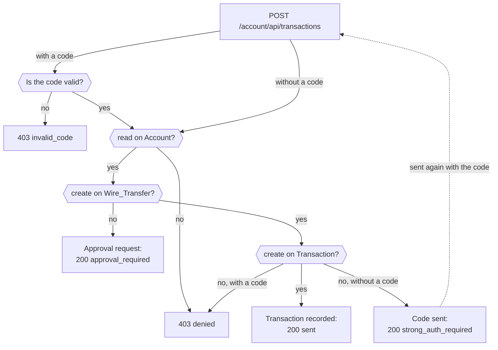
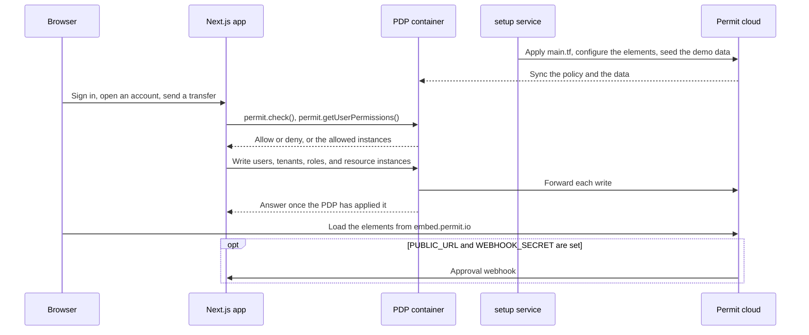

Learn how Mesa Verde Bank, an open source Next.js banking demo, models its authorization with Permit.io: tenant roles, attribute-based wire transfer limits, per-transaction relationships, and approval flows. This page is for developers who implement authorization in a fintech or banking application and want a worked example to copy from.

The code is in the [mesa-verde-banking folder](https://github.com/permitio/examples/tree/main/mesa-verde-banking) of the `permitio/examples` repository. The app runs on your machine with Docker Compose and needs only a Permit environment API key.

## What you build

The Mesa Verde model answers these authorization questions for a bank account:

- **Who can use an account.** Each new user gets their own tenant and the `AccountOwner` role in it. Owners add beneficiaries and members.
- **Who can send a wire transfer, and how much.** Rules combine the user's role, the transfer amount, where the user signs in from, and whether the user entered a one-time code.
- **Who can see a transaction.** The owners of the sending and the receiving account get a role on that transaction instance.
- **Who can approve a blocked transfer.** When the policy denies a transfer, the account owner reviews it in an embedded approval UI.

## Model overview

The schema is defined in Terraform in [`main.tf`](https://github.com/permitio/examples/blob/main/mesa-verde-banking/main.tf). The tables below summarize it.

**Resources**

| Resource key | Actions | Attributes |
|---|---|---|
| `Account` | `read`, `add-beneficiaries`, `add-members` | None |
| `Wire_Transfer` | `approve`, `review`, `deny`, `operate`, `create` | `id`, `description`, `date`, `currency` (string), `amount` (number) |
| `Transaction` | `create`, `list` | `id`, `description`, `date`, `currency` (string), `amount` (number) |

**Tenant roles** (role-based access control, RBAC)

| Role key | Permissions |
|---|---|
| `AccountOwner` | `Account:add-members`, `Account:add-beneficiaries`, `Account:read`, `Transaction:list`, `Wire_Transfer:create`, `Wire_Transfer:approve` |
| `AccountBeneficiary` | `Account:add-members`, `Account:read`, `Transaction:list` |
| `AccountMember` | `Account:read` |

**Resource roles** (relationship-based access control, ReBAC)

| Resource role | Permissions | Assigned to |
|---|---|---|
| `Transaction#Sender` | `list` | The owner of the sending account |
| `Transaction#Receiver` | `list` | The owner of the receiving account |
| `Wire_Transfer#_Reviewer_` | `approve`, `deny`, `review` | The account owner, on a transfer that needs approval |
| `Wire_Transfer#_Approved_` | `operate` | The requesting user, after a reviewer approves the request |

**Attribute-based sets** (attribute-based access control, ABAC)

| Set | Type | Condition |
|---|---|---|
| `Small_Transaction`, `Small_Wire` | Resource set | `resource.amount` less than or equal to 1000 |
| `Large_Transaction`, `Large_Wire` | Resource set | `resource.amount` greater than or equal to 1000 |
| `Safe_Owners` | User set | `user.location` equals `user.country`, and the user has the `AccountOwner` role |
| `Unsafe_Owners` | User set | `user.location` doesn't equal `user.country`, and the user has the `AccountOwner` role |
| `Strong_Auth_Owners` | User set | `user.strongAuth` is `true`, and the user has the `AccountOwner` role |

**User attributes**, also defined in `main.tf`: `location` (the country the user signs in from), `country` (the country of the user's registered address), and `strongAuth` (the user entered a one-time code for this request). All country values are ISO 3166 codes.

The model has no relations between resource types. For a model built on relations and role derivations, see [Google Drive permissions with ReBAC](/modeling/google-drive).

## Prerequisites

- Docker with Compose. See [Get Docker](https://docs.docker.com/get-docker/).
- A Permit.io account and an environment with no existing policy. Setup applies `main.tf` to the environment and adds the demo data. Create an environment as described in [Projects and environments](/manage-your-account/projects-and-env), then copy its environment API key ([Get your API key](/overview/get-api-key)).

## Run the example locally \{#run-the-demo-locally}

The [mesa-verde-banking README](https://github.com/permitio/examples/tree/main/mesa-verde-banking#run-it-with-docker-compose) has the steps. In short, you set `PERMIT_API_KEY` in `.env` and run `docker compose up --build`. Compose starts a policy decision point (PDP) container, a one-shot `setup` service that applies `main.tf` with Terraform, configures the Permit Elements, and seeds the demo data, and the app on `http://localhost:3000`.

Setup creates four demo users. They all sign in with the password `mesa-verde-demo`, and each one also owns an account of their own:

| User | Role in Alice's account | `country` | `location` | What the policy allows |
|---|---|---|---|---|
| `alice@mesaverde.example` | `AccountOwner` | US | US | Any transfer from her account |
| `bob@mesaverde.example` | `AccountBeneficiary` | GB | GB | Transfers of £1,000 or less from Alice's account. Larger ones need Alice's approval. |
| `carol@mesaverde.example` | `AccountMember` | US | US | Sees the balance of Alice's account, but not its transactions. Every transfer from it needs approval. |
| `dave@mesaverde.example` | None | US | FR | Transfers over £1,000 from his own account need a one-time code |

A user who signs up with another email address owns an account of their own, has no registered country, and needs a one-time code for every transfer.

To verify the setup, open the [Policy Editor](https://app.permit.io/policy-editor) in your environment. It shows the `Account`, `Wire_Transfer`, and `Transaction` resources with the roles from the model overview. Then sign in to the app as `alice@mesaverde.example` and open her account. The app shows the **Send Wire Transfer**, **Manage Account Users**, and **Review Wire Transfers** buttons.

## Authorization flows in the demo \{#authorization-flows}

Each flow below maps to part of the model and to code in the example.

### Multi-tenant RBAC for new accounts \{#multi-tenancy-hierarchical-role-based-access-control-rbac}

The app signs users in with [Better Auth](https://www.better-auth.com) (email and password). The first time a user opens the app, the `GET /account/api/tenants` route creates a tenant for that user, syncs the user to Permit, and assigns the `AccountOwner` role in the new tenant. The code is in [Sync users, tenants, and roles](#data).

### Secure collaboration with Permit Elements \{#secure-collaboration}

Account owners and beneficiaries manage the people on an account with [Permit Elements](/embeddable-uis/overview), embeddable UI components for permission management. The User Management element lets a user invite members and assign them roles.


### Feature toggling in the UI \{#dynamic-ui-feature-toggling}

The frontend shows or hides buttons based on the same policy the backend enforces. The app uses `permit-fe-sdk`: the browser sends the list of actions to the app's `/account/api/frontend-permissions/<account>` route, which runs `permit.bulkCheck()` for the signed-in user and returns one decision per action. The route ignores user attributes that the browser sends, so the browser can't claim attributes the user doesn't have. `src/components/AbilityContext.tsx` turns the decisions into flags, and `src/components/AccountToolbar.tsx` renders a button only when its flag is `true`:

```tsx
{abilities?.CREATE_WIRE_TRANSFER === true ? (
  <Button type="primary" onClick={() => setActiveModal('wire-transfer')}>
    Send Wire Transfer
  </Button>
) : null}
{abilities?.ADD_MEMBERS === true ? (
  <Button type="default" onClick={() => setActiveModal('user-management')}>
    Manage Account Users
  </Button>
) : null}
```

The `CREATE_WIRE_TRANSFER` flag checks `create` on `Wire_Transfer` with an `amount` of 100, a small transfer, so beneficiaries see the button too. For the same pattern on a dashboard, see [Show or hide UI components by permission](/modeling/feature-flagging).

### Multi-step wire transfer authorization \{#fine-grained-wire-transfer-permissions}

A wire transfer passes more than one permission check before the app records it. The `POST` handler in `src/app/account/api/transactions/route.ts` runs these steps:

1. **Redeem the one-time code, if the request has one.** A wrong or used code answers HTTP 403 with `{ "code": "invalid_code" }`.
2. **Check the account.** `permit.check(user, "read", Account)` in the account's tenant. A user with no role in the account gets HTTP 403 with `{ "code": "denied" }`, so a stranger can't ask the account owner for approvals.
3. **Check the transfer.** `permit.check(user, "create", Wire_Transfer)` with the transfer attributes. Owners pass through the `AccountOwner` role. Beneficiaries pass only for transfers in `Small_Wire`.
4. **Start an approval if the transfer check fails.** The app creates a `Wire_Transfer` resource instance, assigns the account owner the `_Reviewer_` role on it, and answers HTTP 200 with `{ "status": "approval_required" }`.
5. **Check the transaction.** `permit.check()` on `Transaction:create` with the user attributes `location` and `strongAuth`. The condition set rules decide the result (see [Condition set rules](#condition-sets)).
6. **Ask for a one-time code if the transaction check fails.** The app sends a code through Better Auth's email-OTP plugin and answers HTTP 200 with `{ "status": "strong_auth_required" }`. The example has no mail server, so the code goes to the app's log (`docker compose logs app`). When the user sends the transfer again with the code, the checks run with `strongAuth: true`. If the transaction check still fails, the app answers HTTP 403 with `{ "code": "denied" }`.
7. **Record the transaction.** The app creates a `Transaction` resource instance, assigns the `Sender` and `Receiver` resource roles, and answers HTTP 200 with `{ "status": "sent" }`.

The next steps of the flow (approval and one-time code) answer HTTP 200 with a `status`, like a sent transfer. A refusal answers HTTP 403 with a `code`.



The flow uses three patterns:

- **External data.** The user's registered `country` and current `location` come from the app's `customer` table, a stand-in for the bank's customer records and for a lookup of the request's location. Setup fills the table for the demo users. The app syncs `country` to Permit as a user attribute, and passes `location` in each transaction check. See [Load external data](/how-to/manage-data/loading-data).
- **Authentication and authorization feedback.** A denied check triggers a stronger authentication step (a one-time code), and the result becomes the `strongAuth` attribute in the next check.
- **Transaction approval.** Account owners approve transfers that other users can't perform on their own.

The demo doesn't track balances. Each account shows a fixed balance, and transfers don't change it. The checks decide only whether the user may send the transfer.

### Transactions with ReBAC \{#relationship-based-access-control-rebac}

Each transaction is a resource instance in Permit. The app assigns the `Sender` and `Receiver` resource roles on that instance, so each party's access comes from its relationship to the transaction, not from a tenant-wide role. To learn the ReBAC terms, see [What is ReBAC?](/how-to/build-policies/rebac/overview).

### Access requests and approvals \{#authorization-ui-components}

The demo uses three more Permit Elements:

1. **Access request.** A member asks for more access on an account, such as permission to view transactions.
2. **Operation approval request.** A user asks for approval of a wire transfer that the policy denies.
3. **Approval management.** The account owner approves or denies the pending requests.


[Configure Permit Elements](#permit-elements) describes each configuration.

## Application architecture

Mesa Verde is a Next.js application. Docker Compose runs it with these parts:

| Component | Role in the demo |
|---|---|
| Next.js app | Serves the UI and the API routes, and signs users in with Better Auth (email and password). Better Auth's email-OTP plugin creates the one-time codes. Users, sessions, and the `customer` table are in a SQLite database. |
| PDP container | Runs `permitio/pdp-v2` and answers every `permit.check()` from the app. The app's data writes go through it to Permit, so they apply in the PDP before the app reads them back. |
| `setup` service | Applies `main.tf` with Terraform, configures the four Permit Elements, and seeds the demo users, accounts, roles, and transactions. Then it exits. |
| Permit cloud | Stores the policy and the data, syncs both to the PDP, and serves the elements from `https://embed.permit.io`. With `PUBLIC_URL` and `WEBHOOK_SECRET` set, Permit calls the app's approval webhook. |

The following diagram shows which part calls which:



### Where the authorization code lives \{#application-code}

All paths are relative to the `mesa-verde-banking` folder.

| Path | Contents |
|---|---|
| `main.tf` | The policy schema and the user attributes, applied with the Permit Terraform provider. |
| `docker-compose.yml` | Runs the PDP, the setup service, and the app. |
| `scripts/setup.ts`, `src/setup/` | The setup: Terraform, the Permit Elements configurations (`elements.ts`), and the demo data (`seed.ts`). |
| `src/lib/permit.ts` | Initializes the Permit SDK and holds the data sync functions. |
| `src/lib/auth.ts` | Better Auth, with email and password sign-in and the email-OTP plugin. |
| `src/lib/personas.ts` | The demo users and transactions. |
| `src/app/account/api/*` | API routes. Most `permit.check()` calls are here. Every route answers HTTP 401 without a Better Auth session. |
| `src/app/account/webhook/route.ts` | Receives the approval result from Permit. |
| `src/components/*` | UI components, including the feature toggles and the embedded elements. |

Every line that asks Permit for a decision carries a `// Permit check:` comment, and every line that writes to Permit a `// Permit write:` comment.

## Build the authorization model \{#configuration-guide}

Permit separates authorization into three parts. The demo configures them in this order:

1. **Schema.** Resources, actions, roles, user attributes, and condition sets. Mesa Verde defines the schema with the [Permit Terraform provider](/integrations/infra-as-code/terraform-provider). You can also use the API or the Permit dashboard.
2. **Data.** Users, tenants, role assignments, attributes, and resource instances. Mesa Verde syncs data with the Node.js SDK from its sign-in and transfer code. Setup seeds the demo data through the Permit API.
3. **Enforcement.** `permit.check()` decides a single request. `permit.getUserPermissions()` returns what a user can access.

### Define the policy schema in Terraform \{#schema}

A Permit policy is a table: rows are resources (or resource sets) with their actions, and columns are roles (or user sets). Each checked cell is a permission.


#### Resources

The `Account` resource covers actions on the account itself:

```hcl
resource "permitio_resource" "Account" {
  key  = "Account"
  name = "Account"
  actions = {
    "read" = {
      name = "Read"
    }
    "add-beneficiaries" = {
      name = "Add Beneficiaries"
    }
    "add-members" = {
      name = "Add Members"
    }
  }
  attributes = {
  }
}
```

The `Wire_Transfer` resource has attributes, so condition sets can match transfers by amount or currency. The `approve`, `review`, `deny`, and `operate` actions support the approval flow. The excerpt leaves out three of the actions, and the `id`, `description`, `date`, and `currency` string attributes:

```hcl
resource "permitio_resource" "Wire_Transfer" {
  name        = "Wire"
  key         = "Wire_Transfer"
  description = "Wire Transfer resource for modeling approval workflows"
  actions = {
    "approve" = {
      name = "Approve"
    }
    # review, deny, and operate
    "create" = {
      name = "Create"
    }
  }
  attributes = {
    # id, description, date, and currency
    "amount" = {
      name = "Amount"
      type = "number"
    }
  }
}
```

The `Transaction` resource covers every money movement, including ones that aren't wire transfers. It has the actions `create` and `list`, and the same attributes as `Wire_Transfer`.

#### User attributes

`main.tf` declares the three user attributes that the user sets compare:

```hcl
resource "permitio_user_attribute" "location" {
  key         = "location"
  type        = "string"
  description = "ISO 3166 country code of where the user is now"
}
```

`country` is a string attribute, and `strongAuth` is a `bool` attribute.

#### Resource sets

A resource set groups resource instances by their attributes at check time. Mesa Verde defines four resource sets: `Small_Transaction`, `Large_Transaction`, `Small_Wire`, and `Large_Wire`. The small transaction set matches amounts up to 1000:

```hcl
resource "permitio_resource_set" "Small_Transaction" {
  key      = "Small_Transaction"
  name     = "Small Transaction"
  resource = permitio_resource.Transaction.key
  conditions = jsonencode({
    "allOf" : [
      { "resource.amount" : { "less-than-equals" : 1000 } }
    ],
  })
  depends_on = [permitio_resource.Transaction]
}
```

The large sets use `greater-than-equals` 1000, so an amount of exactly 1000 matches both the small and the large set.

#### Roles

Tenant roles grant permissions across the whole tenant, which in Mesa Verde is one bank account:

```hcl
resource "permitio_role" "AccountOwner" {
  key  = "AccountOwner"
  name = "Account Owner"
  permissions = [
    "Account:add-members",
    "Account:add-beneficiaries",
    "Account:read",
    "Transaction:list",
    "Wire_Transfer:create",
    "Wire_Transfer:approve",
  ]
  depends_on = [permitio_resource.Wire_Transfer, permitio_resource.Transaction, permitio_resource.Account]
}

resource "permitio_role" "AccountBeneficiary" {
  key  = "AccountBeneficiary"
  name = "Account Beneficiary"
  permissions = [
    "Account:add-members",
    "Account:read",
    "Transaction:list",
  ]
  depends_on = [permitio_resource.Account, permitio_resource.Transaction]
}

resource "permitio_role" "AccountMember" {
  key  = "AccountMember"
  name = "Account Member"
  permissions = [
    "Account:read",
  ]
  depends_on = [permitio_resource.Account]
}
```

None of these roles grants `Transaction:create`. Condition set rules grant it.

#### User sets

A user set groups users by their attributes. The schema holds only the condition. The attribute values come from data sync or from the `permit.check()` call.

| User set | Matches |
|---|---|
| `Safe_Owners` | Account owners whose location matches the country of their registered address. |
| `Unsafe_Owners` | Account owners whose location doesn't match the country of their registered address. |
| `Strong_Auth_Owners` | Account owners who entered a one-time code for the request. |

The `Safe_Owners` user set:

```hcl
resource "permitio_user_set" "Safe_Owners" {
  key  = "Safe_Owners"
  name = "Safe Owners"
  conditions = jsonencode({
    "allOf" : [
      {
        "user.location" : {
          "equals" : {
            "ref" : "user.country"
          }
        }
      },
      {
        "user.roles" : {
          "array_contains" : "AccountOwner"
        }
      }
    ]
  })
  depends_on = [permitio_user_attribute.location, permitio_user_attribute.country]
}
```

The condition compares two user attributes with `ref`, and also requires the `AccountOwner` role.

#### Condition set rules \{#condition-sets}

A condition set rule grants a permission to a user set (or role) on a resource set. Each rule needs a user set, a resource set, and a permission. This rule lets `Safe_Owners` create large transactions:

```hcl
resource "permitio_condition_set_rule" "allow_safeowners_large_transactions" {
  user_set     = permitio_user_set.Safe_Owners.key
  resource_set = permitio_resource_set.Large_Transaction.key
  permission   = "Transaction:create"
  depends_on   = [permitio_resource_set.Large_Transaction, permitio_user_set.Safe_Owners]
}
```

All condition set rules in `main.tf`:

| User set or role | Resource set | Permission |
|---|---|---|
| `Safe_Owners` | `Large_Transaction`, `Small_Transaction` | `Transaction:create` |
| `Strong_Auth_Owners` | `Large_Transaction`, `Small_Transaction` | `Transaction:create` |
| `Unsafe_Owners` | `Small_Transaction` | `Transaction:create` |
| `AccountBeneficiary` | `Small_Transaction` | `Transaction:create` |
| `AccountBeneficiary` | `Small_Wire` | `Wire_Transfer:create` |

The two `AccountBeneficiary` rules set `user_set` to the role's user set, `__autogen_AccountBeneficiary`. Permit stores a rule that names a role under that key, so with the key written out, applying `main.tf` again doesn't try to create the rules a second time.

An account owner who signs in from outside their home country can send only small transfers until they enter a one-time code.

#### Resource roles

A resource role grants permissions on one resource instance instead of the whole tenant. Mesa Verde defines four:

- `Transaction#Sender` and `Transaction#Receiver` grant `list` on one transaction.
- `Wire_Transfer#_Reviewer_` grants `approve`, `deny`, and `review` on one transfer.
- `Wire_Transfer#_Approved_` grants `operate` on one transfer. The [Operation Approval element](/embeddable-uis/element/operation-approval) uses the `_Reviewer_` and `_Approved_` roles. When a reviewer approves a request, Permit assigns the requesting user `_Approved_` on that instance.

:::info Resource role notation
`Transaction#Sender` means the `Sender` role on the `Transaction` resource type. The `#` separator follows the tuple notation of the [Google Zanzibar paper](https://www.permit.io/blog/what-is-google-zanzibar).
:::

The `Transaction#Sender` resource role:

```hcl
resource "permitio_role" "Sender" {
  key         = "Sender"
  name        = "Sender"
  resource    = permitio_resource.Transaction.key
  permissions = ["list"]
  depends_on  = [permitio_resource.Transaction]
}
```

#### Apply the schema \{#summary}

The `setup` service applies `main.tf` with Terraform, and keeps the Terraform state in a Compose volume so that setup can run again. In dev mode, `pnpm demo:setup` runs the same setup. The Policy Editor then shows the full schema:


:::tip Manage the policy as code
Permit generates policy code from the schema. To store and review that code in your own Git repository, see [GitOps](/integrations/gitops/overview).
:::

The applied schema enforces rules such as:

- Only account owners can add beneficiaries. Owners and beneficiaries can add members.
- Account owners and beneficiaries can list the account's transactions.
- Account owners in their home country, or with a one-time code, can create large transactions.
- The sender and the receiver of a transaction can list that transaction.
- The `_Reviewer_` of a wire transfer can approve or deny it.

### Sync users, tenants, and roles \{#data}

The PDP evaluates checks against the data it holds, so the app syncs users, tenants, role assignments, attributes, and resource instances to Permit when they change in the app. Most of the sync code is in [`src/lib/permit.ts`](https://github.com/permitio/examples/blob/main/mesa-verde-banking/src/lib/permit.ts).

#### Sync the user

Until a user owns their own account, each visit runs `openAccount()`, which syncs the user by email. When the bank knows the country of the user's registered address, the user gets it as the `country` attribute:

```ts
// Permit write: the user, with their registered country
await permit.api.users.sync({
  key: email,
  email,
  ...(country === undefined ? {} : { attributes: { country } }),
});
```

#### Create a tenant for each account

Each user gets a tenant. The tenant key is the whole email address in lower case, with each run of other characters replaced by `-`: `alice@mesaverde.example` owns `alice-mesaverde-example`. The tenant name is the email address:

`openAccount()` looks for the tenant first, and creates it only when it is missing:

```ts
// Permit write: the user's account, a tenant. A 409 means a request running at the same time
// created it first.
await createOrKeep(() => permit.api.tenants.create({ key: tenant, name: email }));
```

The key holds the whole address, so two users whose addresses share the part before the `@` don't share an account. If the tenant exists and another user owns it, `openAccount()` fails instead of adding the new user to it. Because each step reads before it writes, a visit after a first one that failed half way finishes opening the account.

To list the accounts a transfer can go to, the `GET /account/api/tenants/all` route lists tenants and leaves out Permit's `default` tenant:

```ts
const tenants = await getPermit().api.tenants.list({ perPage: 100 });
```

#### Assign a tenant role

Permit has two kinds of role assignment: a tenant role applies to the whole tenant, and a resource role applies to one resource instance. The app assigns the new user `AccountOwner` in their tenant when the account has no owner yet. `createOrKeep()` treats an HTTP 409 (the assignment exists) as done:

```ts
await createOrKeep(() =>
  // Permit write: AccountOwner of their account
  permit.api.roleAssignments.assign({ role: 'AccountOwner', tenant, user: email }),
);
```

#### Assign a resource role

When the app records a transaction, it assigns the `Sender` role to the owner of the sending account and the `Receiver` role to the owner of the receiving account. The `resource_instance` value is `<resource type>:<instance key>`:

```ts
const instance = `Transaction:${transfer.id}`;
const assignments = [{ role: 'Sender', user: senderKey }];
if (receiver !== undefined) assignments.push({ role: 'Receiver', user: receiver.key });
await Promise.all(
  assignments.map(({ role, user }) =>
    permit.api.roleAssignments.assign({ role, tenant, resource_instance: instance, user }),
  ),
);
```

#### Sync user attributes \{#sync-user-attributes}

Setup writes each demo user's `country` as a user attribute, and `openAccount()` writes it for a new user (see [Sync the user](#sync-the-user)). In a production application, sync attributes such as `country` when the user is created or updated. To sync attributes from your identity provider, use [SCIM provisioning](/integrations/SCIM/SCIM_overview). Attributes that change per request, such as `location` and `strongAuth`, go in the `permit.check()` call instead (see [Check a transaction](#check)).

#### Create resource instances

The app creates a `Transaction` resource instance with the transfer's fields as attributes. The server sets the transfer's `id` and `date`. Resource roles such as `Sender` attach to this instance:

```ts
const [receiver] = await Promise.all([
  getAccountOwner(transfer.to),
  // Permit write: the transaction, then its Sender and Receiver relationships
  permit.api.resourceInstances.create({
    resource: 'Transaction',
    key: transfer.id,
    tenant,
    attributes: { ...transfer },
  }),
]);
```

`getAccountOwner()` finds the owner of the receiving account, who gets the `Receiver` role.

#### Wait for the PDP to apply writes \{#facts-via-pdp}

The PDP gets data changes from Permit a short time after the API accepts them. The transaction list is read from the PDP right after a transfer, so the app sends its data writes (users, tenants, resource instances, and role assignments) through the PDP instead. With `proxyFactsViaPdp`, the PDP forwards each write to Permit and answers once it has applied the change, waiting up to `factsSyncTimeout` seconds:

```ts
client = new Permit({
  token: apiKey,
  apiUrl,
  pdp: pdpUrl,
  proxyFactsViaPdp: true,
  factsSyncTimeout: 10,
});
```

### Enforce permissions in the API routes \{#enforcement}

The app uses two SDK calls in its API routes, plus `permit.bulkCheck()` for the UI toggles:

- `permit.check(user, action, resource)` returns `true` or `false` for one request.
- `permit.getUserPermissions(user, tenants, resources, resource_types)` returns the resource instances a user has permissions on, with the user's roles on each.

Each argument to `permit.check()` takes a key or an object:

| Argument | Key form | Object form |
|---|---|---|
| User | `"john@permit.io"` | `{ key, attributes }` |
| Action | `"read"` | Not used in the demo |
| Resource | `"Account"` | `{ type, key, tenant, attributes }` |

#### Check a transaction \{#check}

To check whether a user can read an account, pass the user key, the action, and the resource type with the tenant:

```ts
// Permit check: may the user read this account?
const allowed = await getPermit().check(user.email, 'read', { type: 'Account', tenant });
```

To check a transaction, pass request-time user attributes and the transaction attributes. The app reads the user's current `location` from the `customer` table. The PDP matches the attributes against the user sets and resource sets:

```ts
const location = findCustomer(getDatabase(), user.email)?.location;
// Permit check: may the user, where they are now and with or without a code, make it?
const transactionAllowed = await permit.check(
  {
    key: user.email,
    attributes: {
      strongAuth: otp !== undefined,
      ...(location === undefined ? {} : { location }),
    },
  },
  'create',
  { type: 'Transaction', tenant, attributes: { ...transfer } },
);
```

#### List allowed transactions \{#getuserpermissions}

The `GET /account/api/transactions` route first checks `list` on `Transaction` for the signed-in user, so members get HTTP 403. To build the list, the app gets the account owner's permissions on `Transaction` instances:

```ts
const permissions = await getPermit().getUserPermissions(
  owner.key,
  undefined,
  [],
  ['Transaction'],
);
```

The tenant argument is `undefined`, so the PDP answers for every tenant. A transaction lives in the tenant of the account that sent it, so a transfer the account received is in another tenant. The resource type argument (`["Transaction"]`) limits the answer to transactions, and the empty array means no filter on specific resource instances. From the answer, the app keeps two kinds of transaction:

| The owner's role | Kept when | Shown as |
|---|---|---|
| `Sender` | The transaction is in this account's tenant | Outgoing |
| `Receiver` | The transaction's `to` attribute is this account | Incoming |

#### Verify the enforcement \{#summary-1}

Sign in as `alice@mesaverde.example` and open her account. The balance route runs `permit.check(user, "read", { type: "Account", tenant })`, and the account page loads because `AccountOwner` has `Account:read`. In the Permit [audit log](https://app.permit.io/audit-log), the `read` decision on `Account` for `alice@mesaverde.example` is allowed.

Then sign in as `dave@mesaverde.example` and send a transfer of more than £1,000 from Dave's account. Dave signs in from FR and his registered country is US, so the `Transaction:create` check denies the transfer and the app asks for a one-time code. Find the code in `docker compose logs app` and enter it: the transfer goes through. The audit log shows the denied decision and then the allowed one.

## Configure Permit Elements \{#permit-elements}

Permit Elements let your users manage permissions inside your application. Setup creates each element configuration through the Permit API (`src/setup/elements.ts`). You can also edit each configuration in the Permit dashboard. The app embeds the elements with `@permitio/permit-js`, which signs the user in through the app's `/account/api/elements-login` route. The route calls `permit.elements.loginAs()` for the signed-in user in the current account.

### User Management

The **Account Members Management** element lets users invite people to an account and assign roles. Open it with the **Manage Account Users** button.


The element maps roles to [permission levels](/embeddable-uis/permission-levels): `AccountOwner` is level 1, `AccountBeneficiary` level 2, and `AccountMember` level 3. Owners assign the beneficiary and member roles. Beneficiaries assign only the member role.

### Access Request

The **Wire Transfer Request** element lets a user without permission to view transactions ask for more access. The **Request Access to Transactions** button appears only for those users.


In the demo configuration, account members request the `AccountBeneficiary` role. See [Access Request element](/embeddable-uis/element/access-request).

### Operation Approval request

The **Wire Transfer Approval Request** element lets a user ask for approval of one `Wire_Transfer` instance that the policy denies, such as a beneficiary's transfer above 1000.


The configuration sets the resource type. When you set `PUBLIC_URL` and `WEBHOOK_SECRET`, setup also registers a webhook: when the reviewer approves or denies, Permit calls the app's `/account/webhook` route with the webhook secret as a bearer token. On approval, the route records the transaction. On denial, it deletes the `Wire_Transfer` instance. Permit must reach the app at `PUBLIC_URL`, so a local run needs a tunnel. Without the webhook, approvals still work in the elements, but the app doesn't record approved transfers. See [Operation Approval element](/embeddable-uis/element/operation-approval) and [Webhooks](/embeddable-uis/webhooks).

### Approval Management

The **Wire Transfer Approval Management** element lists pending requests for the reviewer. Account owners open it with the **Review Wire Transfers** button.


See [Approval Management element](/embeddable-uis/element/approval-management).

## Next steps \{#conclusion}

- Read the [mesa-verde-banking source](https://github.com/permitio/examples/tree/main/mesa-verde-banking) to see every check and write in context.
- Build a relationship graph with role derivations in [Google Drive permissions with ReBAC](/modeling/google-drive).
- Define attribute-based rules in [Build an ABAC policy](/how-to/build-policies/abac/building-abac-policy).
- Manage your schema in code with the [Terraform provider](/integrations/infra-as-code/terraform-provider).
- Ask questions about your fintech model in the [Permit Slack community](https://io.permit.io/slack).
