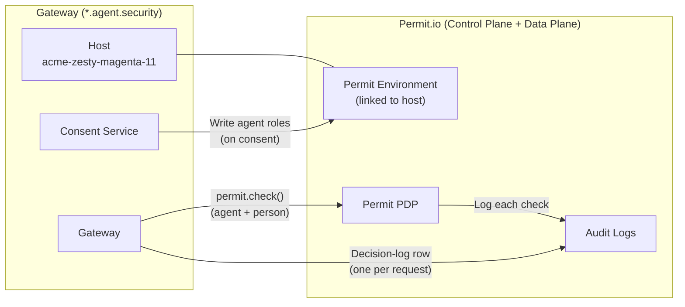
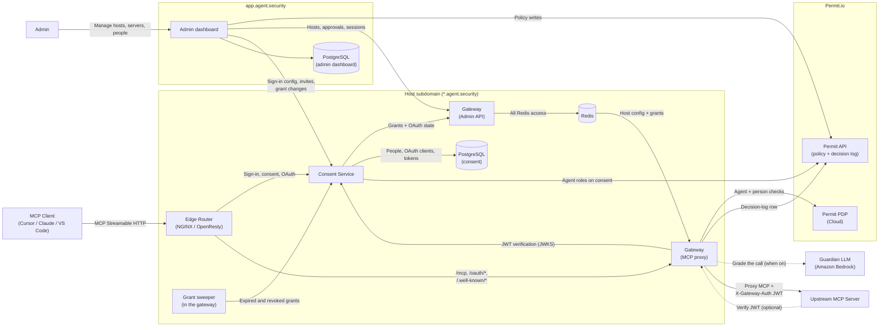
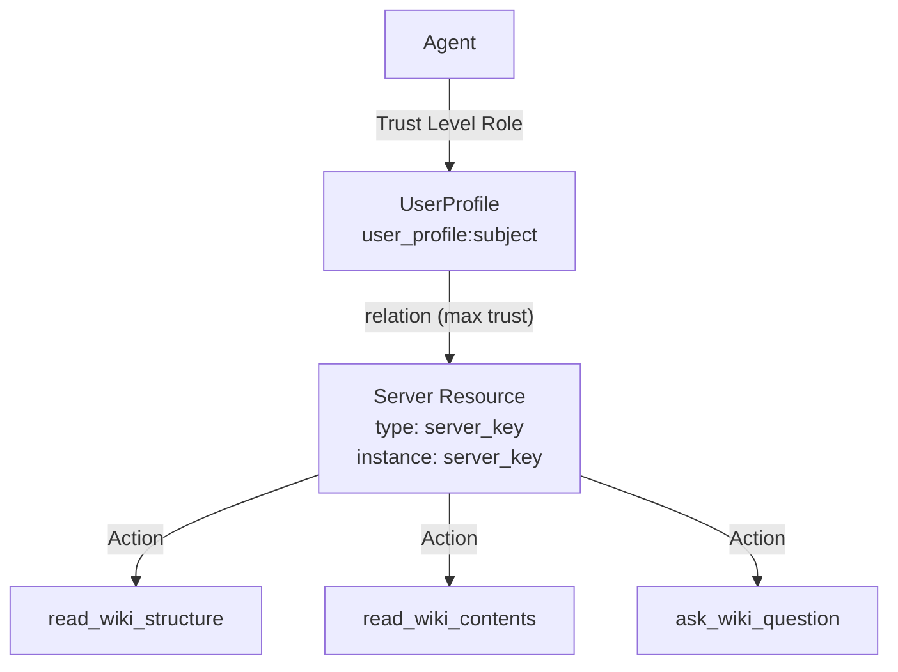
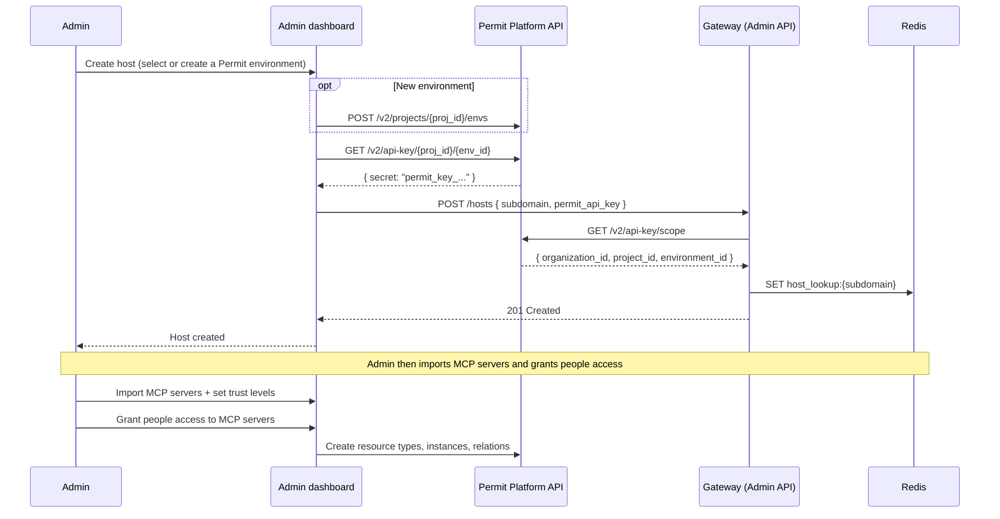
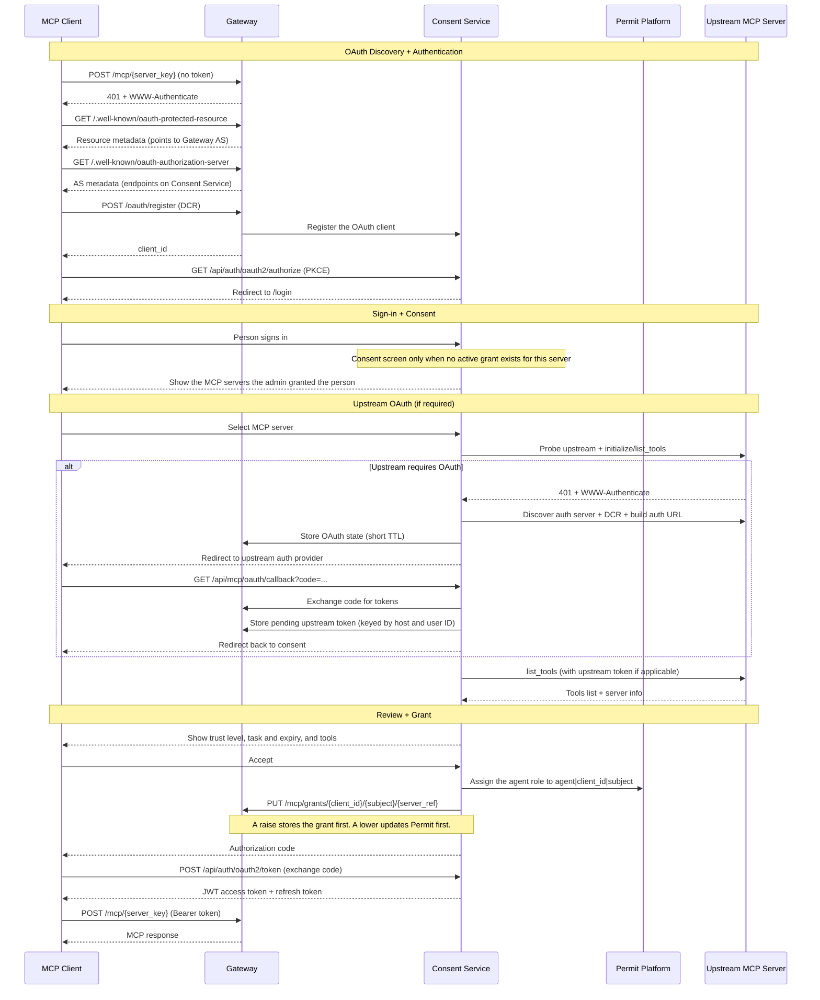
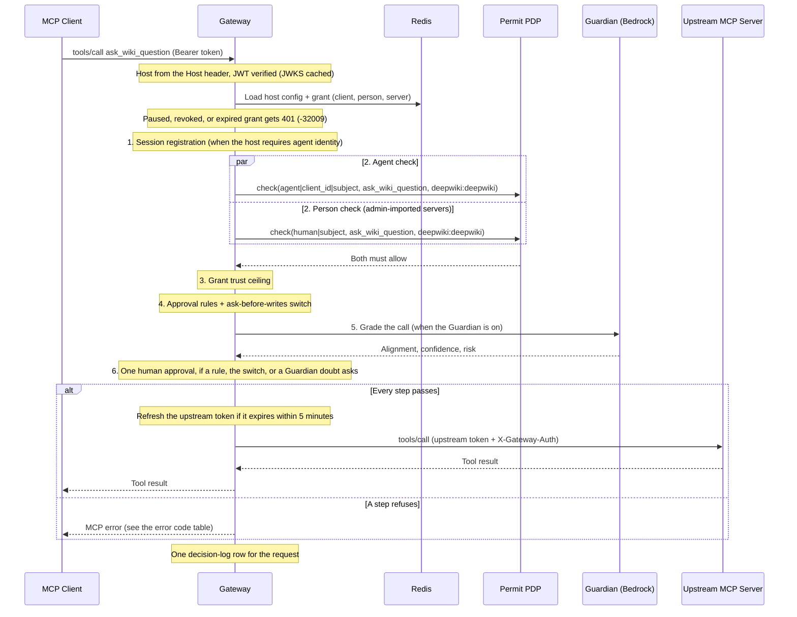
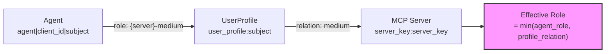
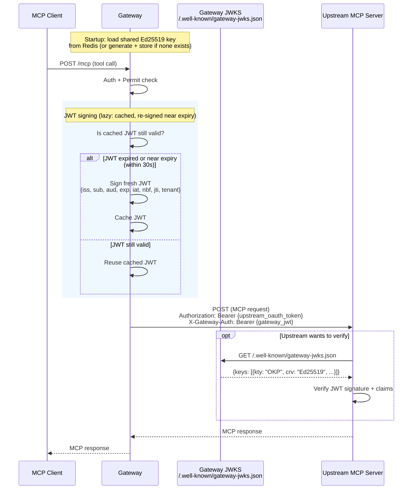

import ZoomableDiagram from '@site/src/components/ZoomableDiagram';

**Short answer:** Permit MCP Gateway runs as a proxy (a gateway, a consent service, and an admin dashboard) in front of MCP servers. For each tool call, resource read, and prompt fetch, the gateway asks a Permit.io policy decision point (PDP) whether the agent and the person it acts for are allowed, then applies the person's grant, approval rules, and an optional LLM judge. Read this page when you review the design before a rollout or plan a self-hosted deployment. Don't use the gateway when you want to enforce permissions inside an MCP server you own.

| Fact | Value |
|---|---|
| Components | Gateway (with a background grant sweeper), consent service, admin dashboard, edge router (NGINX/OpenResty), Redis, two PostgreSQL databases (consent service and admin dashboard), the Permit.io control plane with a Permit PDP, and, when you turn it on, the Guardian LLM judge on Amazon Bedrock. |
| Supported MCP clients | Cursor, VS Code, Claude Desktop, and Claude Code. Each MCP server page in the admin dashboard shows the server's MCP URL and a configuration for each client. |
| Deployment modes | Hosted (SaaS) on `*.agent.security`, customer-controlled, and fully on-premises. The last two are available on Enterprise plans. See [Enterprise deployment](/permit-mcp-gateway/enterprise-deployment). |
| Authorization model | A relationship-based access control (ReBAC) trust ceiling on standard Permit objects. Gateway policies can also use RBAC and ABAC. |
| Sign-in methods | Email and password, email one-time passcode, passkeys, Google, GitHub, and Microsoft OAuth, and SAML 2.0 or OIDC single sign-on. See [Authentication methods](/permit-mcp-gateway/authentication-methods). |
| Audit | The PDP logs each check, the Guardian logs each verdict, and the gateway adds one decision-log row per request that says how the request ended. The admin dashboard shows them on the Dashboard and on each agent, human, and MCP server's **Audit Logs** tab. The PDP checks also appear in the Permit **Audit Log** screen. |
| SDK or code change | None. You point the MCP client at the gateway URL, `https://<subdomain>.agent.security/mcp/<server_key>`, instead of the MCP server URL. |
| Free tier | Community plan, labeled "Free forever" on the [Permit MCP Gateway pricing](https://www.permit.io/mcp-gateway/pricing) page: "Up to 1,000 MAU (human + agentic identities)", Tenants 10, Environments 1, Audit log retention 7 days. The main [Permit.io pricing](https://www.permit.io/pricing) page lists different Community limits for Permit.io authorization outside the gateway. |
| Open-source components | The Permit PDP and [OPAL](https://github.com/permitio/opal) that Permit uses are open source. The Access Request MCP server ([permitio/permit-mcp](https://github.com/permitio/permit-mcp)) is a separate open-source project and is not the gateway. |

{/* GEO pass: gateway free-tier values are copied from https://www.permit.io/mcp-gateway/pricing as fetched on 2026-10-05 (Community column). Re-check them before merging. */}

Learn how Permit MCP Gateway is built: which components run, where data lives, how a request is authorized, and how upstream Model Context Protocol (MCP) servers verify gateway traffic. This page is for platform operators, security architects, and decision makers who review the gateway before a rollout or plan a self-hosted deployment. For what the gateway does and why, start with the [Permit MCP Gateway overview](/permit-mcp-gateway/overview).

## Architecture at a glance \{#executive-summary}

Permit MCP Gateway is a proxy between MCP clients (such as Cursor, Claude Desktop, and Claude Code) and upstream MCP servers. For each connection and each gated request (`tools/call`, `resources/read`, and `prompts/get`), the components work in this order:

1. The consent service signs the person in and stores a **grant**: the person's approval of one agent on one MCP server, with the trust level, the task, and when access ends.
2. The gateway sends a `permit.check()` call to the PDP for the agent and, on servers the admin imported, a second one for the person. Each check must allow the request.
3. The gateway applies the grant's trust level, the server's approval rules, and the Guardian, and holds the request for a human approval when one of them asks.
4. The gateway writes one decision-log row that records how the request ended.

The design has these properties:

| Property | How it works |
| --- | --- |
| **Transparent proxy** | MCP clients connect to the gateway URL instead of the upstream server URL. The upstream MCP server receives proxied requests and needs no code changes. |
| **Identity binding** | Each request is tied to a person (the user who signed in) and an agent (one MCP client acting for that person), through a relationship-based access control (ReBAC) model. |
| **Policy check on each request** | The decision uses the trust level the person granted the agent, the maximum trust level the admin granted the person, and the trust level of the tool. |
| **Server-side grants** | The gateway stores each grant, including the upstream OAuth tokens, in Redis. MCP clients never hold upstream tokens, and one client can hold grants on several servers. |
| **Host isolation** | Each host (a named gateway instance) has its own subdomain, Permit environment, policies, users, and grants. |

## Deployment models and where each component runs \{#deployment}

The same gateway software runs in three deployment models. The components on this page are the same in each model. What changes is who runs them and where the control plane and the policy decision point (PDP) run.

| Component | Hosted (SaaS) | Customer-controlled | Fully on-premises |
| --- | --- | --- | --- |
| Gateway and consent service | Permit runs them on `*.agent.security` | You run them in your network | You run them in your Kubernetes cluster, on your own domain |
| Admin dashboard | Permit runs it on `app.agent.security` | Contact Permit for your deployment | You run it in your Kubernetes cluster, on your own domain |
| PDP | Permit.io Cloud PDP | A PDP in your network | A PDP in your cluster, set per host in the admin dashboard |
| Control plane (policies, audit logs) | Permit.io cloud | Permit.io cloud | Your self-hosted Permit Platform |

The Guardian calls a model on Amazon Bedrock. In the hosted gateway, Permit runs that connection. In the on-premises values template, the Guardian is off. To turn it on in a self-hosted deployment, the gateway needs a Bedrock endpoint it can reach.

The diagrams on this page use the hosted names (`*.agent.security`, `app.agent.security`, Cloud PDP). In a self-hosted deployment, replace them with your own domain, your PDP, and your Permit Platform. For the full comparison of the three models, see [Enterprise deployment](/permit-mcp-gateway/enterprise-deployment#deployment-models). To install the gateway in your cluster, see [On-prem installation](/permit-mcp-gateway/on-prem-installation).

## Permit.io as control plane and data plane \{#permitio-as-control-plane-and-data-plane}

Permit.io is the **control plane** and the default **data plane** for Permit MCP Gateway.

- **Control plane:** Permit.io holds the authorization model: resource types, actions, roles, relations, derived roles, and role assignments. The admin dashboard ([app.agent.security](https://app.agent.security)) writes hosts' environments, MCP servers, tools, and people's access through the Permit API. The consent service writes each agent's role when a person approves it, and removes the role when the grant ends. Admins can also inspect the same policies in the Permit dashboard ([app.permit.io](https://app.permit.io)).
- **Data plane:** the Permit PDP evaluates each `permit.check()` call from the gateway. The hosted gateway uses the Cloud PDP. Self-hosted deployments use a PDP in your network, so authorization decisions stay inside your network.

Each gateway **host** maps to one **Permit environment**. The admin sets this link when creating the host, by selecting an existing environment in a Permit project or creating a new one. The environment can't be changed after the host is created. All resources, users, roles, and audit logs for the host live in that environment.



Because gateway policies are standard Permit objects, they work with Permit's role-based (RBAC), attribute-based (ABAC), and relationship-based (ReBAC) access control models, with policy updates through Open Policy Administration Layer (OPAL), and with the Permit audit log API. For how hosts, tools, and trust levels map to Permit objects, see [How Permit MCP Gateway works with Permit.io](/permit-mcp-gateway/permit-integration).

## System components \{#system-architecture-overview}

<ZoomableDiagram title="System Architecture Overview">



</ZoomableDiagram>

| Component | Hosted address | What it does |
| --- | --- | --- |
| **Admin dashboard** (Platform UI) | `app.agent.security` | Admins sign in and manage hosts, MCP servers, humans, agents, approvals, and consent grants. See the [admin dashboard reference](/permit-mcp-gateway/platform). |
| **Edge router** (NGINX/OpenResty) | `<host>.agent.security` | Routes each request by path to the gateway or the consent service, and keeps an MCP session on the same gateway replica. |
| **Gateway** | `<host>.agent.security/mcp` and `/mcp/<server_key>` | Proxies MCP traffic and runs the decision chain on each `tools/call`, `resources/read`, and `prompts/get` request. |
| **Gateway Admin API** | Internal | Stores host configuration, grants, approvals, and OAuth state in Redis for the admin dashboard and the consent service. |
| **Grant sweeper** | Internal, in the gateway | A background task that finds grants that expired, were revoked, or were deleted, and asks the consent service to clean them up: the consent service removes the agent's Permit role, and the agent's consent and tokens once no other grant for that client and person remains. |
| **Consent service** | `<host>.agent.security` | OAuth 2.1 authorization server: sign-in, consent, upstream MCP OAuth, and the person's own pages, such as **Your MCP agents** and **Your approvals**. See [Consent service](/permit-mcp-gateway/consent-service). |
| **Permit PDP** | Cloud PDP, or your PDP when self-hosted | Evaluates each agent check and person check. |
| **Guardian** | Amazon Bedrock | An LLM judge that grades each tool call against the server's intent. When the server has no intent, it grades against the person's task when the person set one, and otherwise against the agent's 12 registered words. Off until an admin turns it on for the host under **Settings** > **Agent Identity**. |
| **Redis** | Internal | Host configuration, grants with upstream OAuth tokens, agent registrations and sessions, pending approvals, and the gateway JWT signing key. Only the gateway reads and writes Redis. |
| **PostgreSQL** (consent service) | Internal | People's accounts, sessions, and passkeys, OAuth clients, consents, and tokens, the host's sign-in configuration and SSO providers, invites, and the history of each grant. |
| **PostgreSQL** (admin dashboard) | Internal | Admin accounts and sessions for the admin dashboard. |

:::info Only the gateway accesses Redis
The consent service and the admin dashboard don't connect to Redis. They store grants, approvals, and OAuth state through the Gateway Admin API, so the Redis schema lives in one component.
:::

## Where data lives and how it flows \{#data-flow}

| From | To | What moves |
| --- | --- | --- |
| MCP client | Edge router | MCP Streamable HTTP requests (`/mcp`, `/mcp/<server_key>`), OAuth discovery and registration (`/.well-known/*`, `/oauth/*`), and browser traffic for sign-in and consent. |
| Edge router | Gateway | `/mcp`, `/oauth/*`, and `/.well-known/*` requests. |
| Edge router | Consent service | Every other path: sign-in, consent, the OAuth authorization server (`/api/auth/*`), and the person's own pages. The edge router refuses `/api/admin/*` from outside the cluster. |
| Consent service | Gateway Admin API | Grants, OAuth states, and pending upstream tokens, over HTTP with a bearer token. |
| Admin dashboard | Gateway Admin API | Hosts, approvals, and session blocks, over HTTP with a bearer token. |
| Admin dashboard | Consent service | The host's sign-in configuration, invites, and an admin's changes to a grant (lower its trust level or revoke it), over HTTP with a bearer token. |
| Gateway Admin API | Redis | All Redis reads and writes. |
| Consent service | PostgreSQL (consent) | People, sign-in sessions, OAuth clients and tokens, and grant history. |
| Admin dashboard | PostgreSQL (admin dashboard) | Admin accounts and sessions. |
| Gateway | Consent service | JSON Web Key Set (JWKS) fetch to verify access tokens (the gateway caches the keys), OAuth client registrations from `/oauth/register`, grant expiries and revokes from the grant sweeper, grant pauses as they happen, and approval emails for people who asked to approve their agent's changes. |
| Gateway | Permit PDP | The agent check and, on admin-added servers, the person check for each gated request. |
| Gateway | Permit API | One decision-log row for each gated request. |
| Gateway | Amazon Bedrock | When the Guardian is on: the tool name, a sanitized copy of its arguments, the server, the intent the call is graded against, the person's task when the person set one, and the agent's own task sentence, which a second check grades the call against and only records. At each registration on a grant whose task the person set: the agent's task sentence and the person's task, for the task check. |
| Gateway | Admin dashboard, Slack | Approval notifications to the admins, by email through the admin dashboard and to a Slack webhook when an admin sets one. |
| Consent service | Permit API | The agent's role when a person approves it, and its removal when the grant ends. |
| Admin dashboard | Permit API | Environments, MCP server resources and tools, and people's access to servers. |
| Consent service, admin dashboard | Upstream MCP server | A probe for the server's tools, and the server's OAuth flow, during consent and import. |
| Gateway | Upstream MCP server | MCP Streamable HTTP with the upstream OAuth token and a signed `X-Gateway-Auth` JWT. See [Upstream authentication](#upstream-authentication-gateway-jwt). |

In the hosted gateway, MCP traffic, including tool call parameters and upstream responses, passes through Permit's managed infrastructure. To keep that traffic inside your network, use a [customer-controlled or fully on-premises deployment](/permit-mcp-gateway/enterprise-deployment).

## Policy model

### Trust levels for tools \{#trust-level-access-control}

Each tool on an MCP server has a trust level. When an admin imports an MCP server, the admin dashboard suggests a trust level from the tool name. The admin can change the trust level of any tool during import, or later in the server's **Tools** card. See the [admin dashboard reference](/permit-mcp-gateway/platform).

| Trust level | Suggested for tool names that contain | Typical operations |
| --- | --- | --- |
| **High** | `delete`, `remove`, `destroy`, `drop`, `purge`, `erase`, `truncate`, `terminate`, `kill`, `revoke` | Destructive |
| **Medium** | `create`, `write`, `update`, `set`, `modify`, `edit`, `put`, `post`, `insert`, `add`, `send`, `execute`, `run`, `invoke`, `submit`, `push`, `publish`, `deploy`, `apply`, `patch` | Write |
| **Low** | Any other name | Read |

The high-level words are checked first, so a tool named `delete_and_create` gets **High**. Trust levels are hierarchical: an agent with a higher trust level can call all tools at lower levels.

### How the gateway builds ReBAC policy \{#policy-architecture}

Permit MCP Gateway generates [Google Zanzibar](/modeling/google-drive)-style ReBAC policies from:

- The roles for people and agents.
- The MCP servers imported into the host.
- The trust level each person grants an agent during consent.
- A `user_profile` resource that links each person to the agents acting for that person.

Each MCP server maps to a **Permit resource type** whose key is the server key, such as `deepwiki`. The server's tools become **actions** on that resource type, using slugified tool names such as `ask_wiki_question`. There are no separate resource instances per tool: the server is both the resource type and the single resource instance.

The agent's permission on a server comes from a three-part chain: **Agent** has a role on the **UserProfile**, and the **UserProfile** has a relation to the **MCP server**. The effective permission is `min(agent_role_on_profile, profile_relation_to_server)`. The person's relation to the server is a ceiling: an agent can't use a higher trust level than the admin granted the person, whatever trust level the person selected during consent.



For the full derivation, see [Authorization: trust ceiling](#authorization-trust-ceiling-min-logic).

## Reproduce a gateway decision with the Node.js SDK \{#reproduce-a-gateway-decision}

For a tool call, the gateway calls `permit.check()` with the agent's key as the user, the tool name as the action, and `{server_key}:{server_key}` as the resource. On a server an admin imported, the gateway sends the same check for the person, and both must return `true`. On a dynamic server (one a person connected by URL), the gateway checks the agent only.

You can send the same checks from a script to debug a decision. Replace `<YOUR_API_KEY>` with the API key of the Permit environment linked to the host, and use the address of your PDP for `pdp` if you self-host. The hosted gateway uses the Cloud PDP. The **Agent ID** and **Person ID** on an approval card in **Approvals** show both keys for a real agent:

```javascript
import { Permit } from "permitio";

const permit = new Permit({
  token: "<YOUR_API_KEY>",
  pdp: "https://cloudpdp.api.permit.io",
});

// The agent key is agent|{client_id}|{subject}. The resource is {server_key}:{server_key}.
const agent = await permit.check("agent|<client_id>|<subject>", "ask_wiki_question", "deepwiki:deepwiki");
// The person key is human|{subject}. The gateway checks it on admin-imported servers.
const person = await permit.check("human|<subject>", "ask_wiki_question", "deepwiki:deepwiki");
console.log(agent && person);
```

The result is `true` when the agent holds a trust level that covers `ask_wiki_question` on the `deepwiki` server and the person is allowed the same action. The checks also appear in the Permit **Audit Log** screen.

A `true` result means Permit allows the call. The gateway still applies the grant's trust level, the approval rules, and the Guardian before the call reaches the server. To test those steps without calling the server, use the **Dry Run** tab on the MCP server's page. To see what happened to a real call, open the agent's **Audit Logs** tab.

## Authentication and authorization flows \{#authentication--authorization}

### How users and agents are identified \{#how-it-works}

The gateway builds a Permit user key from the caller type:

- **Human:** `human|{subject}`, where `subject` is the signed-in person's ID. The consent service and the admin dashboard use this key for policy management, such as granting a person access to an MCP server. The gateway also uses it for the person check on admin-imported servers.
- **Agent:** `agent|{client_id}|{subject}`, where `client_id` is the OAuth client ID of the MCP client and `subject` is the ID of the person it acts for. Each agent is one person using one MCP client, so two people who use the same client are two agents. The gateway uses this key for the agent check.

The flows below run in this order:

1. **Admin setup, once per host:** the admin creates a host, imports MCP servers, and grants people access.
2. **Person connection, once per MCP client and server:** the person signs in, picks a server, completes upstream OAuth if the server requires it, and chooses a trust level, a task, and when access ends. The consent service stores the grant and issues a JWT access token to the MCP client.
3. **Each gated request:** the gateway verifies the JWT, loads the grant, runs the decision chain, and proxies allowed requests.

### Sequence: admin setup flow \{#sequence-admin-setup-flow}

The admin creates a host in the admin dashboard by selecting a Permit project and an environment, or by creating a new environment. The admin dashboard gets the environment's API key, the gateway resolves the key's scope, and the gateway stores the host configuration in Redis.



For the admin steps in the dashboard, see [Set up hosts for your organization](/permit-mcp-gateway/host-setup).

### Sequence: user consent flow \{#sequence-user-consent-flow}

The first time a person connects an MCP client to a server, the client discovers the gateway's OAuth endpoints, and the person signs in and grants consent. If the upstream MCP server requires OAuth, the consent service runs that OAuth flow and stores the upstream token in the gateway. The diagram shows the protocol messages. For each screen the person sees, and for grant expiry and re-consent, see [Consent service](/permit-mcp-gateway/consent-service).



The consent service issues these tokens:

| Token | Lifetime |
| --- | --- |
| Authorization code | 30 minutes |
| Access token (JWT) | 1 hour |
| ID token | 10 hours |
| Refresh token | 30 days |

A grant ends at the end date the person picked on the consent screen, if the person picked one. A grant stays in Redis for up to 90 days after it was last used: each authorized request on the grant resets that timer, at most once a minute.

:::info Server allow-list
By default, a person can connect only to MCP servers that the admin imported and granted the person access to. If the host has **Allow Dynamic MCP Connections** on, people can also enter their own upstream MCP server URL during consent. New hosts have the setting on by default, and once it's on it can't be turned off. See [Dynamic MCPs](#dynamic-mcps).
:::

### Sequence: authorization decision flow \{#sequence-authorization-decision-flow}

When a `tools/call`, `resources/read`, or `prompts/get` request reaches the gateway, the gateway runs these steps before it proxies the request to the upstream MCP server. Any step can stop the request.



The steps run in this order:

1. **Session registration.** When the host has **Require Agent Identity** on, the agent must call `gateway_register_session` first. A request without a valid registration gets a message that tells the agent to register. A registration that drifts past the host's block threshold blocks that MCP session, and the agent must open a new session and register again. The third blocked session within 24 hours pauses the grant, and the person approves the agent again.
2. **Permit checks.** The agent check (`agent|{client_id}|{subject}`) and, on admin-imported servers, the person check (`human|{subject}`) run at the same time, and both must allow. A tool call is checked on the tool's action. A resource read or prompt fetch is checked on the server's connect action, which every trust level grants. If the PDP doesn't answer, the gateway refuses the request.
3. **Grant trust ceiling.** The gateway refuses a tool whose trust level is above the level stored in the grant, even if Permit allows it.
4. **Approval rules and the person's switch.** The server's approval rules can hold the request for an admin. If the person turned on **Ask me before this agent changes or deletes anything**, a write waits for the person.
5. **Guardian.** When the host has the Guardian on, it grades the call against the server's intent, and also reads the person's task when the person set one. When the server has no intent, it grades against the person's task when the person set one, and otherwise against the agent's 12 registered words. The Guardian allows the call, refuses it, or is unsure. The host's **If the Guardian is unsure** setting decides whether an unsure call is denied or waits for a human.
6. **One human approval.** If a rule, the person's switch, or a Guardian doubt asks for approval, the gateway holds the request once. The approval goes to the person when the person's switch is the only reason, and to the admins in **Approvals** otherwise.


Each check shows on the agent's **Audit Logs** tab. To investigate a decision, see [Audit logs](/permit-mcp-gateway/audit-logs). For approvals, see [Human-in-the-loop approvals](/permit-mcp-gateway/human-in-the-loop).

The gateway returns these MCP error codes:

| Code | When |
| --- | --- |
| `-32004` | Permission denied: a Permit check, the trust ceiling, the Guardian, or an admin refused the request. |
| `-32005` | Internal error, including when the gateway can't get an answer from the PDP. The gateway refuses the request instead of allowing it. |
| `-32006` | Identification required: on a host that requires agent identity, a resource read, prompt fetch, or completion request arrived without a current registration. The message tells the agent to call `gateway_register_session` and retry. A tool call gets the same message as an error tool result instead. |
| `-32009` | Reconsent required, with HTTP 401 and a `WWW-Authenticate` header: the grant for this server is paused, revoked, or expired. The MCP client signs in again, and the person approves the agent again. |
| `-32012` | The MCP session is blocked, for example by an admin. The agent opens a new MCP session and calls `gateway_register_session` again. |

:::note Tool lists are not filtered
The gateway returns **all upstream tools** in `tools/list` responses, whatever the agent's trust level. Enforcement happens on each call, so an agent can see a tool that it can't call. When the host requires agent identity, the gateway adds its own `gateway_register_session` tool to the end of the list.
:::

### Authorization: trust ceiling (min logic) \{#authorization-trust-ceiling-min-logic}

The effective permission on an MCP server is the **minimum** of two values: the agent's trust level and the person's relation to the server. The person's relation is a ceiling on what any of that person's agents can do.



Permit implements `min()` with nine derived role rules for each MCP server:

| Agent role on profile | Profile relation to server | Effective server role |
| --- | --- | --- |
| `{server}-high` | `high` | **high** |
| `{server}-high` | `medium` | **medium** (capped) |
| `{server}-high` | `low` | **low** (capped) |
| `{server}-medium` | `high` | **medium** |
| `{server}-medium` | `medium` | **medium** |
| `{server}-medium` | `low` | **low** (capped) |
| `{server}-low` | `high` | **low** |
| `{server}-low` | `medium` | **low** |
| `{server}-low` | `low` | **low** |

The effective role decides which tools the agent can call:

| Tool trust level | Effective roles that can call the tool |
| --- | --- |
| **Low** | `low`, `medium`, `high` |
| **Medium** | `medium`, `high` |
| **High** | `high` |

### Example outcomes by agent \{#agent-configuration-examples}

The trust level a person selects during consent becomes the agent's role. In this example, the admin gave Check TheDog **High** access to the DeepWiki server, whose tools are `read_wiki_structure` (Low), `read_wiki_contents` (Low), and `ask_wiki_question` (Medium):

| Agent (MCP client) | Person | MCP server | Trust level granted | Allowed tools | Denied tools |
|---|---|---|---|---|---|
| Acme Research Agent | Check TheDog | `deepwiki` | Low | `read_wiki_structure`, `read_wiki_contents` | `ask_wiki_question` |
| Acme Research Agent | Check TheDog | `deepwiki` | Medium | `read_wiki_structure`, `read_wiki_contents`, `ask_wiki_question` | None |

If the admin had given Check TheDog only **Low** access to DeepWiki, the agent would be capped at Low even when the person granted it Medium.

To change these grants in the admin dashboard, see [Managing humans and agents](/permit-mcp-gateway/managing-humans-and-agents).

## Upstream authentication (gateway JWT) \{#upstream-authentication-gateway-jwt}

When the gateway proxies a request to an upstream MCP server, it adds a short-lived JSON Web Token (JWT), signed by the gateway, in the `X-Gateway-Auth` header. The upstream OAuth token stays in the `Authorization` header. An upstream server that verifies the `X-Gateway-Auth` JWT can reject agents that connect to the upstream URL directly and skip the gateway's authentication, authorization, and consent checks.

The gateway always sends the header, and there is nothing to turn on. Verification is up to the upstream server. An upstream server that doesn't verify the header ignores it and behaves as before.

### How the gateway signs upstream requests \{#how-it-works-1}

- The gateway signs JWTs with an Ed25519 key stored in Redis and shared by all gateway replicas, so any replica serves the same public key.
- The public key is published at `GET /.well-known/gateway-jwks.json` on the host. The endpoint needs no authentication and sends `Cache-Control: public, max-age=300` (5 minutes).
- Each JWT carries the signed-in person's ID, the upstream URL as audience, and the host subdomain.
- The gateway reuses a JWT until 30 seconds before it expires, then signs a new one. Long-lived MCP sessions always send a valid token without signing on every request.



### JWT claims

| Claim | Value | Purpose |
| --- | --- | --- |
| `iss` | `agent-security-gateway` | Identifies the issuer |
| `sub` | Signed-in person's ID | The person the request is made for |
| `aud` | Canonical upstream URL: host lowercased, all trailing slashes (including the root `/`) removed | Intended recipient |
| `exp` | Issue time plus the token lifetime (5 minutes by default) | Token expiry |
| `iat` | Issue time minus 30 seconds (clock-skew leeway) | When the token was issued |
| `nbf` | Issue time minus 30 seconds (clock-skew leeway) | Not valid before this time |
| `jti` | Unique UUID | Unique token ID |
| `tenant` | Host subdomain | The host the request belongs to |

### Two authentication headers on upstream requests \{#two-auth-headers-coexist}

Each upstream request carries two headers with different purposes:

| Header | Issued by | What it proves |
| --- | --- | --- |
| `Authorization: Bearer <token>` | The upstream server's OAuth provider | The person authorized this request with the upstream service |
| `X-Gateway-Auth: Bearer <jwt>` | The gateway | The request came from this gateway host |

### Verify gateway requests on the upstream MCP server \{#verifying-on-the-upstream-side}

To reject traffic that doesn't come through the gateway, verify the `X-Gateway-Auth` header on each request against the gateway's JWKS. This example uses the [`jose`](https://www.npmjs.com/package/jose) library in a Node.js request handler, where `req` and `res` are the HTTP request and response:

```js
import { createRemoteJWKSet, jwtVerify } from 'jose';

const JWKS = createRemoteJWKSet(
  new URL('https://<tenant>.agent.security/.well-known/gateway-jwks.json')
);

const auth = req.headers['x-gateway-auth'];
if (typeof auth !== 'string' || !auth.startsWith('Bearer ')) {
  return res.status(401).end();
}

const { payload } = await jwtVerify(
  auth.slice(7).trim(),
  JWKS,
  {
    issuer: 'agent-security-gateway',
    audience: 'https://your-mcp-server.example.com', // canonical: lowercase host, no trailing slash
    algorithms: ['EdDSA'],
    clockTolerance: 30,
  }
);
```

Replace these values:

| Placeholder | Replace with |
| --- | --- |
| `<tenant>` | Your host subdomain. In a self-hosted deployment, use your gateway base domain instead of `agent.security`. |
| `https://your-mcp-server.example.com` | The canonical form of your upstream URL: host lowercased and all trailing slashes removed. For example, `https://MCP.Example.com/` becomes `https://mcp.example.com`, and `https://your-server.example.com/v1/` becomes `https://your-server.example.com/v1`. |

`jwtVerify` throws an error when the signature, issuer, audience, or time claims don't match. Return HTTP 401 in that case, and for any request without the header. A request that passes verification returns the claims in `payload`, with the person's ID in `payload.sub`.

The JWKS URL, a `curl` command that fetches the key, and a TypeScript verification file (`verify-gateway-request.ts`) for each host are in the admin dashboard under **Settings** > **Upstream Authentication (JWT)**.


:::warning Set a clock tolerance of at least 30 seconds
The gateway backdates `iat` and `nbf` by 30 seconds. If your verifier's clock runs ahead of the gateway's clock and the verifier has no clock tolerance, the verifier rejects valid tokens. Set a tolerance of at least 30 seconds, such as `clockTolerance: 30` in `jose`.
:::

:::note Replay protection is up to the verifier
The `jti` claim is unique per token, but `jwtVerify` doesn't check whether it has seen a `jti` before. For replay protection, store each `jti` you accept for at least the token lifetime plus 30 seconds, for example in a Redis set with that expiry, and reject a `jti` that is already stored.
:::

### Signing key rotation \{#key-rotation}

The gateway doesn't rotate its signing key automatically. After the key is 90 days old, the gateway logs a warning and reports the key's age in the `gateway_jwt_signing_key_age_seconds` metric. Each JWT has a `kid` (key ID) header. A JWT library with JWKS caching, such as `jose`, fetches the JWKS again when it sees an unknown `kid`, so a rotation needs no change on upstream verifiers.

If you run the gateway yourself, contact your Permit team for the rotation procedure for your deployment.

## Rate limiting

The hosted gateway limits requests per client IP address on sign-in, sign-up, OAuth client registration, and MCP endpoints. There is nothing to configure. A request over a limit gets **HTTP 429** with this JSON body:

```json
{
  "error": "rate_limited",
  "message": "You have exceeded the rate limit. Please try again later."
}
```

Permit sets the limit values and can change them, so this page doesn't list them. The limits allow for corporate networks where many users share one public IP address. If users behind one IP address get HTTP 429 responses in normal use, contact [Permit support](https://permit.io/support).

Each host also caps the number of OAuth clients that can register. When the host is at its cap, `/oauth/register` returns HTTP 429 with the error `too_many_requests`.

### Handle HTTP 429 responses in MCP clients \{#handling-429-responses-in-mcp-clients}

When an MCP client or agent gets an HTTP 429 response:

1. **Check the response body.** An `error` value of `rate_limited` means a gateway rate limit was hit, not an application error.
2. **Wait and retry.** Back off for a few seconds before retrying, and increase the wait on each retry.
3. **Reduce concurrency.** If several agents share one IP address, lower the number of parallel requests.

## Dynamic MCPs

Dynamic MCPs let people connect to an MCP server URL of their choice during consent, in addition to the servers the admin imported. The host setting is **Allow Dynamic MCP Connections**, under **Settings** > **Dynamic MCP Connections**. Once the setting is on, it can't be turned off. See the [admin dashboard reference](/permit-mcp-gateway/platform).

In Permit, the consent service creates a separate resource type for each person's dynamic MCP server. The resource type key is `{serverKey}-{userId}`, and the resource has the attribute `mcp_server_type: "dynamic"`. The host-level setting is enforced through a `connect_dynamic_mcp` action on the `user_profile` resource. A dynamic server belongs to one person, so the gateway runs only the agent check on it.

## Glossary

| Term | Meaning |
| --- | --- |
| **MCP** | Model Context Protocol, an open standard that connects AI tools to external services |
| **Human** | The person who signs in and delegates access to agents |
| **Agent** | One person using one MCP client, with the Permit key `agent\|{client_id}\|{subject}` |
| **Grant** | A person's approval of one agent on one MCP server, with a trust level, a task, and an end date |
| **Host** | A named gateway instance with its own subdomain, Permit environment, policies, users, and grants |
| **Trust level** | Risk classification (low, medium, high) that decides which tools an agent can call |
| **Guardian** | An LLM judge that grades each tool call against the server's intent, the person's task, or the agent's 12 registered words |
| **PDP** | Policy decision point, the Permit component that evaluates authorization requests |
| **HITL** | Human-in-the-loop approval of a tool call |
| **ReBAC** | Relationship-based access control |
| **OPAL** | Open Policy Administration Layer, which pushes policy updates to PDPs |
| **OPA** | Open Policy Agent, the policy engine inside the Permit PDP |

## Frequently asked questions \{#faq}

### Where is the authorization decision made?

In a Permit policy decision point (PDP), and then in the gateway. The PDP evaluates the agent check and the person check. The gateway then applies the grant's trust level, the approval rules, and the Guardian. The hosted gateway uses the Permit.io Cloud PDP, and a self-hosted deployment uses a PDP in your network.

### How does the gateway identify humans and agents?

It builds a Permit user key from the caller type. A person is `human|{subject}`, where `subject` is the signed-in person's ID. An agent is `agent|{client_id}|{subject}`: the OAuth client ID of the MCP client and the person it acts for. The gateway checks the agent key on every gated request, and the person key on admin-imported servers.

### What data does the gateway store, and where?

Redis holds host configuration, grants with upstream OAuth tokens, agent registrations, pending approvals, and the gateway JWT signing key. The consent service's PostgreSQL database holds people's accounts, OAuth clients and tokens, sign-in configuration, and grant history. The admin dashboard's PostgreSQL database holds admin accounts. Permit.io holds the policy and the audit log.

### Can the upstream MCP server verify that a request came through the gateway?

Yes. The gateway adds a short-lived JWT in the `X-Gateway-Auth` header and publishes the public key at `/.well-known/gateway-jwks.json` on the host. An upstream server that verifies the JWT can reject agents that connect to it directly.

### Which deployment models does the gateway support?

Hosted (SaaS), customer-controlled, and fully on-premises. The same gateway software runs in each model. See [Enterprise deployment](/permit-mcp-gateway/enterprise-deployment).

### Do I need to change my MCP servers?

No. MCP clients connect to the gateway URL instead of the upstream server URL, and the upstream server receives proxied requests without code changes.

## Next steps

- [Enterprise deployment](/permit-mcp-gateway/enterprise-deployment): compare the hosted, customer-controlled, and fully on-premises models.
- [On-prem installation](/permit-mcp-gateway/on-prem-installation): install the gateway in your Kubernetes cluster.
- [Consent service](/permit-mcp-gateway/consent-service): the screens people see when they authorize an agent, and grant expiry.
- [How Permit MCP Gateway works with Permit.io](/permit-mcp-gateway/permit-integration): the policy objects the gateway creates in Permit.
- [Audit logs](/permit-mcp-gateway/audit-logs): investigate allowed and denied requests.
