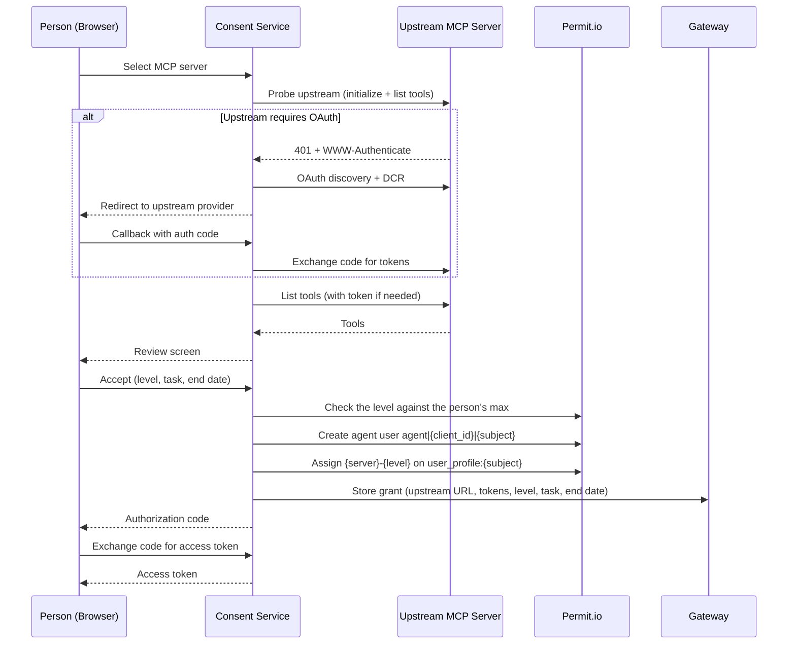

The Consent Service is the part of Permit MCP Gateway that people see in the browser. It signs a person in, lets them approve an MCP client (an agent) on one MCP server, and gives them pages to review, edit, and revoke what they approved. This page is for gateway admins who roll out the gateway and support people through consent, and for anyone who debugs a connection.

The Consent Service is the OAuth 2.1 authorization server of each gateway host, served on the host's own subdomain, for example `https://acme-zesty-magenta-11.agent.security`. For the admin steps that come before a person's first consent (create a host, import an MCP server, grant the person access), see the [Quickstart](/permit-mcp-gateway/quickstart).

| Fact | Value |
| --- | --- |
| Where it runs | On each host's subdomain, `https://<subdomain>.agent.security` |
| What a person approves | One agent (MCP client) on one MCP server, at a trust level, with a task and an end date. The gateway stores this approval as a **grant**. |
| Grants per agent | One per MCP server. An agent can hold grants on several servers at once. |
| When the person is asked again | When the agent has no grant for the server, or the grant is paused, revoked, or expired. An active grant skips the consent screen. |
| Self-service pages | **Your MCP agents** (`/my-mcp-agents`), **Your approvals** (`/approvals`), **Your passkeys** (`/passkeys`) |

## The consent flow step by step \{#the-user-journey}

The consent flow runs the first time a person connects an MCP client, such as Cursor, VS Code, Claude Desktop, or Claude Code, to an MCP server through the gateway. It runs again for that server when the grant stops serving the agent. See [When the person is asked again](#re-consent).

### 1. The MCP client starts OAuth \{#1-mcp-client-triggers-oauth}

The person adds a gateway URL to the MCP client. Each MCP server's page in the Platform shows its URL, `https://<subdomain>.agent.security/mcp/<server_key>`, with configuration snippets for each client. The host-level URL `https://<subdomain>.agent.security/mcp` also works and lets the person pick the server during consent.

The client connects and receives `401 Unauthorized`. The client reads the gateway's OAuth metadata (`/.well-known/oauth-protected-resource`, which points to the authorization server), registers itself through Dynamic Client Registration (DCR), and opens a browser window on the host.

### 2. The person signs in \{#2-login}

The **Sign In** page shows the sign-in methods the admin turned on for the host. A host starts with email and password: **Email**, **Password**, **Forgot password?**, **Sign In**, and **Create Account**. For the other methods (email code, passkeys, Google, GitHub, Microsoft, and SAML or OIDC single sign-on), see the [Authentication methods reference](/permit-mcp-gateway/authentication-methods).


A person without an account clicks **Create Account** and enters **Name**, **Email**, **Password**, and **Confirm Password**. On hosted gateway hosts, a new account verifies its email address first: the **Check your email** page asks the person to open the verification link, and offers **Resend verification email**.


### 3. The person selects an MCP server \{#3-server-selection}

The **Connect MCP Server** page says which client wants to connect, for example "Acme Research Agent wants to connect to an MCP server". It lists the MCP servers an admin granted the person access to. Each card shows the server's name, its URL, its tools, and a trust badge, such as **High Trust**, which is the highest trust level the admin allows the person on that server. The person clicks a card and then **Select**. **Refresh list** reloads the list.

When the host has **Allow Dynamic MCP Connections** on, the page also shows **or enter a custom URL**, where the person enters any MCP server URL and clicks **Connect**. See [Platform reference](/permit-mcp-gateway/platform) for the host setting.


The page skips the server list when the client connected through a per-server URL, `/mcp/<server_key>`: the Consent Service connects to that server directly. If the person has no access to that server, the page shows `MCP server "<server_key>" is not available or you don't have access to it.`

:::note Empty server list
If an admin hasn't granted the person access to any MCP server, the page shows "No MCP servers available. Contact your administrator to grant you access to MCP servers." An admin grants access on the person's page under **Humans** (**MCP Server Access**, then **Grant Access**). The person then clicks **Refresh list**. See [Manage humans and agents](/permit-mcp-gateway/managing-humans-and-agents).


:::

### 4. The person signs in to the upstream MCP server \{#4-upstream-oauth}

After the person selects a server, the page shows "Connecting to server..." while the Consent Service connects to the upstream MCP server and lists its tools.

If the upstream server requires OAuth, such as GitHub or Linear, the page shows **Authorization Required** ("This server requires you to sign in first.") with a **Sign in to Continue** button:

1. The Consent Service discovers the upstream server's OAuth authorization server.
2. The Consent Service registers as an OAuth client through DCR. If the upstream server doesn't support DCR, the page asks for an OAuth client ID and client secret (**Manual OAuth Configuration Required**) and shows the redirect URI to register with the provider.
3. The browser goes to the upstream provider, where the person approves access.
4. On the way back, the Consent Service exchanges the authorization code for upstream tokens. The gateway stores the tokens in the person's grant and uses them for the agent's calls to that server.

If the upstream server doesn't require OAuth, the flow skips this step.

### 5. The person reviews the approval \{#5-trust-level-selection}

The review screen shows, from top to bottom:

1. **Target Server**: the server's name and URL, and **Change** to go back to the server list. A server the person entered by URL has a **Custom URL** badge.
2. **Purpose, set by your admin**: the server's workflow intent, when the admin wrote one.
3. **Name this agent (optional)**: a display name admins see in the Platform instead of the app's name. The name is used only the first time this app connects.
4. **Trust Level**: a slider with **Low**, **Medium**, and **High**, and **Max** showing the highest level the admin allows.
5. **Task and expiry**: who states the agent's task, and when access ends.
6. **Available Tools**: each tool with an **Allowed** or **Denied** badge for the selected level, the counts (for example "2 allowed · 1 denied"), and the **Ask me before this agent changes or deletes anything** switch.
7. "You will be redirected to" the client's callback URL.
8. **Deny** and **Accept**.


#### Trust level

| Trust level | Tools the agent can call |
| --- | --- |
| **Low** | Read-only tools, for example `get_issues` or `list_repos` |
| **Medium** | Low tools and write tools, for example `create_issue` or `send_message` |
| **High** | Low, medium, and destructive tools, for example `delete_repo` or `remove_member` |

The slider shows all three levels. Levels above **Max** are muted, and the person can't select them. The Consent Service checks the level again when the person accepts. See [Max trust level](/permit-mcp-gateway/permit-integration#max-trust-level-three-layers-of-enforcement).

Where a tool's level comes from depends on the server:

- **A server an admin imported:** the admin sets each tool's level, and the tool shows, for example, "Requires medium trust (set by admin)". A tool the admin didn't give a level is blocked.
- **A server the person entered by URL:** the level comes from keywords in the tool name, the same classification the admin sees at import. The person can change a tool's level, up to **Max**.

#### Task and expiry

By default, the section reads "Acme Research Agent reports its own task when it connects." and "Access never expires." **Advanced** opens two choices:

- **I set the task**: "You write it. The agent can't change it." The person answers "What should Acme Research Agent do on DeepWiki?" in up to 500 characters. When the host has **Require Agent Identity** on, which also turns on the **Agent intent** layer, the agent's task at registration is compared with this task, and the agent's **Sessions** card shows whether it fits. On Permit's hosted gateway a task that doesn't fit is recorded, not blocked; see [Check agent identity and intent](/permit-mcp-gateway/advanced-features). When the host's Guardian is on, it grades each call against this task as well as the server's purpose.
- **Agent reports its task** (default): "The agent describes it, as today." A note warns that "A compromised agent can describe a task that excuses a harmful call." and lists what is still checked on every call: the trust level, and the server's purpose when the Guardian checks it.

**Access ends** offers **1 hour**, **1 day**, **7 days**, **Custom** (a date and time in the person's local time, from 5 minutes to 90 days ahead), and **Forever**. Until the person picks one, **I set the task** ends access in **7 days**, and **Agent reports its task** never ends it.


For the host settings behind the task check and the Guardian, see [Check agent identity and intent](/permit-mcp-gateway/advanced-features).

#### Ask me before this agent changes or deletes anything

The switch at the top of **Available Tools** applies to this server. It is off for a first approval. When the person turns it on:

- The tools split into **Asks you first** (rows marked "Changes data" or "Deletes data") and **Runs without asking**.
- Each write or delete call waits for the person's approval, and the person gets an email. Reads run without asking. See [Your approvals](#your-approvals).

The screen sorts tools by name and by the hints the server publishes. The gateway decides at call time, so a tool the screen lists under **Asks you first** can run without asking when the admin trusts the server's read-only hints.

When the switch was on and the person turns it off, **Accept** first asks the person to confirm it's them, with an emailed code or a passkey. See [Sign-in check for approvals](/permit-mcp-gateway/authentication-methods#sign-in-check-for-approvals).

### 6. The person accepts \{#6-authorize}

The person checks the redirect notice ("You will be redirected to ..."), which names the address the browser returns to, and clicks **Accept**. **Deny** ends the flow, and the client gets no access.

If the browser doesn't return to the client, the page shows **Completed.** and "You can close this tab."

### 7. The Consent Service saves the approval \{#7-sync-and-redirect}

When the person accepts:

1. **Level check:** the Consent Service checks the level against the admin's max for the server, and rejects a higher level with `403`.
2. **Permit:** the Consent Service assigns the agent user `agent|{client_id}|{subject}` the role `{server}-{level}` on the person's profile, `user_profile:{subject}`, and creates the agent user if it doesn't exist. Each person who approves the same client gets their own agent user.
3. **Grant:** the gateway stores the grant for this client, person, and server: the upstream URL and tokens, the trust level, who states the task (and the task), and the end date. When the level goes up, the gateway stores the grant before Permit raises the role. When it goes down, Permit lowers the role first.
4. **Code and token:** the Consent Service issues an OAuth authorization code, and the client exchanges it for an access token.
5. **Redirect:** the browser returns to the MCP client, which calls tools through the gateway.

**Result:** the agent appears on the **Agents** page of the Platform under the person, the approval appears on the **Consent Grants** page, and the agent's calls appear on its **Audit Logs** tab. See [Audit logs](/permit-mcp-gateway/audit-logs).

## When the person is asked again \{#re-consent}

The gateway keeps one grant per client, person, and MCP server. The person sees the consent screen for a server only when the client's grant for that server can't serve it:

- **No grant:** the client connects to this server for the first time, or the grant was deleted, or 90 days passed without use.
- **Paused:** three of the agent's sessions were blocked within 24 hours, for example because its identity drifted, or an admin paused it.
- **Revoked:** the person or an admin revoked it.
- **Expired:** the end date the person picked has passed.

An active grant skips the consent screen: when the client signs in again, the browser returns to the client without asking.

When a grant stops serving, the gateway answers the agent's request with HTTP `401`, JSON-RPC error code `-32009` (`Reconsent required: <reason>`), and an OAuth challenge. The MCP client runs OAuth again, and the person sees the consent screen for that server. A call that was waiting for an approval when the grant stopped fails with the same code.

For a paused grant, the **Task and expiry** section shows "Your approval of Acme Research Agent on DeepWiki is paused" with the reason and the time, and "Accept approves it again." The task field starts from the task the person saved.

### Several servers for one client

An agent can hold grants on several servers. Approving a second server doesn't change the first one. A client that connects through `/mcp/<server_key>` uses the grant for that server. A client that connects through the host-level `/mcp` uses the grant the person approved last.

### Change an agent's trust level

- **An admin can only lower it.** On the agent's page in the Platform, the **Access** card lowers the level from the agent's next call. See [Manage humans and agents](/permit-mcp-gateway/managing-humans-and-agents).
- **Only the person can raise it.** The person revokes the agent on [Your MCP agents](#your-mcp-agents), then reconnects it from the MCP client and picks a higher level on the consent screen, up to their max trust. Reconnecting while the grant is active doesn't show the consent screen.

## How long an approval lasts \{#session-lifecycle}

### Grants and transport sessions \{#session-types}

| Record | Where it lives | What it holds |
| --- | --- | --- |
| **Grant** | Gateway (Redis), one per client, person, and MCP server | The upstream URL and OAuth tokens, the trust level, the task settings, and the end date. Survives MCP client restarts. |
| **Transport session** | Gateway memory | The live MCP-over-HTTP connection. The gateway opens a new transport session from the grant when the client reconnects. |

### Session expiry

| Event | When | What happens |
| --- | --- | --- |
| **End date** | The time the person picked under **Access ends** | The gateway marks the grant expired, and the Consent Service removes the agent's role in Permit. The next request asks the person again. |
| **No use for 90 days** | 90 days after the last authorized request. Each request renews the timer, at most once a minute. | The gateway drops the grant. The next request asks the person again. |
| **Revoked** | Immediately, from the agent's next request | The person revokes on **Your MCP agents**, or an admin revokes in the Platform. The Consent Service removes the agent's role in Permit. |
| **Paused** | Immediately, from the agent's next request | The grant serves nothing until the person approves it again. |
| **Admin removes the person's access to the server** | Immediately, from the agent's next call | Permit denies the calls of all the person's agents on that server. |

When an expired or revoked grant was the client's last one, the Consent Service also removes the client's sign-in tokens and consent.

Grants close to their end date show **Expiring soon** in the Platform and on **Your MCP agents**. The host's **Expiring consent grants** setting decides how early (2 days by default).

### Upstream token refresh \{#token-refresh}

If the upstream MCP server issued a refresh token, the gateway refreshes the upstream access token when it is within 5 minutes of expiry. The person doesn't sign in to the upstream provider again.

## Pre-select an MCP server in the gateway URL \{#pre-configured-urls}

Give people a per-server URL so the consent flow skips the server list:

```text
https://acme-zesty-magenta-11.agent.security/mcp/deepwiki
```

In this URL, `deepwiki` is the server key set at import. The **MCP URL** card on each MCP server's page in the Platform shows this URL and the client snippets. The person still signs in, reviews the approval, and accepts.

The host-level URL also takes an `upstream_mcp` query parameter with the upstream server's URL:

```text
https://acme-zesty-magenta-11.agent.security/mcp?upstream_mcp=https://mcp.deepwiki.com/mcp
```

- If the URL matches an MCP server the person can access, the consent flow selects that server.
- If it matches none and the host allows dynamic MCP connections, the consent flow connects to that URL as a custom server.
- If it matches none and the host doesn't allow dynamic MCP connections, the page shows "This host does not allow connecting to dynamic MCP servers. Contact your administrator."

:::info Access still required
A pre-selecting URL doesn't grant access. The person still needs an admin to grant access to the server. For sharing these URLs with a team, see [Set up hosts](/permit-mcp-gateway/host-setup).
:::

## Pages people use after consent \{#self-service-pages}

People manage their own approvals on the host's subdomain, for example `https://acme-zesty-magenta-11.agent.security`. The account menu in the bottom-left corner of every page lists **MCP agents** and **CLI and API agents** (under **Your agents**), **Your passkeys**, **Profile** (marked **Soon**), and **Log out**.


### Your MCP agents

`/my-mcp-agents` lists "Agents you approved as" the person's email, grouped by MCP server. Each row shows:

- The status: **Active**, **Expiring soon**, **Paused**, **Expired**, or **Revoked**.
- The agent's name and trust level, and an **Agent-reported** badge when the agent states its own task.
- The task, and when access ends, for example "Task set by you · Ends 2026-11-17 12:54 UTC, in 7 days".


The person can:

- **Edit** the task of an agent whose task they set. The gateway uses the new task once the agent registers again or opens a new MCP session. If the person's sign-in is older than the host's window, saving asks for an emailed code or a passkey first.
- Open **History** for one approval, or **All history** for every change on the host.
- **Revoke** an approval. The dialog says the agent "stops on its next request. To use it again, reconnect it from your MCP client and approve it."

A paused row shows why the grant is paused and "Reconnect Acme Research Agent in your MCP client to approve it again." **Review the task** edits the task first. Saving a task doesn't resume the agent; only approving it again does.

### Your approvals

When **Ask me before this agent changes or deletes anything** is on, each write or delete call of the agent waits for the person. The gateway emails the person a link to the call's approval page on the host. `/approvals` lists every call that waits for the person. With nothing waiting, it reads "Nothing waits for you right now."


The approval page ("An agent is waiting for you") shows what the call would do, its arguments, and why the person is asked. The person clicks **Approve** or **Reject**:

- If the person signed in within the host's window (15 minutes by default), the decision applies.
- If the sign-in is older, the person enters the code the gateway emails for that decision (it works once, for 5 minutes, with 5 tries) or clicks **Sign in again instead**.
- If the person has a passkey on the host, every decision is confirmed with the passkey.

If nobody decides in time, the page shows **Expired** and the call doesn't run. An admin can also decide the call from **Approvals** in the Platform. For the window, see [Sign-in check for approvals](/permit-mcp-gateway/authentication-methods#sign-in-check-for-approvals).

### Your passkeys

`/passkeys` lists the person's passkeys on this host, adds one (**Add a passkey**), and removes one. A passkey belongs to the host it was registered on. When the host doesn't offer passkeys to the person, the page reads "Passkeys are off".


For how passkeys change sign-in and approvals, see [Passkeys](/permit-mcp-gateway/authentication-methods#passkeys-webauthn).

### The host's landing page

Opening the host's address, for example `https://acme-zesty-magenta-11.agent.security`, shows the **Agent Security Gateway** page. It says "This page is not meant to be opened directly in your browser." and shows client setup tabs for the host-level URL `https://<subdomain>.agent.security/mcp`. A signed-in person also sees a **Your MCP agents** link and a **Manage your authorized agents** button.


## What the Consent Service does behind the screens \{#what-happens-behind-the-scenes}

This sequence shows the calls between the browser, the Consent Service, the upstream MCP server, Permit, and the gateway during one consent flow:



The diagram shows a first approval. When the level goes up, the gateway stores the grant before Permit raises the role.

### Tool discovery

When the person selects an MCP server, the Consent Service lists the upstream server's tools. On a server an admin imported, each tool's level is the one the admin set in Permit. On a server the person entered by URL, the level comes from keywords in the tool name, the same classification the admin sees at import (see [Platform reference](/permit-mcp-gateway/platform)). The **Allowed** and **Denied** badges update as the person moves the slider.

### Permit objects the consent flow uses \{#permit-relationship-creation}

| Permit object | Created by | Purpose |
| --- | --- | --- |
| Person user `human\|{subject}`, profile `user_profile:{subject}`, and the person's `owner` role on it | Consent Service, when the person signs in | Represents the person. |
| Profile-to-server relation, for example `medium` | Platform, when an admin grants access | The person's max trust level on the server. The Consent Service checks it before it accepts consent. |
| Agent user `agent\|{client_id}\|{subject}` | Consent Service, at consent | One person's use of one MCP client. |
| Agent role on the profile, for example `deepwiki-low` | Consent Service, at consent | The level the person approved for the agent on this server. |

The agent's effective trust level on a call is the lower of the agent's role and the profile-to-server relation, so the admin's max caps every agent of the person. For the full model, see [How Permit MCP Gateway works with Permit.io](/permit-mcp-gateway/permit-integration#the-userprofile-indirection-rebac).

## Next steps

- [Authentication methods reference](/permit-mcp-gateway/authentication-methods): configure how people sign in and how they confirm approvals.
- [Manage humans and agents](/permit-mcp-gateway/managing-humans-and-agents): grant access, set max trust levels, and lower or revoke agents.
- [How Permit MCP Gateway works with Permit.io](/permit-mcp-gateway/permit-integration): the policy model behind trust levels.
- [Audit logs](/permit-mcp-gateway/audit-logs): review the calls an agent makes after consent.
