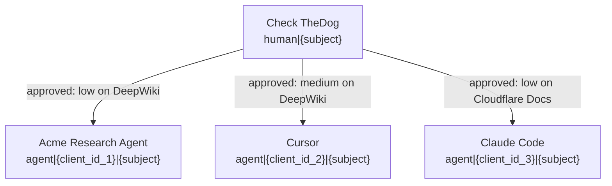
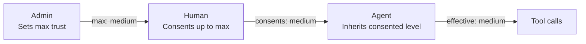
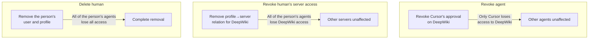

This page is for admins of Permit MCP Gateway. It explains how the gateway identifies **humans** (the people who sign in) and **agents** (one person using one MCP client), how trust passes from admin to human to agent, and how you grant, lower, block, and revoke access in the [admin dashboard](https://app.agent.security).

To create a host and import MCP servers first, see [Set up hosts for your organization](/permit-mcp-gateway/host-setup). The examples use the host `acme-zesty-magenta-11.agent.security`, the DeepWiki MCP server, the person Check TheDog, and the MCP client Acme Research Agent.

## Core concepts

### What is a human?

A **human** is a person who signs in on a host through the [consent flow](/permit-mcp-gateway/consent-service). Permit identifies a human as `human|{subject}`, where `{subject}` is the person's user ID. A person's account, and so their user ID, is the same on every host they sign in to.

A human doesn't call tools. A human **delegates** authority to an agent by completing the consent flow. During consent, the person:

- Signs in and proves their identity.
- Chooses an MCP server from the servers an admin granted.
- Selects the trust level to grant the agent, up to the max trust level the admin set.
- Optionally names the agent, sets its task, and chooses when access ends.

An admin can **pre-authorize** a person before they sign up. When you invite a person by email and grant MCP server access, the person can complete consent on first connection.

### What is an agent?

An **agent** is one person using one MCP client, such as Cursor, Claude Desktop, Claude Code, VS Code, or any other client that speaks the Model Context Protocol (MCP). Permit identifies an agent as `agent|{client_id}|{subject}`:

- `{client_id}` is the OAuth client ID the MCP client receives when it registers with the host before the consent flow.
- `{subject}` is the user ID of the person who approved it.

Because the person is part of the key, two people who approve the same MCP client get two separate agents, each with its own access. When an MCP client registers again, for example after a reinstall, it gets a new client ID. The admin dashboard groups those registrations under the same agent and lists them on the agent's **Registrations** card.

The gateway creates an agent when a person completes consent. You can't create an agent by hand. An agent appears on the **Agents** page after the person consents. Its name is the MCP client's registered name, or the name the person entered in **Name this agent** during consent. Admins can [rename it](#rename-an-agent).

### One human, many agents

When one person connects several MCP clients, each client is a **separate agent** with its own permissions:



Each agent gets its own grant for each MCP server, with its own trust level, task, and end date. As a result:

- Check TheDog can grant Cursor Medium trust on DeepWiki and grant Acme Research Agent only Low trust on the same server.
- Revoking Cursor's access doesn't affect Acme Research Agent.
- The audit log records each agent's tool calls separately.

## How trust flows

Trust passes through three parties. The **admin** sets a ceiling, the **human** selects a level within that ceiling, and the **agent** receives the result.



### The trust calculation

An agent's effective trust level on an MCP server is the lower of the admin's max trust level and the level the person approved for the agent:

```
effective_trust = min(admin_max_trust, human_consented_trust)
```

The consent screen doesn't offer levels above the max, so the third and fifth rows below happen when an admin lowers the max after the person consented.

| Admin sets max | Agent approved at | Agent gets |
| --- | --- | --- |
| High | High | **High** |
| High | Medium | **Medium** (the person chose less) |
| Medium | High | **Medium** (admin cap applies) |
| Medium | Medium | **Medium** |
| Low | Medium | **Low** (admin cap applies) |
| Low | Low | **Low** |

The gateway enforces the ceiling in three places: the Permit policy (derived roles), the consent screen (levels above the max can't be selected), and the consent API (a server-side `403` rejection). See [Max trust level: three layers of enforcement](/permit-mcp-gateway/permit-integration#max-trust-level-three-layers-of-enforcement).

On a static MCP server, the gateway checks each tool call twice, at the same time: once for the agent (`agent|{client_id}|{subject}`) and once for the person (`human|{subject}`). Both checks must allow the call.

### What each trust level allows

| Trust level | Tool types | Examples |
| --- | --- | --- |
| **Low** | Read-only operations | `get_issues`, `list_repos`, `read_wiki_contents` |
| **Medium** | Low + write operations | `create_issue`, `update_record`, `send_message` |
| **High** | Low + medium + destructive operations | `delete_repo`, `remove_member`, `destroy_environment` |

## Managing humans

### Viewing the Humans page

The **Humans** page (**Human Users**) lists the people who signed up on the current host, with their **Name**, **Email**, **Identity ID**, and **Type**. People you invited who haven't signed up yet appear above the table under **Pending Invites**. Click a name to open the person's page.


### Invite a person by email

Invite a person to pre-authorize them before they sign up:

1. Open **Humans** and click **Invite by Email**.
2. Enter the **Email Address**.
3. Click **Invite**.

The person appears under **Pending Invites**. Their access activates when they register on the host with this email. An invite has no **MCP Server Access** card, so grant server access from the MCP server's page: in **Authorized Humans**, click **Grant Access** and pick the person under **Pending Invites**, or invite them there directly on the **Invite by Email** tab.


### The person's page

A person's page has **Overview** and **Audit Logs** tabs. The **Overview** tab has these cards:

| Card | Contents |
| --- | --- |
| **User Information** | The person's user ID, first name, last name, and email. |
| **MCP Server Access** | The MCP servers the person can access during consent, each with a **Trust level** select (the max trust level) and a **Revoke access** button. |
| **Connected Agents** | The person's agents, each with its server, trust level, and sessions. |
| **Approval verification** | How the person proves it's them before deciding their agents' approvals: **Sign-in or emailed code**, or **Passkey**. For a person with passkeys, **Reset to sign-in** removes their passkeys on the host and emails them. |
| **Danger Zone** | **Delete User**. |

The **Audit Logs** tab lists the person's agents' calls. See [Audit logs](/permit-mcp-gateway/audit-logs).


### Granting access to an MCP server

A person can't complete the consent flow for an MCP server until an admin grants access to that server. Until then, the consent screen says "No MCP servers available. Contact your administrator to grant you access to MCP servers."

1. Open **Humans** and select the person.
2. In **MCP Server Access**, click **Grant Access**.
3. In the **Grant MCP Server Access** dialog, pick the **MCP Server**.
4. Set **Max trust**. The default is **Low**.
5. Click **Grant Access**.


You can also grant access from the MCP server's page: in **Authorized Humans**, click **Grant Access**. The **Grant Human Access** dialog has an **Existing User** tab and an **Invite by Email** tab.

The dialog explains the rule: "The effective agent trust level is min(agent's consent trust, this level)." If you set the max to Medium, the consent screen doesn't let the person select High.

To confirm the grant, have the person connect an MCP client. The granted server appears in the consent screen's server list.


### Updating max trust level

To change a person's max trust level for an MCP server, select a new level in the server's **Trust level** select on the person's page:

- **Lowering** the max trust level caps every existing agent of that person on that server. The person doesn't need to consent again, because the `min()` calculation applies the new ceiling.
- **Raising** the max trust level doesn't raise existing agents. The person revokes the agent on **Your MCP agents**, then reconnects it from the MCP client and picks a higher level on the consent screen, up to their max trust. See [Give a user a higher trust level](#a-user-needs-higher-trust-than-i-originally-set).

### Revoking a human's access

To revoke a person's access to an MCP server, click **Revoke access** (the trash button) on the server's row in **MCP Server Access**. Revoking removes the profile-to-server relation in Permit. The effect cascades to the person's agents:

- **Every agent** acting for that person is denied on its next tool call to that server.
- The person's own check on that server denies too, so a new consent for that server isn't possible.
- The person's access to **other** MCP servers doesn't change.

To restore access, grant access again.

### Viewing connected agents

The **Connected Agents** card lists every agent that connected for the person. For each agent, you see its name, its MCP server, its trust level, how many of its sessions are active and how many are blocked, and a badge when sessions are missing an intent. Click an agent's name to open its page.


Use this card to see all the access a person has delegated.

### Delete a person

In **Danger Zone** on the person's page, click **Delete User** and confirm. Deleting a person removes their Permit user, their profile, and its relationships, so all of their agents lose access to all servers. The person's sign-in account isn't deleted: their next sign-in creates their Permit user and profile again, and an admin grants server access again. For a pending invite, the button is **Revoke Invite**.

## Managing agents

### Viewing the Agents page

The **Agents** page lists every agent on the current host. Each agent is one person using one MCP client.

- **List** view: a tree of people, their agents, and each agent's sessions, with the columns **Name**, **Current intent**, **Servers**, **Trust**, **Status**, and **Last seen**. Use **Expand All** and **Collapse All** to open the tree.
- **Map** view: people, agents, and servers connected by lines that show each agent's effective trust level.
- Filters: **Search** (person, client ID, session, or intent), **Person**, **Agent**, **Server**, **Session status** (**All**, **Active**, **Blocked**, or **Ended**), and **Intent missing only**.

A session shows **Intent missing** when the agent didn't declare an intent in it, for example because the host doesn't require agent identity. See [Check agent identity and intent](/permit-mcp-gateway/advanced-features).

Each agent row has a menu with **View details**, **Rename**, and **Revoke**. Each active session row has **Block Session**.


### Understanding the agent page \{#understanding-agent-metadata}

An agent's page shows the agent's name with a rename button, "On behalf of" the person "on" the server, and badges for the agent type and trust level. It has **Overview** and **Audit Logs** tabs. The **Overview** tab has these cards:

| Card | Contents |
| --- | --- |
| **Identity check: sent to re-approval** | Shown only when the gateway's identity check sent the agent back to the person for re-approval. |
| **Sessions** | Each MCP session the agent opened on the server, with the intent it declared, its status, and **Block Session**. |
| **Access** | The agent's status, task, who set the task, and when it was approved, plus **Admin actions**: lower its **Level** or **Revoke access**. |
| **Registrations** | The OAuth client IDs that belong to this agent. Each new registration of the MCP client adds a client ID. |


### Sessions and intents

The **Sessions** card lists each MCP session the agent opened on the server. When the host requires agent identity, each session shows the intent sentence the agent declared, which intent it is (for example **Intent 1 of 1**), whether the gateway **Accepted** it, and whether it **Fits** the task. Click **Show intents** to see every intent the agent declared in the session. A session without a declared intent shows **Intent missing**.

### Block a session

Block a session to stop an agent that went off track in one session, without revoking the agent:

1. On the **Agents** page or the agent's **Sessions** card, click **Block Session** on the session.
2. Confirm with **Block Session** in the **Block session ...?** dialog.

The gateway refuses every later request on that session. The agent has to open a new session and register again. Other sessions of the agent keep working.

:::warning
Three blocked sessions within 24 hours send the agent back to the person for re-approval. The gateway counts blocks per server. After a block, the agent's **Sessions** card shows how many of the three the agent has used in the last 24 hours.
:::

### Lower an agent's trust level \{#modifying-agent-trust-levels}

Admins can only lower an agent's trust level. The **Access** card explains: "Lower only: an agent never gets more than the person it acts for approved when connecting it."

1. Open **Agents** and select the agent.
2. In the **Access** card, under **Admin actions**, select a lower **Level**. Levels above the current one are locked.
3. Confirm with **Lower to `<level>`** in the **Lower `<agent>` to `<level>`?** prompt.

From its next call, the agent can run only tools at the new level or below on that server.


Only the person can raise the level again. The person revokes the agent on **Your MCP agents** (`https://<subdomain>.agent.security/my-mcp-agents`), then reconnects it from the MCP client and picks a higher level on the consent screen, up to their max trust. Reconnecting while the grant is active doesn't show the consent screen.

### Rename an agent

1. Click the pencil next to the agent's name, or select **Rename** in the agent row's menu on the **Agents** page.
2. In the **Rename agent** dialog, enter a **Display name**. Clear the field to show the MCP client's registered name again.
3. Click **Save**.

The new name applies to the agent wherever it appears. The agent's identity, access, and links don't change.

### Revoking an individual agent

To revoke one agent's access to an MCP server:

1. Open **Agents** and select the agent.
2. In the **Access** card, click **Revoke** next to **Revoke access**. You can also select **Revoke** in the agent row's menu on the **Agents** page.
3. Confirm with **Revoke** in the **Revoke `<agent>` for `<person>`?** dialog.

The gateway revokes the agent's approval on that server across all its client IDs, and the agent stops on its next request. The person's other agents and the person's access grant don't change. The person can approve the agent again by reconnecting the MCP client.

## Review consent grants

The **Consent Grants** page lists every approval a person gave an MCP agent on the current host, one row per person, agent, and server:

| Column | Contents |
| --- | --- |
| **Agent** | The agent's name. Click it to open the agent's page. |
| **Server** | The MCP server key. |
| **Level** | The approved trust level. |
| **Task** | The task the person set, or the note that the agent reports its own task. |
| **Ends** | When the approval ends, if it has an end date. |
| **Status** | **Active**, **Expiring soon**, **Paused**, **Expired**, or **Revoked**. |
| **Sessions** | How many of the agent's sessions are active. |

**Recent changes** shows the last five events on the host, such as "Approved at Low" for Acme Research Agent on deepwiki. Click **View all history** to open the **History** panel: every approval, change, pause, expiry, and revoke on the host, newest first. The **Expiring consent grants** section of **Settings** sets how early a grant shows **Expiring soon**.


## Revocation levels compared \{#revocation-three-levels}

| Action | What it does | Scope | How to restore |
| --- | --- | --- | --- |
| **Block a session** | Refuses every later request on that session | Only that session. Three blocked sessions in 24 hours send the agent for re-approval | The agent opens a new session and registers again |
| **Revoke an agent** | Revokes the agent's approval on that server and removes its role on the person's profile | Only that agent loses access to that server | The person reconnects and approves the agent again |
| **Revoke a human's server access** | Removes the profile-to-server relation | **All** agents acting for that person lose access to that server | An admin grants access again |
| **Delete a human** | Removes the person's user, profile, and relationships from Permit | **All** of that person's agents lose access to **all** servers | The person signs in again and an admin grants access again |



## Common scenarios

### Start your team with read-only access \{#i-want-to-give-my-team-read-only-access-initially}

When you grant MCP server access, keep the max trust level at **Low** for every person. People can consent only at Low, so their agents can call only read-only tools. Raise individual people to Medium or High when they need it.

### Revoke all agents of a user who left \{#an-employee-left--how-do-i-revoke-all-their-agents}

**Delete the human** on the person's page. Deleting the person removes their user profile from Permit, which removes the derived permissions of every agent that acted for them, on every MCP server.

### Allow Cursor but not Claude Desktop on a server \{#i-want-to-allow-cursor-but-not-claude-desktop-for-a-specific-server}

After both MCP clients complete consent, open **Agents** and revoke the Claude Desktop agent's access to the server. The Cursor agent keeps its access, because each agent's access is managed separately.

An agent exists only after the person completes consent with that MCP client, so you can't revoke a client's access before the client connects. Revoking doesn't stop the person from approving the client again by reconnecting.

### Give a user a higher trust level \{#a-user-needs-higher-trust-than-i-originally-set}

1. On the person's page, raise their max trust level for the server in **MCP Server Access**.
2. Ask the person to revoke the agent on **Your MCP agents**, then reconnect it from the MCP client and pick a higher level on the consent screen, up to their max trust. Reconnecting while the grant is active doesn't show the consent screen.

The agent keeps its current trust level until the person approves it again.

### Stop an agent that went off track \{#stop-an-agent-that-went-off-track}

Block the session on the **Agents** page or the agent's **Sessions** card. Only that session stops. If the agent keeps going off track, three blocked sessions within 24 hours send it to the person for re-approval. To stop the agent on the server right away, revoke it.

### Review everything an agent did \{#i-want-to-see-everything-an-agent-has-done}

Open **Agents**, select the agent, and open its **Audit Logs** tab. Each row shows when the call happened, the identity, the event, the decision, and the reason. **Show checks** expands a row to the **Agent check** and the **Person check**. For more, see [Audit logs](/permit-mcp-gateway/audit-logs) and [Reading audit logs in Permit](/permit-mcp-gateway/permit-integration#reading-audit-logs).


## Next steps

- [Consent Service](/permit-mcp-gateway/consent-service): what people see when they grant trust to an agent.
- [Permit integration](/permit-mcp-gateway/permit-integration): the roles and relations behind the trust calculation.
- [Audit logs](/permit-mcp-gateway/audit-logs): investigate allowed and denied tool calls.
- [Human-in-the-loop approvals](/permit-mcp-gateway/human-in-the-loop): require admin approval for sensitive tools.
- [Check agent identity and intent](/permit-mcp-gateway/advanced-features): agent identity, intents, and the Guardian.
