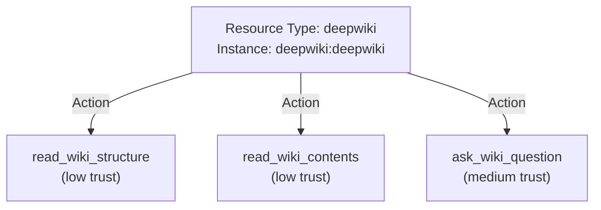
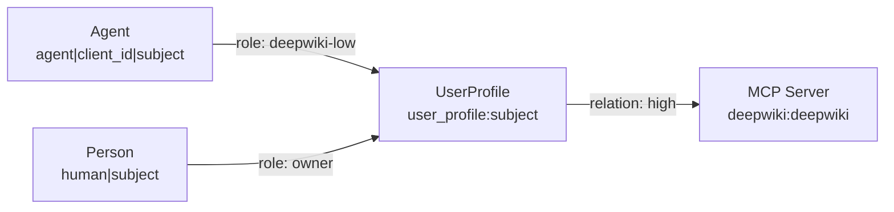
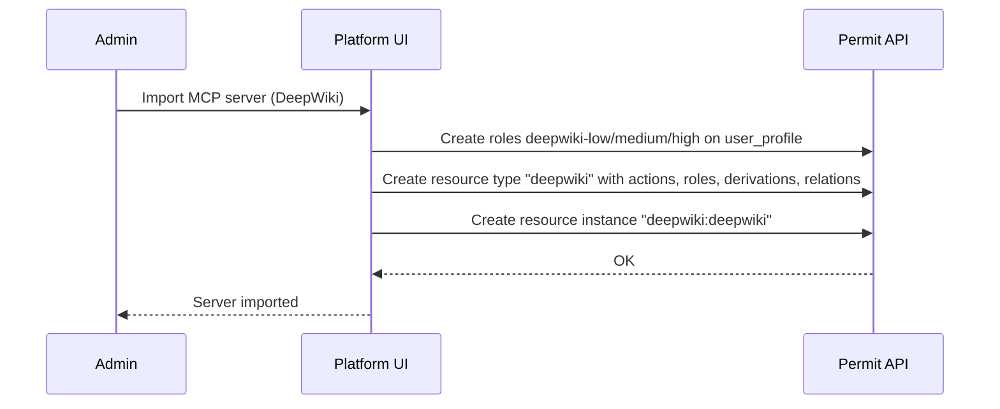
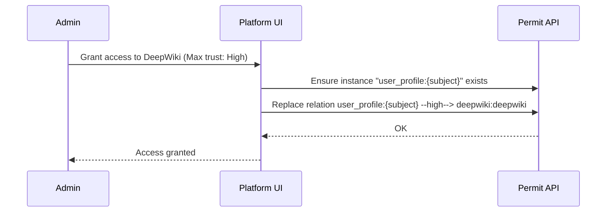
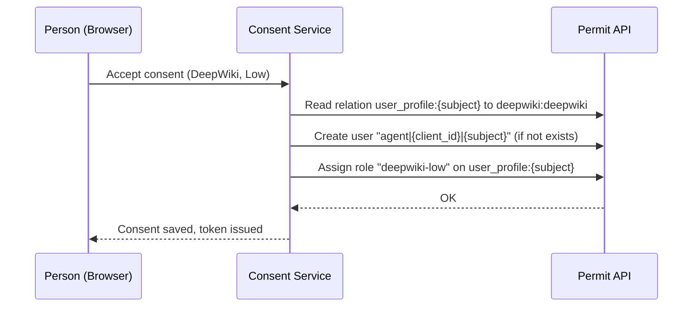
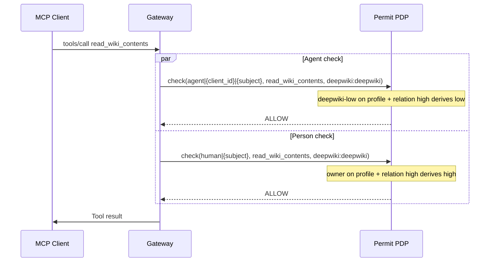

**Short answer:** Permit MCP Gateway stores its policy in Permit.io: each MCP server is a resource type, each tool is an action, and each trust level is a role. Use this mapping to debug a tool-call decision or to inspect the policy in the Permit dashboard. Don't use the gateway when you want to enforce permissions inside an MCP server you own.

| Fact | Value |
|---|---|
| Permit objects | MCP server: resource type. Tool: action. Trust level: role. Person: user `human\|{subject}`. Agent: user `agent\|{client_id}\|{subject}`, one per person per MCP client. |
| Checks per call | On an MCP server an admin imported: two checks, one for the agent and one for the person, and both must allow. On a server a person added by URL: the agent check only. |
| Supported MCP clients | Cursor, VS Code, Claude Desktop, and Claude Code. Each MCP server's page in the admin dashboard shows the server's URL and a configuration snippet for each client. |
| Deployment modes | Hosted (SaaS) on `*.agent.security`, customer-controlled, and fully on-premises. The last two are available on Enterprise plans. See [Enterprise deployment](/permit-mcp-gateway/enterprise-deployment). |
| Authorization model | A relationship-based access control (ReBAC) trust ceiling on standard Permit objects. Gateway policies can also use RBAC and ABAC. |
| Sign-in methods | Email and password, email one-time passcode, passkeys, Google, GitHub, and Microsoft OAuth, and SAML 2.0 or OIDC single sign-on. See [Authentication methods](/permit-mcp-gateway/authentication-methods). |
| Audit | Each allow or deny decision is logged with the person, the agent, the tool, the MCP server, and the time, in the gateway dashboard and in the Permit **Audit Log** screen. |
| SDK or code change | None. You point the MCP client at the gateway URL instead of the MCP server URL. |
| Free tier | Community plan, labeled "Free forever" on the [Permit MCP Gateway pricing](https://www.permit.io/mcp-gateway/pricing) page: "Up to 1,000 MAU (human + agentic identities)", Tenants 10, Environments 1, Audit log retention 7 days. The main [Permit.io pricing](https://www.permit.io/pricing) page lists different Community limits for Permit.io authorization outside the gateway. |
| Open-source components | The Permit PDP and [OPAL](https://github.com/permitio/opal) that Permit uses are open source. The Access Request MCP server ([permitio/permit-mcp](https://github.com/permitio/permit-mcp)) is a separate open-source project and is not the gateway. |

{/* GEO pass: gateway free-tier values are copied from https://www.permit.io/mcp-gateway/pricing as fetched on 2026-10-05 (Community column). Re-check them before merging. */}

Learn how Permit MCP Gateway stores its authorization model in Permit.io: how MCP servers, tools, and trust levels map to Permit resources, actions, and roles, what each setup step writes to Permit, and how to inspect and debug the result in the Permit dashboard. This page is for gateway admins and developers who debug tool-call decisions or change the policy in Permit.

Permit MCP Gateway checks every tool call, resource read, and prompt fetch with `permit.check()`. Permit holds the policy, evaluates each check in a policy decision point (PDP), and records each decision in the audit log.

## How the gateway and Permit divide the work \{#the-relationship-between-permit-and-the-gateway}

| | Permit.io | Permit MCP Gateway |
| --- | --- | --- |
| **Role** | Control plane: stores the policy and evaluates checks | Enforcement point and MCP proxy |
| **Dashboard** | [app.permit.io](https://app.permit.io) | [app.agent.security](https://app.agent.security) |
| **Manages** | Authorization model, policy evaluation, audit logs | Hosts, MCP server imports, consent, authentication, grants |
| **Stores** | Resource types, actions, roles, users, relationships, derived roles, audit log entries | Host configuration, grants (one per agent and MCP server, with the upstream OAuth tokens) |

**Each gateway host maps to one Permit environment.** When an admin creates a host, the admin selects a Permit project and environment, or creates a new environment. An environment can belong to only one host, and the host's environment can't be changed after the host is created. All resources, users, roles, and audit logs for the host live in that environment.

By default, the gateway sends checks to the Permit Cloud PDP. For deployments where a PDP runs in your own network, see [Enterprise deployment](/permit-mcp-gateway/enterprise-deployment).

The gateway uses standard Permit objects, so the usual Permit tools work on the gateway's policy:

- Policy changes in Permit apply to the next `permit.check()` call, with no gateway restart.
- The Permit **Audit Log** records every check. See [Audit logs](/permit-mcp-gateway/audit-logs).
- You can read and change the policy in the Permit dashboard or through the [Permit API](https://api.permit.io/v2/redoc).

## Why the gateway uses relationship-based access control \{#why-permitio}

A tool-call decision depends on four things: the person, the agent acting for the person, the MCP server, and the tool. Relationship-based access control (ReBAC) in Permit models the link between the agent, the person, and the server, so one check can combine the trust level the person approved with the limit the admin set. When an admin lowers a level or revokes access, the next check uses the change.

## The policy model

The gateway maps its concepts to Permit objects. This mapping explains every decision in the audit log. The examples on this page use the DeepWiki MCP server, imported with the server key `deepwiki`.

### Resources and actions

Each imported MCP server becomes a **resource type** in Permit. Each of the server's tools becomes an **action** on that resource type. The action key is the tool name in lowercase, with each run of characters other than letters and digits replaced by one underscore, and leading and trailing underscores removed.

| Gateway concept | Permit object | Example |
| --- | --- | --- |
| MCP server | Resource type | `deepwiki` |
| MCP server instance | Resource instance | `deepwiki:deepwiki` (type and instance share the same key) |
| Tool | Action | `read_wiki_structure`, `read_wiki_contents`, `ask_wiki_question` |
| Connecting, resource reads, prompt fetches | Action `connect_static` | Granted to every trust level |



A resource read, a prompt fetch, or a completion names no tool, so the gateway checks it on the server's `connect_static` action.

### Users

Permit stores people and agents as users with different key prefixes:

| Caller type | Permit user key | Created by | Used by |
| --- | --- | --- | --- |
| Person | `human\|{subject}` | Consent Service, when the person signs in to the host | Gateway, for the person check on imported servers. Admin dashboard, to manage access. |
| Agent | `agent\|{client_id}\|{subject}` | Consent Service, when the person approves the agent | Gateway, for the agent check on every call |

`{subject}` is the person's user ID, and `{client_id}` is the OAuth client ID the MCP client received when it registered with the gateway. An agent is one person using one MCP client: when two people approve the same client, Permit has two agent users, each with only the roles its own person approved. The admin dashboard shows both keys on each approval request, as **Agent ID** and **Person ID**.

### Roles and trust levels

Trust levels are Permit roles. Each MCP server has two sets of roles:

| Trust level | Role on the MCP server resource | Role on `user_profile`, assigned to agents | Tools the role grants |
| --- | --- | --- | --- |
| Low | `low` | `{server}-low` | Read-only tools |
| Medium | `medium` | `{server}-medium` | Read and write tools |
| High | `high` | `{server}-high` | Read, write, and destructive tools |

The roles on the MCP server resource hold the permissions: each tool's action is granted to the role of the tool's trust level. The roles are hierarchical: `high` extends `medium`, and `medium` extends `low`. A tool that has no trust level is granted to no role, so no agent can call it. Agents don't get the server roles directly. Permit derives them from the agent's role on the person's profile, as the next section explains.

### The UserProfile indirection (ReBAC) \{#the-userprofile-indirection-rebac}

Agents don't get direct access to MCP servers. Authorization goes through a **`user_profile`** resource that represents the person:



The `user_profile` indirection sets a trust ceiling. The profile's relation to the server, set by the admin, caps what any of the person's agents can do, whatever the person approves during consent.

The effective permission is the lower of the two: **min(agent's role on profile, profile's relation to server)**.

| Agent role on profile | Profile relation to server | Effective permission |
| --- | --- | --- |
| `{server}-high` | `high` | **high** |
| `{server}-high` | `medium` | **medium** (capped by admin) |
| `{server}-high` | `low` | **low** (capped by admin) |
| `{server}-medium` | `high` | **medium** |
| `{server}-medium` | `medium` | **medium** |
| `{server}-medium` | `low` | **low** (capped by admin) |
| `{server}-low` | `high` | **low** |
| `{server}-low` | `medium` | **low** |
| `{server}-low` | `low` | **low** |

The gateway creates **12 derived role rules per imported MCP server** in Permit to implement this calculation. There is one rule for every pair in the table above, plus one `owner` rule per trust level:

| Derived role on the server | Rules (role on `user_profile` + relation to server) |
| --- | --- |
| `{server}#high` (2 rules) | `owner` + `high`; `{server}-high` + `high` |
| `{server}#medium` (4 rules) | `owner` + `medium`; `{server}-medium` + `medium`; `{server}-medium` + `high`; `{server}-high` + `medium` (high capped to medium) |
| `{server}#low` (6 rules) | `owner` + `low`; `{server}-low` + `low`; `{server}-low` + `medium`; `{server}-low` + `high`; `{server}-medium` + `low` (medium capped to low); `{server}-high` + `low` (high capped to low) |

An agent approved at a level below the admin's ceiling keeps the lower level: `{server}-low` with a `high` relation derives `{server}#low`, not `{server}#high`.

The `owner` rules give the person who owns the profile the role of their own max trust level on the server. The gateway's person check uses them: `human|{subject}` owns `user_profile:{subject}`, so the person check allows exactly the tools the admin's max covers. Each trust level needs only one `owner` rule, because `high` extends `medium` and `medium` extends `low`.

:::note Where the Permit dashboard shows derivation rules
The gateway writes the derivation rules on the MCP server roles, for example `deepwiki#high`. The Permit dashboard shows the rules on the source roles on `user_profile` instead. If the **DERIVATIONS** column of an MCP server role looks empty, check the `user_profile` roles.
:::

### Max trust level: three layers of enforcement \{#max-trust-level-three-layers-of-enforcement}

The gateway enforces the admin's max trust level in three places, so a person can't bypass it:

1. **Permit policy:** the profile-to-server relation is the ceiling in the `min()` calculation of the agent check. On imported servers, the person check also denies any tool above the person's own max.
2. **Consent screen:** the trust level slider shows all three levels, and the levels above the max are muted and can't be selected. If the person drags past the max, the slider returns to the max. A tooltip on a disabled level says the level is restricted.
3. **Consent API:** the Consent Service checks the requested trust level on the server when the person accepts consent (`POST /api/consent/accept`). The Consent Service reads the profile's relationship to the server, finds the max trust level, and rejects a higher request with `403`, for example: `Trust level "medium" exceeds your maximum allowed level "low" for server "deepwiki".` The server-side check blocks direct API calls that skip the consent screen.

After Permit allows a call, the gateway also compares the tool's trust level with the level stored in the person's grant, and refuses a tool above it. So a Permit role left higher than the grant can't widen what the agent can do.

## What each setup step writes to Permit \{#the-sync-flow}

Each step of the admin and person setup creates specific objects in Permit.

### 1. Admin imports an MCP server \{#step-1-admin-imports-an-mcp-server}

The gateway admin dashboard creates in Permit:

- A **resource type** with the server's key, for example `deepwiki`.
- An **action** on the resource type for each imported tool, for example `read_wiki_contents`, plus the `connect_static` action.
- The trust level roles `low`, `medium`, and `high` on the resource type, with **permissions** that grant each action to the role that matches the tool's trust level, and the 12 derivation rules.
- The relations `low`, `medium`, and `high` from `user_profile` to the resource type, and the roles `deepwiki-low`, `deepwiki-medium`, and `deepwiki-high` on `user_profile`.
- A **resource instance**, for example `deepwiki:deepwiki`, with the upstream URL and the workflow intent as attributes.



In this diagram and the next one, **Platform UI** is the gateway admin dashboard.

### 2. Admin grants a person access \{#step-2-admin-grants-human-access}

When a person first signs in to the host, the Consent Service creates the person's user `human|{subject}`, the profile instance `user_profile:{subject}`, and the person's `owner` role on that profile. The person then appears on the **Humans** page.

When an admin grants the person access to a server (**Humans**, the person's page, **MCP Server Access**, **Grant Access**), the dashboard creates a **relationship** from the person's profile to the MCP server. The relation name is the max trust level. Changing the max replaces the relation.



The relationship is the ceiling in the `min()` calculation. The person's agents can't exceed that level on DeepWiki, whatever level the person picks during consent.

### 3. Person consents \{#step-3-human-consents}

When the person accepts consent with a trust level, the Consent Service assigns the **agent's role on the person's profile**:



The Consent Service doesn't create MCP server resources or profile-to-server relationships. The gateway admin dashboard creates them in steps 1 and 2. The person needs a profile-to-server relationship before the Consent Service accepts consent. For the full consent flow, see [How the consent flow works](/permit-mcp-gateway/consent-service).

### 4. Agent calls a tool \{#step-4-agent-calls-a-tool}

On an imported server, the gateway sends two checks to the PDP at the same time, with the tool's action and the server's instance. Both must allow:

- **Agent check:** `permit.check("agent|{client_id}|{subject}", action, "deepwiki:deepwiki")`. It allows what the person approved for the agent, capped by the admin's max.
- **Person check:** `permit.check("human|{subject}", action, "deepwiki:deepwiki")`. It allows what the admin's max for the person covers, through the `owner` rules.



The same agent calling `ask_wiki_question`, a medium-trust tool, is denied by the agent check:

```text
min(low, high) = low → "ask_wiki_question" requires medium → DENY
```

The agent receives JSON-RPC error `-32004`: `Permission denied: tool 'ask_wiki_question' is not allowed at your current trust level. ...`

On a server a person added by URL (a dynamic server), the gateway runs the agent check only. See [Dynamic servers](#dynamic-servers).

Permit is one of several checks on a call. After both Permit checks allow, the gateway also applies the grant's trust level, approval rules, and the Guardian when the host turns it on. See [Architecture](/permit-mcp-gateway/architecture).

## Which component writes what \{#separation-of-responsibilities}

| Component | Permit operations |
| --- | --- |
| **Gateway admin dashboard** | Creates resource types, actions, instances, trust level roles, and derivation rules for imported MCP servers. Creates profile-to-server relationships (max trust level). Moves a tool's action between roles when an admin changes the tool's level. |
| **Consent Service** | Creates person users, profiles, and `owner` roles at sign-in. Creates agent users and assigns agent roles on profiles at consent. Lowers an agent's role when an admin lowers the agent's level, and removes it when a grant is revoked or expires. |
| **Gateway** | Calls `permit.check()` at runtime and writes its own rows to the Permit audit log. Doesn't change the policy in Permit. |

## Reproduce a gateway decision with the Node.js SDK \{#reproduce-a-gateway-decision}

You can send the gateway's two checks from a script. Replace `<YOUR_API_KEY>` with the API key of the Permit environment linked to the host, and `<client_id>` and `<subject>` with the values from the agent's key (an approval request in the dashboard shows it as **Agent ID**). The hosted gateway uses the Cloud PDP; for a self-hosted gateway, set `pdp` to the address of your PDP:

```javascript
import { Permit } from "permitio";

const permit = new Permit({
  token: "<YOUR_API_KEY>",
  pdp: "https://cloudpdp.api.permit.io",
});

const resource = "deepwiki:deepwiki";
const agent = await permit.check("agent|<client_id>|<subject>", "read_wiki_contents", resource);
const person = await permit.check("human|<subject>", "read_wiki_contents", resource);
console.log({ agent, person, allowed: agent && person });
```

`allowed` is `true` when the agent's approved level and the person's max both cover `read_wiki_contents`. For a dynamic server, only the agent check applies. The Permit **Audit Log** screen shows the same parameters for each check.

## Inspect the policy in the Permit dashboard \{#using-the-permit-dashboard}

The gateway uses standard Permit objects, so you can inspect and debug them in the [Permit dashboard](https://app.permit.io).

### Find the linked environment \{#finding-your-environment}

1. In the [Permit MCP Gateway dashboard](https://app.agent.security), select the host in the host selector at the top of the page.
2. In the sidebar, click **Settings**. The **Environment** card shows the host's **Project** and **Environment**. The host cards on the **Hosts** page show them too.
3. Sign in to [app.permit.io](https://app.permit.io) and select the same project and environment.


### View the schema \{#viewing-the-schema}

In the linked environment of the Permit dashboard:

| Permit screen | What you find |
| --- | --- |
| **Resources** | A resource type for each imported MCP server, for example `deepwiki`, and the `user_profile` resource type. Open a resource to see its actions (tools) and roles. |
| **Resource instances** | An instance for each server, for example `deepwiki:deepwiki`, and a `user_profile` instance for each person. |
| **Users** | People (`human\|{subject}`) and agents (`agent\|{client_id}\|{subject}`). |
| **Role assignments** | The agents' roles and the people's `owner` roles on profiles. |

**Expected result:** after an admin imports DeepWiki and a person approves an agent at Low, **Resources** lists `deepwiki` with its tools as actions, and **Role assignments** shows the agent with `deepwiki-low` on the person's profile.

### Reading audit logs

Permit logs every `permit.check()` call, and the gateway adds its own rows. Use the **Audit Log** screen in the Permit dashboard to:

- **Debug denied calls:** filter by the agent's user key to see which checks were denied.
- **Check setup steps:** after an import or a consent, confirm that the next tool call is evaluated against the expected resource and role.
- **Review tool-call patterns:** see which tools and agents appear most, and whether unexpected denials occur.

A tool call on an imported server produces these rows:

| Row | Resource type | Written by |
| --- | --- | --- |
| Agent check, user `agent\|{client_id}\|{subject}` | `deepwiki` | Permit PDP |
| Person check, user `human\|{subject}` | `deepwiki` | Permit PDP |
| What happened to the call, action `gateway.mcp_tool_call` | `gateway.deepwiki` | Gateway |

The gateway writes other rows on `gateway.deepwiki` too, such as the Guardian's verdict (`gateway.guardian_decision`) and the agent's session registration (`gateway.agent_identity`). Filter on `gateway.deepwiki` to see the gateway's rows for a server without the PDP's checks.

:::tip Match Permit entries to gateway activity
The agent's key is `agent|{client_id}|{subject}`. To find the agent in [app.agent.security](https://app.agent.security), enter its client ID in **Search** on the **Agents** page, open the agent, and select its **Audit Logs** tab. **Show checks** on a row shows the agent check and the person check with their decisions. See [Audit logs](/permit-mcp-gateway/audit-logs).
:::

## Server metadata and allow-list \{#server-metadata-and-allow-list}

### Upstream URL storage

Each imported MCP server stores its upstream URL as an attribute on the Permit resource instance:

```text
resource_instance.attributes.upstream_url = "https://mcp.deepwiki.com/mcp"
```

The Consent Service reads `upstream_url` to resolve a server key to its upstream URL. The gateway admin dashboard reads it to show the URL on the server's page. The allow-list check reads it too.

### Allow-list enforcement

When a person connects to an MCP server during consent, the Consent Service checks that the upstream URL belongs to an imported server the person has access to. When the person accepts consent, the Consent Service checks that the person has a `user_profile` to server relationship.

By default, the Consent Service rejects upstream URLs that don't match an imported server. When the host has **Allow Dynamic MCP Connections** on, people can also enter their own URLs. Turning the setting on can't be undone. See [Platform reference](/permit-mcp-gateway/platform).

## Dynamic servers

A server a person adds by URL is a dynamic server. It belongs to that person, so its Permit objects differ from an imported server's:

| | Imported server | Dynamic server |
| --- | --- | --- |
| Resource type and instance | `{server_key}`, `{server_key}:{server_key}` | `{server_key}-{subject}`, one per person and server |
| Profile-to-server relation | Set by an admin (the max trust level) | `high`, written when the person first connects |
| Derivation rules | 12, with `owner` rules | 9, without `owner` rules |
| Checks per call | Agent and person | Agent only |
| Connect action | `connect_static` | `connect_dynamic` |

Connecting to a dynamic server also needs the `connect_dynamic_mcp` permission on the person's own `user_profile`, which the dashboard sets up when the host allows dynamic MCP connections.

## Tenant model

The gateway creates all resource instances in the **`default` Permit tenant**. Multi-tenancy is handled by gateway hosts, one subdomain and one Permit environment each, not by Permit tenants.

Permit environments include the `default` tenant, so the tenant needs no setup.

## Deny by default \{#default-policy-deny-by-default}

A new Permit MCP Gateway environment has no permissions. No agent can call a tool until all four steps are done:

1. **Admin imports an MCP server:** creates the resource type, actions, roles, and instance in Permit.
2. **Admin grants a person access:** creates the profile-to-server relationship (the max trust level). The person signs in first, which creates their user and profile.
3. **Person consents:** creates the agent's role on the person's profile.
4. **Agent calls a tool:** Permit evaluates the agent's derived role, and on imported servers the person's, against the tool's trust level.

Each step depends on the one before. If an admin imports a server and grants no one access, no one can consent. If a person has access and hasn't consented, no agent has a role. Every `permit.check()` for an incomplete combination returns **DENY**.

## Customize the policy \{#customizing-policies}

### Override a tool's trust level \{#overriding-auto-classified-trust-levels}

At import, the gateway classifies each tool by keywords in its name, for example `delete_*` as high and `create_*` as medium. To change a tool's trust level:

1. In the gateway admin dashboard, click **MCP Servers** and open the server.
2. In the **Tools** card, find the tool.
3. Select a different trust level in the tool's trust select.

The gateway admin dashboard moves the tool's action to the permissions of the new trust level role in Permit. The new trust level applies within about a minute, because the gateway caches each tool's trust level for 60 seconds. For the keyword list, see [Platform reference](/permit-mcp-gateway/platform).

### When changes apply \{#what-changes-take-effect-immediately-vs-require-re-consent}

| Change | Effect | Re-consent needed? |
| --- | --- | --- |
| Change a tool's trust level | Applies within about a minute. The gateway caches each tool's trust level for 60 seconds. | No |
| Lower a person's max trust level | The new ceiling caps the person's agents on their next call. | No |
| Raise a person's max trust level | Agents keep their approved role, so the effective level doesn't rise. | Yes. The person revokes the agent on **Your MCP agents**, then reconnects it from the MCP client and picks a higher level on the consent screen, up to their max trust. |
| Lower an agent's level (the agent's **Access** card) | The Consent Service lowers the agent's role in Permit and its grant. The next call uses the lower level. | Only to raise it again. An admin can't raise an agent's level. The person revokes the agent and reconnects it to pick a higher level. |
| Revoke a person's access to a server | All of the person's agents lose derived permissions on that server. | Not applicable |
| Revoke an agent | The grant is revoked, and the agent's role on the profile is removed. | Yes, to restore access |

For the procedures, see [Manage humans and agents](/permit-mcp-gateway/managing-humans-and-agents).

## Frequently asked questions \{#faq}

### How does Permit MCP Gateway map MCP concepts to Permit objects?

An imported MCP server becomes a resource type, and its instance has the same key (`deepwiki:deepwiki`). Each tool becomes an action on that resource type. Trust levels are roles. People are Permit users with the key `human|{subject}`, and agents are Permit users with the key `agent|{client_id}|{subject}`.

### Why is the agent key per person?

An agent is one person using one MCP client. With a per-person key, each person's agent holds only the role that person approved, so one person's approval never widens what another person's agent of the same client can do.

### Why does the gateway check the person as well as the agent?

On an imported server, the person check is a second, separate read of the person's own access, through the `owner` derivation rules. A call runs only when both the agent check and the person check allow it.

### Why does the gateway use relationship-based access control?

A tool-call decision depends on the person, the agent acting for the person, the MCP server, and the tool. ReBAC models the link between the agent, the person, and the server, so one check can combine the trust level the person approved with the limit the admin set.

### Which Permit tenant does the gateway use?

The `default` tenant. The gateway handles multi-tenancy with hosts, one subdomain and one Permit environment each, not with Permit tenants.

### What happens when I change a policy in Permit?

The next `permit.check()` call uses the change, with no gateway restart.

### Why is every tool call denied on a new environment?

A new gateway environment has no permissions. An agent can call a tool only after an admin imports an MCP server and grants a person access, the person consents, and the agent receives a trust level. A check for an incomplete combination returns deny.

### Where do I see why a call was denied?

Open the agent's **Audit Logs** tab in [app.agent.security](https://app.agent.security) and click **Show checks** on the row, or open the **Audit Log** screen in the linked Permit environment to see the `permit.check()` parameters and the decision.

## Next steps

- [How the consent flow works](/permit-mcp-gateway/consent-service): how a person approves an agent at a trust level.
- [Audit logs](/permit-mcp-gateway/audit-logs): investigate allowed and denied tool calls.
- [Manage humans and agents](/permit-mcp-gateway/managing-humans-and-agents): grant access, set max trust levels, and lower or revoke agents.
- [Architecture](/permit-mcp-gateway/architecture): the gateway's components and request flows.
