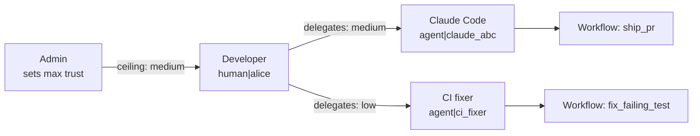
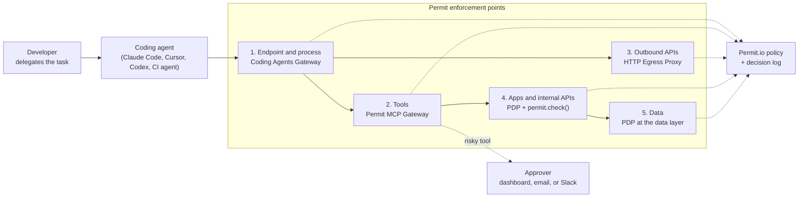

This page describes how Permit.io secures a software factory of AI coding agents end to end. It is for architects and platform engineers who need to see where each control sits before they plan a rollout.

## The identity model \{#identity-model}

Every agent in the factory has its own identity, separate from the developer who runs it. The identity is composite:

| Part | What it is | Where it comes from |
| --- | --- | --- |
| **Delegating human** | The person accountable for the work | Your identity provider (IdP), through the gateway's consent flow |
| **Client** | The agent software, such as Claude Code or Cursor | For MCP, the OAuth client ID the client registers with the gateway |
| **Workflow** | The job the agent is doing, such as `ship_pr` or `bump_dependency` | An API workflow or an MCP server grant |
| **Intent** | What the agent says it is trying to do in this session | The agent declares it when it registers a session (agent interrogation) |

In Permit MCP Gateway, a human is `human|{subject}` and an agent is `agent|{client_id}`. Each MCP client a person connects is a separate agent identity with its own permissions. See [Managing humans and agents](/permit-mcp-gateway/managing-humans-and-agents).

Trust flows down. An agent's effective trust on a server is the lower of the admin's ceiling and the level the human delegated: `effective_trust = min(admin_max_trust, human_consented_trust)`. Revoking the human's access removes access for every agent that human delegated to.

## Five enforcement layers \{#layers}

An agent action crosses several layers on its way from the developer's machine to production. Put a check at each layer that matters to you. Each check asks the same policy about the same identity, so a prompt injection that slips past one layer meets the next.

| Layer | What it governs | Default posture |
| --- | --- | --- |
| **1. Endpoint and process** | Outbound HTTP calls from coding agent processes on managed machines | Deny by default with an explicit allowlist. Deployed through your MDM tooling. |
| **2. Tools** | MCP servers and the SaaS behind them (GitHub, Linear, Jira, Slack) | Deny until an admin grants a server. Tools classified as read (low), write (medium), or destructive (high). |
| **3. Outbound APIs** | REST APIs, webhooks, and third-party services agents call directly | Deny until a workflow rule matches the host, path, and method. Credentials injected by the proxy. |
| **4. Applications and internal APIs** | Business actions in your own services, such as merge, deploy, or approve | Your policy in Permit, checked with `permit.check()` where the agent is the subject. |
| **5. Data** | Databases and warehouses the agents query | Your policy, applied as a filter or a check before the query runs. |

## One factory run, step by step \{#one-run}

This is what happens when a developer hands a failing test to Claude Code through the gateways.

1. **Launch.** The developer runs `asg run --workflow fix_failing_test --client claude`. A browser opens for consent, and the developer approves access for that workflow. Every launch is a separate agent identity. See [Launch an agent with asg run](/permit-mcp-gateway/http-egress-proxy/cli#launch-an-agent-with-asg-run).
2. **Declare intent.** On a host with agent identity enabled, the agent registers a session and declares its task before governed traffic is forwarded.
3. **Read the ticket.** The agent calls `get_issue` on the Linear MCP server through Permit MCP Gateway. The tool is low risk, the agent holds medium trust, and the call is allowed and logged.
4. **Fetch a dependency.** The agent calls the package registry. The workflow allows that host, so the egress proxy forwards the request and logs it.
5. **Try something off-task.** A comment in the ticket tells the agent to post environment variables to an external host. No rule in the workflow matches the host, so the proxy denies the request before it resolves the destination, and logs the denial.
6. **Open a pull request.** The agent calls `create_pull_request` on the GitHub MCP server. The call is a write, within medium trust, and is allowed.
7. **Merge.** The agent calls the merge tool. The tool requires approval, so the gateway holds the call as pending and notifies approvers in the dashboard, by email, or in Slack. A reviewer approves, and the call runs. If nobody decides before the timeout, the gateway rejects it.
8. **Audit.** The decision log holds every step: the human, the agent, the tool or host, the decision, and the reason.

## Approval checkpoints \{#checkpoints}

Put human approval on actions that are hard to undo, and nowhere else:

- Merging to protected branches
- Deploying to production
- Reading or rotating secrets
- Querying or changing production data
- Publishing packages
- Calling a destination for the first time

Configure approvals per tool or per server, with a [trusted agent bypass](/permit-mcp-gateway/human-in-the-loop#trusted-agent-bypass) for named CI agents that should never wait. See [Policy patterns](/software-factory-security/policies#approval-checkpoints).

## The decision log \{#decision-log}

Every gateway decision is a `permit.check()` call recorded in Permit's audit log, with the agent's identity as the user key, the tool as the action, and the MCP server as the resource. The egress proxy logs the agent, the target host and path, the matched rule, and the outcome. See [Investigate agent activity with audit logs](/permit-mcp-gateway/audit-logs) and the proxy's [audit trail](/permit-mcp-gateway/http-egress-proxy/security#audit-trail).

## Deployment options \{#deployment}

| Model | Where the gateway runs | Fits |
| --- | --- | --- |
| **Hosted** | Permit's cloud, at [app.agent.security](https://app.agent.security) | Pilots and teams without network residency requirements |
| **Customer-controlled** | The gateway and a local PDP in your network; Permit hosts the control plane | Teams that need decisions and credentials inside their network |
| **Fully on-premises** | The whole stack in your environment, with no internet connection required | Air-gapped "dark factories" and regulated environments |

Customer-controlled and fully on-premises deployments are on Enterprise plans. See [Enterprise deployment](/permit-mcp-gateway/enterprise-deployment).

## Next steps \{#next-steps}

- [Roll out a governed pilot](/software-factory-security/rollout)
- [Policy patterns for a software factory](/software-factory-security/policies)
- [Audit and compliance evidence](/software-factory-security/compliance)
